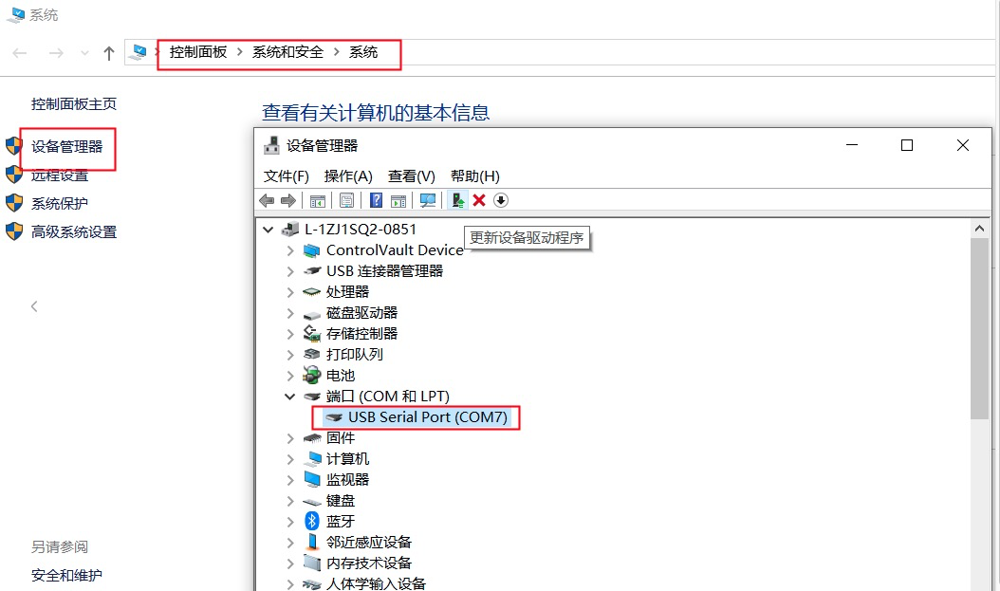

> **学习物联网，来HaaSEDU就对了** 

# ESP32固件烧录

&emsp;&emsp;
ESP32是开源世界中被开发者普遍使用的开发板，在ESP32中同样可以使用Python语言基于HaaS开发框架进行轻应用开发。前提是ESP32设备中有烧录HaaS开发团队发布的ESP32的标准固件。本文则主要介绍怎样烧录包含HaaS开发框架的ESP32标准固件。
<br>

## 固件下载

&emsp;&emsp;
下载[ESP32 HaaS官方固件](https://hli.aliyuncs.com/o/config/HaaS_Python/HaaSPython-esp32-nodemcu32s.zip)并解压，解压完成后可以看到起目录结构如下：

```
├── HaaSPython-esp32-nodemcu32s-<xxx>.bin   # HaaS官方固件, <xxx>为版本号

```

&emsp;&emsp;
历史版本：
* [ESP32-NodeMCU-V0.1.4](https://hli.aliyuncs.com/o/config/HaaS_Python/HaaSPython-esp32-nodemcu32s-v0.1.4.zip)
* [ESP32-NodeMCU-V0.1.2](https://hli.aliyuncs.com/o/config/HaaS_Python/HaaSPython-esp32-nodemcu32s-v0.1.2.zip)

<br>

### PC环境准备
&emsp;&emsp;
将ESP32用数据线和电脑USB口相连。

#### Windows系统

&emsp;&emsp;
如果您的电脑是Windows系统，请通过控制面板下的设备管理器，查询当前电脑下ESP32插入后新增的端口。下图中显示ESP32连接后新增的串口为“COM7”。
> 注意：每台PC的串口可能都不一样，如果有多个串口，可以断开PC和ESP32之间的连线，然后将PC和ESP32相连，找到新增的那个串口。



&emsp;&emsp;
如果电脑在连接ESP32之前和之后，没有新增串口，则需要安装ESP32的串口驱动。ESP32串口芯片有两种，请根据自己的ESP32型号选择合适的驱动（如果您不知道自己的ESP32型号，两个驱动都安装上即可）：
* [CH340串口驱动下载页](http://www.wch.cn/downloads/CH341SER_ZIP.html)
* [CP2102串口驱动下载](https://www.silabs.com/documents/public/software/CP210x_Universal_Windows_Driver.zip)

<br>

#### MAC系统

&emsp;&emsp;
如果您的电脑是MAC系统，系统会自带ESP32 UART驱动程序，无需单独安装。可以在命令行中通过如下命令查看ESP32接到电脑之前和之后串口列表的差异确认ESP32串口名称。

```bash
# 接入ESP32之前
(base) ➜  ~ ls /dev/tty.usb*
zsh: no matches found: /dev/tty.usb*

# 接入ESP32之后
(base) ➜  ~ ls /dev/tty.usb*
/dev/tty.usbserial-0001
```

&emsp;&emsp;
其中接入ESP32之后新出现的"/dev/tty.usbserial-0001"即为ESP32所对应的串口。
> 注意：每台PC的串口可能都不一样，上面只是笔者电脑上面的串口信息。

<br>

### 固件烧录过程
&emsp;&emsp;
烧录此固件需使用HaaS-Studio集成开发环境，请先确保有按照[HaaS-Studio安装](./HaaS_Studio_开发环境.md)中的说明安装好HaaS-Studio集成开发环境。

1. 点击“快速开始”（）按钮后选择“烧录工具”按钮（）。如下图所示。
<div align="center">

</div>
2. 选择好ESP32对应的“串口名字”和固件所在路径之后点击“开始烧录”按钮，HaaS Studio便会将此固件烧录到开发板中，如下图所示。
> 下图中是笔者电脑中的串口好和固件名称，请读者按照根据串口和固件实际路径进行选择。
> 如果“串口名字”下拉框中没有正确的串口号，可以拔插ESP32的USB口后，点击“刷新”按钮刷新串口列表。
> 如果读者想擦除整个固件可以将“是否擦除”复选框选中（建议第一次烧录选择此项）。

<div align="center">

</div>

烧录过程中命令行窗口会输出如下日志，烧录完成，中断日志中会提示"Hash of data verified."。
```log
Serial port /dev/cu.usbserial-0001
Connecting.......
Detecting chip type... Unsupported detection protocol, switching and trying again...
Connecting....
Detecting chip type... ESP32
Chip is ESP32-D0WD (revision 1)
Features: WiFi, BT, Dual Core, 240MHz, VRef calibration in efuse, Coding Scheme None
Crystal is 40MHz
MAC: 8c:ce:4e:9a:67:ec
Uploading stub...
Running stub...
Stub running...
Changing baud rate to 460800
Changed.
Erasing flash (this may take a while)...
Chip erase completed successfully in 13.0s
Hard resetting via RTS pin...

...
Changing baud rate to 460800
Changed.
Configuring flash size...
Flash will be erased from 0x00001000 to 0x001e3fff...
Compressed 1977072 bytes to 1172201...
Wrote 1977072 bytes (1172201 compressed) at 0x00001000 in 31.0 seconds (effective 511.0 kbit/s)...
Hash of data verified.

Leaving...
Hard resetting via RTS pin...
```

&emsp;&emsp;
经过上面的步骤固件就烧录到ESP32中去了。

<br>
