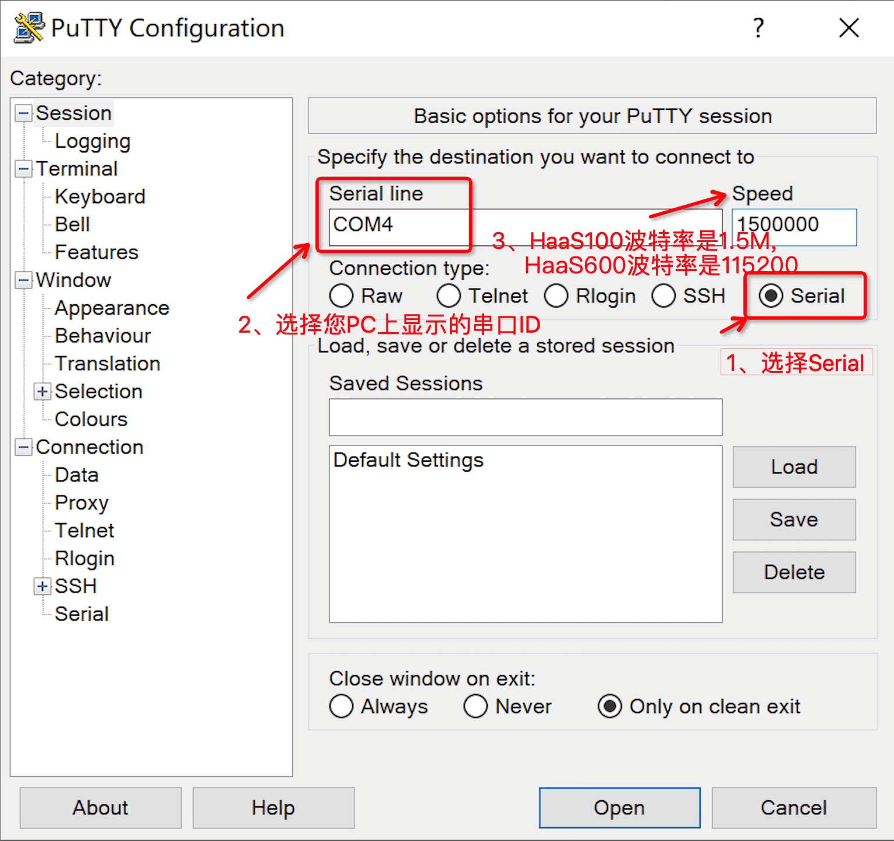

> **学习物联网，来HaaSEDU就对了** 

# HaaS EDU K1固件烧录

&emsp;&emsp;
HaaS EDU K1 是一款专用于教育的开发套件，整体配置的的资源非常丰富。 其内置了高性能MCU-HaaS1000，集成了超大大容量的存储，高达18MB的RAM以及16M的flash，并且支持扩展卡，配备了丰富的外设以及传感器。

&emsp;&emsp;
HaaS EDU K1支持使用C/C++、Python和JavaScript语言进行开发。本节则主要介绍怎样烧录进行Python开发所需要的固件。请根据读者自己开发环境选择“Windows系统固件烧录”或“MAC系统固件烧录”的章节。

<br>

## 固件下载

&emsp;&emsp;
下载[HaaS EDU K1 V2.0官方固件](https://hli.aliyuncs.com/o/config/haas/haaseduk1.zip)并解压，解压完成后可以看到起目录结构如下：

```
.
├── __init__.py             # 初始化脚本
├── 20210615                # 固件版本信息，会随发布时间变化而变化
├── flash_program_ll.py     # 固件烧录脚本
├── flash_program.py        # 固件烧录脚本
├── littlefs.bin            # 固件文件系统
├── ota_rtos.bin            # 固件镜像文件
└── ymodem.py               # 固件烧录ymodem脚本
```

<br>

## PC环境准备
&emsp;&emsp;
将HaaS EDU K1用TypeC数据线和电脑相连。

### Windows系统

&emsp;&emsp;
读者请通过控制面板下的设备管理器，查询当前电脑下HaaS EDU K1插入后新增的端口。下图中显示HaaS EDUK1连接后新增的串口为“COM7”。
> 注意：每台PC的串口可能都不一样，如果有多个串口，可以断开PC和HaaS EDU K1之间的连线，然后将PC和HaaS EDU K1相连，找到新增的那个串口。


&emsp;&emsp;
如果连接HaaS EDU K1之前和之后，没有新增串口，则需要安装HaaS EDU K1的串口驱动，[请点我下载](https://ftdichip.com/drivers/vcp-drivers/)。

<br>

### MAC系统

&emsp;&emsp;
MAC系统需要使用到的工具：Pyhton3，pyserial
* 安装Python指令
```
brew install python3
```


&emsp;&emsp;
安装完成后，执行"Python --version"命令，确认Python版本号为3.x.x，如下所示：

```
Python 3.x.x
```

* 安装pyserial指令

```
pip3 install pyserial
```

&emsp;&emsp;
安装完成后，执行"pyserial-ports"命令，确认可以查看到系统上面的所有串口信息，如下所示(请注意每台开发电脑的输出都是不同的)。
```
/dev/cu.Bluetooth-Incoming-Port
/dev/cu.CloudWalker-SPPDev-11
/dev/cu.CloudWalker-SPPDev-13
/dev/cu.usbserial-AU03OKKM
4 ports found
```


&emsp;&emsp;
其中"/dev/cu.usbserial-AU03OKKM"即为HaaS EDU K1所对应的串口。

<br>

## 固件烧录过程

&emsp;&emsp;
在命令行中进入到固件解压后文件夹的根目录下面。

### Windows系统

&emsp;&emsp;
假设固件解压后路径为"C:\haaseduk1"。Windows下打开命令行工具（建议使用PowerShell工具）后，依次执行如下指令：
```
cd C:\haaseduk1
python.exe flash_program.py --bin=./ota_rtos.bin --bin=./littlefs.bin#0xB32000
```

&emsp;&emsp;
接下来烧录脚本会提示让输入串口，此串口即为HaaS EDU K1和PC连接后设备管理器中新产生的串口。
```
binary file is ['./ota_rtos.bin', './littlefs.bin#0xB32000']

--- Available ports:
---  1: COM7                 'USB Serial Port (COM7)'
--- Enter port index or full name:
```

&emsp;&emsp;
在“Enter port index or full name:”后输入目标串口ID，这里输入1后敲回车即可。

<br>

### MAC系统

&emsp;&emsp;
假设固件解压后路径为"~/Downloads/haaseduk1"。
```
cd ~/Downloads/haaseduk1
python flash_program.py --bin=./ota_rtos.bin --bin=./littlefs.bin#0xB32000
```


&emsp;&emsp;
接下来烧录脚本会提示让输入串口，此串口即为HaaS EDU K1和PC连接后设备管理器中新产生的串口。
```
binary file is ['./ota_rtos.bin', './littlefs.bin#0xB32000']

--- Available ports:
---  1: /dev/cu.Bluetooth-Incoming-Port 'n/a'
---  2: /dev/cu.usbserial-AU03OKKM 'FT232R USB UART - FT232R USB UART'
--- Enter port index or full name:
```

&emsp;&emsp;
在“Enter port index or full name:”后输入目标串口ID，这里输入2后敲回车即可。


&emsp;&emsp;
选择好目标串口之后，当看到如下所示的提示后，则表明烧录过程开始：
```
(ash:/data)# reboot
?H???

CHIP_ID=haas1000
KERNEL=
OTA_CODE_OFFSET=0
CRASH_DUMP_SIZE=0

......

Backup part addr:0x2a000
Please input flash addr:
0x2a000
flash addr: 0x2a000

Please start ymodem ... (press ctrl+c to cancel)

CCCC
<<< 0x43
Packet 0 >>>
<<< 0x6
<<< 0x43
Packet 2720 / 2719.0 >>>  <<< ACK
EOF
>>> EOT
<<< 0x15
>>> EOT
<<< 0x6
<<< 0x43
Packet End >>>
```


&emsp;&emsp;
如果在烧录的过程中会出现如下提示，请按下HaaS EDU K1上复位按钮(正面屏幕旁边的最小的按钮)重启设备。

```
"Please reboot the board manually"
```

<br>

## 查看日志

&emsp;&emsp;
烧录完成以后，可以通过串口工具连接设备进入命令行。请读者根据自己的习惯打开串口工具进行日志查看。如果读者没有使用过PC上的串口工具，也可以参考下面的工具说明。 

### Windows系统

&emsp;&emsp;
Windows系统可以使用Putty工具，工具的设定请参考下图：



<br>

### MAC系统

&emsp;&emsp;
MacOS 推荐使用picocom串口工具。picocom安装命令如下。
```
brew install picocom
```


&emsp;&emsp;
此工具只能通过命令行启动，启动命令如下：
```
picocom -b 1500000 /dev/cu.usbserial-AU03OKKM
```


&emsp;&emsp;
在此工具页面下如果需要退出串口的时候请先按Ctrl+a，再按Ctrl+q。


&emsp;&emsp;
经过上面的步骤固件就烧录到HaaS EDU K1中去了。烧录成功后，串口信息会被记录到了烧录文件夹下的 .config_burn 文件中，内容如下：

<br>

### MAC系统
```
  {
    "chip_haas1000": {
        "baudrate": "1500000",
        "binfile": [
            "./ota_rtos.bin",
            "./littlefs.bin#0xB32000"
        ],
        "serialport": "/dev/cu.usbserial-AU03P0PA"
    }
  }
```

<br>

### Windows系统
```
{
    "chip_haas1000": {
        "baudrate": "1500000",
        "binfile": [
            "./ota_rtos.bin",
            "./littlefs.bin#0xB32000"
        ],
        "serialport": "COM7"
    }
  }
  ```

&emsp;&emsp;
serialport 字段为HaaS设备在当前电脑上的串口路径，不同设备会有差异。如果串口路径信息发生了改变， 需要手动修改 serialport 字段的值为 实际路径之后再进行烧录。

&emsp;&emsp;
如果在烧录的过程中出现如下错误，则表明设备的串口信息发生改变。可以按照第二步的操作，在终端输入 pyserial-ports 命令获取有效的串口信息并修改serialport 字段 即可。

```
python flash_program.py --bin=./ota_rtos.bin --bin=./littlefs.bin#0xB32000
binary file is ['./ota_rtos.bin', './littlefs.bin#0xB32000']
serial port is /dev/cu.xxxxxxxxxxxxx
the settings were restored in the file /Users/xxxx/Downloads/haas100/.config_burn
Traceback (most recent call last):
  File "flash_program.py", line 228, in <module>
    main()
  File "flash_program.py", line 223, in main
    burn_bin_files(myconfig["serialport"], myconfig['baudrate'], myconfig["binfile"])
  File "flash_program.py", line 154, in burn_bin_files
    raise Exception("Failed to open serial port: %s!" % portnum)
Exception: Failed to open serial port: /dev/cu.xxxxxxxxxxxxx!

```