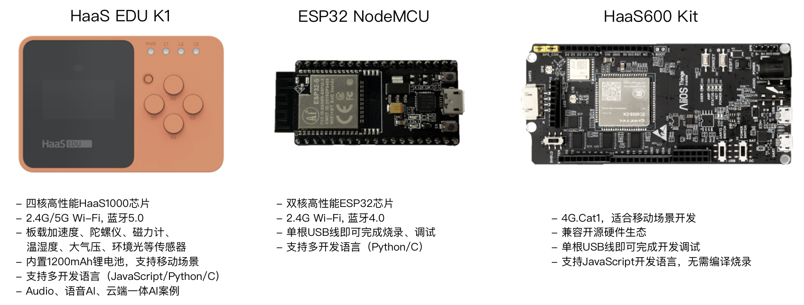

> **学习物联网，来HaaSEDU就对了**

# HaaS EDU项目简介
&emsp;&emsp;
HaaS EDU项目是依托于阿里云IoT **HaaS云端一体开发框架**推出的物联网教育课程。该项目以日常生产生活中的实际场景为案例，每个案例都覆盖了物联网设备硬件功能设计、设备端开发、物联网云端及应用开发全链路的知识。场景式的案例可以让物联网学习者可以边学边做，实践证明这样的学习方式对快速提高并巩固学习者的实战能力有很大帮助。

## HaaS EDU项目设计思想
&emsp;&emsp;
HaaS EDU项目在智能生活、智慧农业、智慧工业、智慧城市及语音AI等行业中挑选了各行业中最具代表性的物联网设备应用场景进行功能拆分和详细讲解。
每个应用场景中选用的都是学习者可以很方便购买到的硬件。每个案例都会对该场景的背景知识、物联网设备在该场景下可以解决的问题以及如何解决这些问题进行讲解，让学习者不仅知其然，还知其所以然。

## 开发板选择
&emsp;&emsp;
学习本课程中的案例有如下三种开发板可选，学习者可以根据个人爱好，自己熟悉的开发语言和学习目标选用适合自己的开发板。

关于开发板及外部传感器硬件积木更详细的信息，请参考 [HaaS硬件积木库](拓展知识/HaaS硬件积木库/README.md) 的说明，其中包含开发板介绍及购买链接。
> 请注意本课程非商业项目，关于开发板及传感器的售后服务请咨询商家。

## 每个场景案例课程包含如下内容：
* 场景说明
* 视频介绍（待后续补充）
* 案例课程的详细操作步骤说明
* 课后作业
* 课程扩展知识（进阶理论及基础知识）

## 课程列表

<table align="left">
    <tr>
        <th>领域</th>
        <th>场景</th>
        <th>学习目标</th>
        <th>课程链接</th>
        <th>编程语言类型</th>
    </tr>
    <tr>
        <th rowspan="4">快速开始</th>
        <th><a href="./1-快速开始/1-IoT简介与HaaS云端一体开发框架">IoT简介与HaaS云端一体开发框架</a></th>
        <th>学习物联网的基础概念及物联网系统的组成部分以及HaaS开发框架</th>
        <th><a href="1-快速开始/1-IoT简介与HaaS云端一体开发框架/README.md">IoT简介与HaaS云端一体开发框架</a></th>
        <th>-</th>
    </tr>
    <tr>
        <th><a href="./1-快速开始/2-传感器">传感器</a></th>
        <th>学习传感器的基本原理及怎样用传感器采集物理世界的信息，体验HaaS</th>
        <th><a href="1-快速开始/2-传感器/README.md">传感器</a></th>
        <th>-</th>
    </tr>
    <tr>
        <th><a href="./1-快速开始/3-物联网设备上云">物联网设备上云</a></th>
        <th>学习怎样将物联网设备连接到云端，并使用MQTT协议和云端进行数据通信</th>
        <th><a href="1-快速开始/3-物联网设备上云/README.md">物联网设备上云</a></th>
        <th>-</th>
    </tr>
    <tr>
        <th><a href="./1-快速开始/4-物联网应用开发">物联网应用开发</a></th>
        <th>学习怎样进行物联网云端和移动端应用开发</th>
        <th><a href="1-快速开始/4-物联网应用开发/README.md">物联网应用开发</a></th>
        <th>-</th>
    </tr>
    <tr>
        <th rowspan="4">智能生活</th>
        <th><a href="./2-智能生活/场景1-守护家庭健康/甲醛检测/">守护家庭健康之甲醛监控系统</a></th>
        <th>学习如何通过传感器对家庭的甲醛浓度进行实时监测</th>
        <th><a href="2-智能生活/场景1-守护家庭健康/甲醛检测/README.md">守护家庭监控-甲醛监控系统</a></th>
        <th>Python/JavaScript</th>
    </tr>
    <tr>
        <th><a href="2-智能生活/场景1-守护家庭健康/燃气泄漏检测">守护家庭健康之燃气泄漏系统</a></th>
        <th>如何通过传感器监控家庭中的燃气浓度，并在燃气浓度过高时报警</th>
        <th><a href="2-智能生活/场景1-守护家庭健康/燃气泄漏检测/README.md">守护家庭监控-燃气泄漏检测</a></th>
        <th>Python/JavaScript</th>
    </tr>
    <tr>
        <th><a href="2-智能生活/场景2-起夜灯">起夜灯</a></th>
        <th>学习如何通过人体检测传感器进行人体检测以及控制夜灯的开关</th>
        <th><a href="2-智能生活/场景2-起夜灯/README.md">起夜灯</a></th>
        <th>Python/JavaScript</th>
    </tr>
    <tr>
        <th><a href="2-智能生活/场景3-番茄时钟">番茄时钟</a></th>
        <th>学习如何实现自己的番茄时钟</th>
        <th><a href="2-智能生活/场景3-番茄时钟/README.md">番茄时钟</a></th>
        <th>Python</th>
    </tr>
    <tr>
        <th rowspan="1">智慧农业</th>
        <th><a href="./3-智慧农业/场景1-花卉养植">花卉养植系统</a></th>
        <th>学习如果通过温湿度传感器监控环境温湿度、自动浇花系统以及如何远程查看花卉系统的状态信息</th>
        <th><a href="3-智慧农业/场景1-花卉养植/README.md">花卉养植</a></th>
        <th>Python/JavaScript</th>
    </tr>
    <tr>
        <th rowspan="1">智慧工业</th>
        <th><a href="./4-智慧工业/场景1-火焰监控报警系统">火焰监控报警系统</a></th>
        <th>学习如何通过火焰传感器实时监控工业锅炉中燃料燃烧状态是否正常，并在检测到燃料熄灭之后自动报警</th>
        <th><a href="4-智慧工业/场景1-火焰监控报警系统/README.md">火焰监控报警系统</a></th>
        <th>Python/JavaScript</th>
    </tr>
    <tr>
        <th rowspan="2">智慧城市</th>
        <th><a href="./5-智慧城市/场景1-智慧路灯">智能路灯</a></th>
        <th>学习如何通过光照传感器检测环境光，并实现路灯的自动开关并完成对路灯状态的监控</th>
        <th><a href="5-智慧城市/场景1-智慧路灯/README.md">智慧路灯</a></th>
        <th>Python/JavaScript</th>
    </tr>
    <tr>
        <th><a href="./5-智慧城市/场景3-车辆定位系统">车辆定位系统</a></th>
        <th>学习如何如何在物联网设备上如何实时获取GPS信息，并在物联网应用系统中实时跟踪车辆位置信息</th>
        <th><a href="5-智慧城市/场景3-车辆定位系统/README.md">车牌定位系统</a></th>
        <th>Python/JavaScript</th>
    </tr>
</table>

 
.

## 开发语言进行分类
* Python语言的开发者请参考[Python语言场景案例集锦](./Python场景案例集锦.md)
* JavaScript语言的开发者请参考[JavaScript语言场景案例集锦](./JavaScript场景案例集锦.md)

## 开发板进行分类
* 选择HaaS EDU K1开发板的开发者可学习的场景请参考[HaaS EDU K1场景案例集锦](./HaaS_EDU_K1_场景案例集锦.md)

* 选择ESP32开发板的开发者可学习的场景请参考[ESP32场景案例集锦](./ESP32_场景案例集锦.md)

* 选择HaaS600开发板的开发者可学习的场景请参考[HaaS600场景案例集锦](./HaaS600_场景案例集锦.md)

