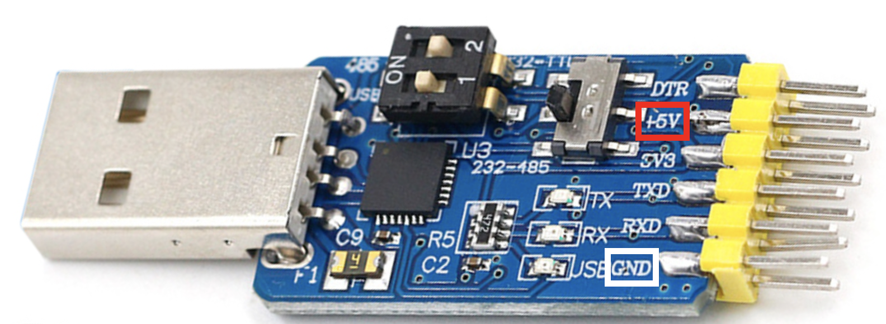
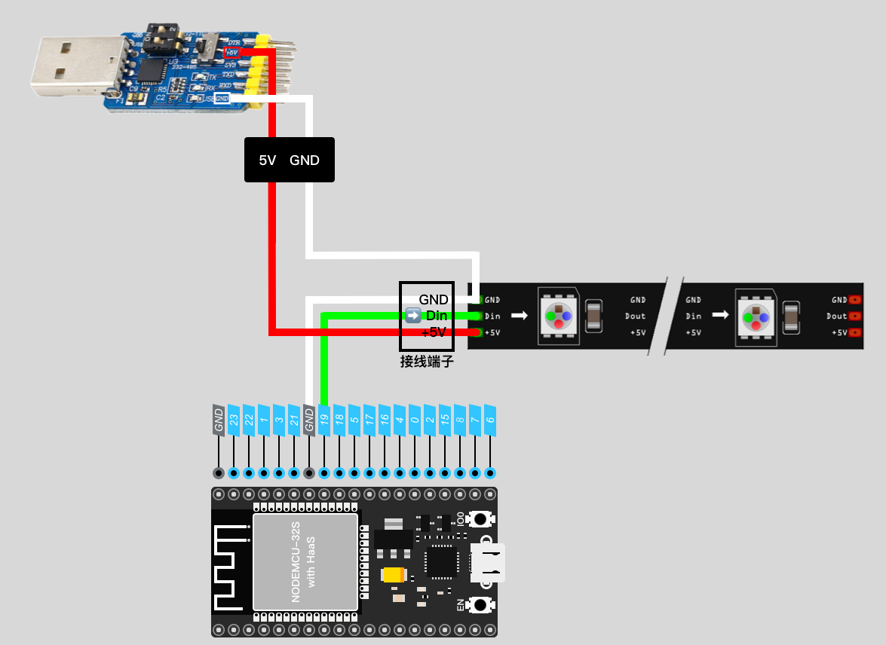
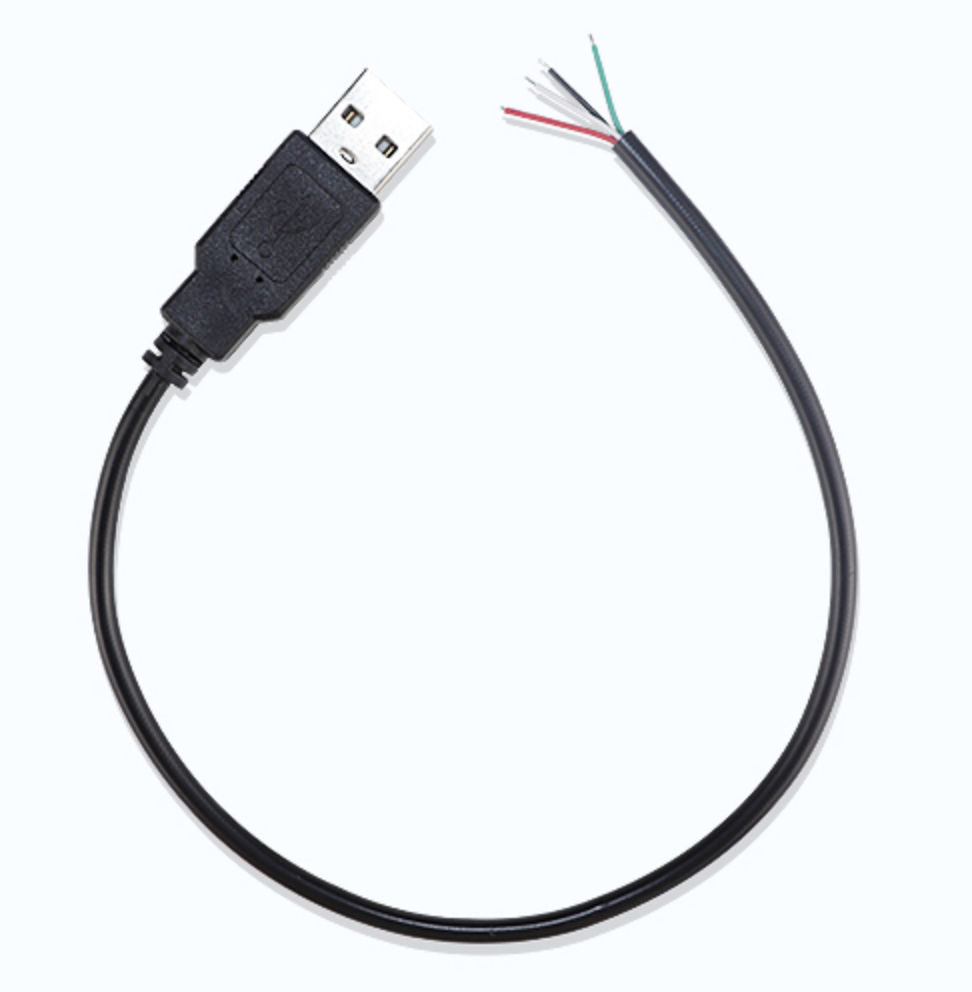

> **学习物联网，来HaaSEDU就对了**

# RGB灯带_WS2812

## 一、产品简介


<div align="center">


</div>

## 二、技术参数
* 工作电压：DC5V
* 工作温度：-15~50℃
* 功耗：每颗灯珠最大0.3W
* 像素：30灯/米，60灯/米，90灯/米，144灯/米，
* 控制芯片：WS2812B
* 颜色制式：RGB888
* 出线方式：SM3pin端子头和2根备用电源线（红色:5V正极）
* 其他：所有灯珠串行连接、并且单独可寻址

## 三、硬件接口

| WS2812 | 开发板 | 外置电源 |
| :----: | :----: | :------: |
|  VCC   |   -    |    5V    |
|  DIN   |  GPIO  |    -     |
|  GND   |  GND   |   GND    |

>由于灯带需要的功率较大，普通开发板上5V供电很可能无法支持正常点亮灯带，因此建议使用外置电源为灯带供电，同时要求开发板与外置电源共地。

其中，外置5V电源建议使用淘宝上常见的“USB转TTL模块”，其一般都会具备5V的电源输出。如下图红框与白框所示。



以ESP32为例，整体接线如下图所示：

其中，灯带上会暴露出一个三线（红，白，绿）的接线端子，以及两根单独的红线和白线。

红线代表VCC，白线代表GND，绿线则是数据线。在接线时，一定要注意绿色线连接的是灯带的 **DIN** 端，这是数据的输入端。



若手头没有可以输出5V的模块，也可以尝试将多余的USB线剪开，一般而言，黑色线为GND，红色线为VCC（5V），再参考上图进行连接。连接时请注意，裸露的线头使用胶带缠绕并避免接触，以防短路。



## 四、软件接口

控制WS2812时，使用的是micropython内置的 neopixel 库。

### NeoPixel - 构造函数

* 函数功能：

构造一个 NeoPixel 对象

* 函数原型：

> class neopixel.NeoPixel(pin, n, bpp=3, timing=1)

* 参数说明

|  参数  |    类型     | 必选参数？ | 说明                                                                    |
| :----: | :---------: | :--------: | :---------------------------------------------------------------------- |
|  pin   | machine.Pin |     是     | machine.Pin实例                                                         |
|   n    |     int     |     是     | 待控制的像素数                                                          |
|  bpp   |     int     |     否     | 对于 RGB LED 为 3，对于 RGBW LED 为 4。对市场上大部分RGB LED，默认为3   |
| timing |     int     |     否     | 置0时选用 400KHz 时钟驱动，置1时选择 800kHz 时钟驱动（大多数为 800kHz） |

* 返回值

NeoPixel对象成功，返回NeoPixel对象；若对象创建失败，则抛出Exception

* 示例：

```python
from machine import Pin
import neopixel

pin = Pin(17, Pin.OUT)
np = neopixel.NeoPixel(pin, n=3)
```

### __setitem__ - 设置像素色值

* 函数功能：

设置单个像素色值

可以直接将 NeoPixel 对象视为数组访问

* 示例：

```python
from machine import Pin
import neopixel

pin = Pin(17, Pin.OUT)
np = neopixel.NeoPixel(pin, n=3)

np[0] = (255, 0, 0) # 第一个像素设为红色，100%亮度
np[1] = (0, 128, 0) # 第二个像素设为绿色，50%亮度
np[2] = (0, 0, 64)  # 第三个像素设为蓝色，25%亮度

np.write() # 使用write()方法将颜色输出到 LED
```

对于 3 种以上颜色的 LED，例如 RGBW 像素或 RGBY 像素， NeoPixel类采用一个bpp参数。要为 RGBW 像素设置 NeoPixel 对象，请执行以下操作：

```python
import machine, neopixel
np = neopixel.NeoPixel(machine.Pin(4), 8, bpp=4)

np[0] = (255, 0, 0, 128) # 橘色 RGBY色值
np[1] = (0, 255, 0, 128) # 黄绿色 RGBY色值
np[2] = (0, 0, 255, 128) # 蓝绿色 RGBY色值

np.write()
```

### __getitem__ - 读取像素色值

* 函数功能：

获取单个像素色值

可以直接将 NeoPixel 对象视为数组访问

* 示例：

```python
np.fill((255,255,255))
print(np[0])
```

* 输出
```
(255,255,255)
```


### __len__ - 获取对象长度

* 函数功能：

获取初始化时的控制像素数量

* 示例：

```python
from machine import Pin
import neopixel

pin = Pin(17, Pin.OUT)
np = neopixel.NeoPixel(pin, n=3)

print(len(np))
```

* 输出
```python
3
```

### fill - 填充到缓冲区

* 函数功能：

将缓冲区中所有像素的值设置为指定的像素值（即 RGB/RGBW 元组）。

* 函数原型： 

> NeoPixel.fill(pxiel)

* 参数说明：

RGB/RGBW 元组，如 白色(255,255,255)

* 示例：

```python
from machine import Pin
import neopixel

pin = Pin(17, Pin.OUT)
np = neopixel.NeoPixel(pin, n=3)

np.fill((255,255,255))
np.write()
```

* 输出
  
三颗LED显示为白色。

### write - 将缓冲区颜色写入LED

* 函数功能：

将缓冲区颜色写入LED。

* 函数原型： 

> NeoPixel.write()

* 参数说明：
  无

* 返回值
  无

* 示例：

```python
from machine import Pin
import neopixel

pin = Pin(17, Pin.OUT)
np = neopixel.NeoPixel(pin, n=3)

np.fill((255,255,255))
np.write()
```

## 五、接口案例

以下案例演示使用30颗灯珠的灯带来进行光效展示。
其中，灯带使用了GPIO17。

* 案例代码
```python
import time
from machine import Pin
import neopixel

def demo(np):
    n = np.n

    # 跑马灯
    for i in range(4 * n):
        for j in range(n):
            np[j] = (0, 0, 0)
        np[i % n] = (255, 255, 255)
        np.write()
        time.sleep_ms(25)

    # 光点往复
    for i in range(4 * n):
        for j in range(n):
            np[j] = (0, 0, 128)
        if (i // n) % 2 == 0:
            np[i % n] = (0, 0, 0)
        else:
            np[n - 1 - (i % n)] = (0, 0, 0)
        np.write()
        time.sleep_ms(60)

    # 呼吸灯
    for i in range(0, 4 * 256, 8):
        for j in range(n):
            if (i // 256) % 2 == 0:
                val = i & 0xff
            else:
                val = 255 - (i & 0xff)
            np[j] = (val, 0, 0)
        np.write()

    # 关闭显示
    for i in range(n):
        np[i] = (0, 0, 0)
    np.write()

pin = Pin(17, Pin.OUT)
np = neopixel.NeoPixel(pin, n=30)
demo(np)

```
