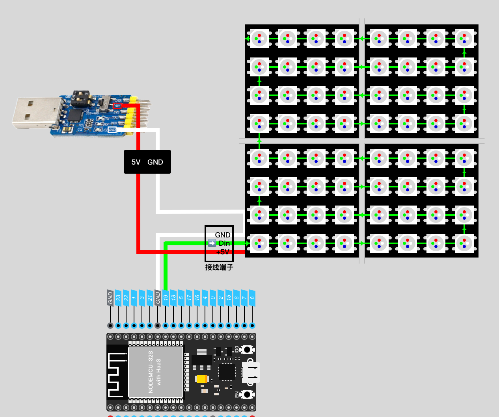

> **学习物联网，来HaaSEDU就对了**

# RGB灯带_WS2812

## 一、产品简介

<div align="center">

</div>

## 二、技术参数
* 工作电压：DC5V
* 工作温度：-15~50℃
* 功耗：每颗灯珠最大0.3W
* 像素：8 * 8，16 * 16，8 * 32
* 控制芯片：WS2812B
* 颜色制式：RGB888
* 出线方式：SM3pin端子头和2根备用电源线（红色:5V正极）
* 其他：所有灯珠串行连接、并且单独可寻址

## 三、硬件接口

| WS2812 | 开发板 | 外置电源 |
| :----: | :----: | :------: |
|  VCC   |   -    |    5V    |
|  DIN   |  GPIO  |    -     |
|  GND   |  GND   |   GND    |

>由于灯带需要的功率较大，普通开发板上5V供电很可能无法支持正常点亮灯带，因此建议使用外置电源为灯带供电，同时要求开发板与外置电源共地。

其中，外置5V电源建议使用淘宝上常见的“USB转TTL模块”，其一般都会具备5V的电源输出。如下图红框与白框所示。


以ESP32为例，整体接线如下图所示：

其中，灯带上会暴露出一个三线（红，白，绿）的接线端子，以及两根单独的红线和白线。

红线代表VCC，白线代表GND，绿线则是数据线。在接线时，一定要注意绿色线连接的是灯带的 **DIN** 端，这是数据的输入端。

> 在整个点阵屏中，所有的像素点曲折排布，其中的数据流向如图中绿线所示，所以，真个屏幕也可以被视作一整条来回弯折的灯带，因此与灯带一样，一块连续的屏幕，仅需要一颗GPIO即可完成控制



若手头没有可以输出5V的模块，也可以尝试将多余的USB线剪开，一般而言，黑色线为GND，红色线为VCC（5V），再参考上图进行连接。连接时请注意，裸露的线头使用胶带缠绕并避免接触，以防短路。


## 四、软件接口

### NeoPixelMatrix - 构造函数

* 函数原型：
> screen = NeoPixelMatrix(pin, width, hight)

* 参数说明

| 参数  |    类型     | 必选参数？ | 说明            |
| :---: | :---------: | :--------: | :-------------- |
|  pin  | machine.Pin |     是     | machine.Pin实例 |
| width |     int     |     是     | 点阵屏像素宽    |
| hight |     int     |     是     | 点阵屏像素高    |

* 返回值

若NeoPixelMatrix对象创建成功，返回NeoPixel对象；
若对象创建失败，则抛出Exception

### pixel - 读取或设置某个像素

* 函数原型：
> NeoPixelMatrix.pixel(x, y[, c])

* 参数说明：

| 参数 | 类型 | 必选参数？ | 说明                                                            |
| ---- | ---- | :--------: | --------------------------------------------------------------- |
| x    | int  |     是     | 像素横坐标                                                      |
| y    | int  |     是     | 像素纵坐标                                                      |
| c    | int  |     否     | 色值。若给定c，将指定像素设置到给定颜色。默认1为点亮，0为熄灭。 |

* 返回值
若未给定c，则获取指定像素的色值。

### fill - 使用指定颜色填满整个帧缓冲区。

* 函数原型：
> NeoPixelMatrix.fill(c)

* 参数说明：

| 参数 | 类型 | 必选参数？ | 说明                             |
| ---- | ---- | :--------: | -------------------------------- |
| c    | int  |     是     | 填充颜色。默认1为点亮，0为熄灭。 |

### hline - 绘制水平线
### vline - 绘制垂直线

* 函数原型：
> NeoPixelMatrix.hline(x, y, w, c)
> NeoPixelMatrix.vline(x, y, w, c)

* 参数说明：

| 参数 | 类型 | 必选参数？ | 说明           |
| ---- | ---- | :--------: | -------------- |
| x    | int  |     是     | 起点像素横坐标 |
| y    | int  |     是     | 起点像素纵坐标 |
| w    | int  |     是     | 线宽           |
| c    | int  |     否     | 色值           |

### line - 绘制任意直线

* 函数原型：
> NeoPixelMatrix.line(x1, y1, x2, y2, c)

* 参数说明：

| 参数 | 类型 | 必选参数？ | 说明           |
| ---- | ---- | :--------: | -------------- |
| x1   | int  |     是     | 起点像素横坐标 |
| y1   | int  |     是     | 起点像素纵坐标 |
| x2   | int  |     是     | 纵点像素横坐标 |
| y2   | int  |     是     | 终点像素纵坐标 |
| c    | int  |     是     | 色值           |

### rect - 绘制空矩形
### fillRect - 绘制填充矩形

* 函数原型：
> NeoPixelMatrix.rect(x, y, w, h, c)
> NeoPixelMatrix.fillRect(x, y, w, h, c)

* 函数说明：

在给定位置、按照给定大小和颜色绘制一个矩形。 rect 类函数仅绘制1个像素的边框，而 fillRect 类函数可绘制出边框和矩形内部。

* 参数说明：

| 参数 | 类型 | 必选参数？ | 说明                               |
| ---- | ---- | :--------: | ---------------------------------- |
| x    | int  |     是     | 起点像素横坐标，以矩形左上角为起点 |
| y    | int  |     是     | 起点像素纵坐标，以矩形左上角为起点 |
| w    | int  |     是     | 矩形宽                             |
| h    | int  |     是     | 矩形高                             |
| c    | int  |     否     | 色值                               |

### circle - 绘制空圆形
### fillCircle - 绘制填充圆形

* 函数原型：
> NeoPixelMatrix.circle(x, y, r, w, c)
> NeoPixelMatrix.fillCircle(x, y, r, c)

* 函数说明：

在给定位置、按照给定半径和颜色绘制一个圆形。 circle类函数绘制w个像素的边框，而 fillCircle 类函数可绘制出边框和矩形内部。

* 参数说明：

| 参数 | 类型 | 必选参数？ | 说明                                                |
| ---- | ---- | :--------: | --------------------------------------------------- |
| x    | int  |     是     | 圆心像素横坐标                                      |
| y    | int  |     是     | 圆心像素纵坐标                                      |
| r    | int  |     是     | 半径                                                |
| w    | int  |     是     | 圆圈像素厚度。当 w = r 时，circle 等同于 fillCircle |
| c    | int  |     否     | 色值                                                |

### scroll

* 函数原型：
> NeoPixelMatrix.scroll(xstep, ystep)

* 函数功能：
使用给定向量转换帧缓冲区的内容。这可能会在帧缓冲区中留下之前颜色的覆盖区。

* 参数说明：

| 参数  | 类型 | 必选参数？ | 说明         |
| ----- | ---- | :--------: | ------------ |
| xstep | int  |     是     | 横向滚动距离 |
| ystep | int  |     是     | 纵向滚动距离 |

### blit

* 函数原型：
> NeoPixelMatrix.blit(fbuf, x, y[, key])

* 函数功能：

在当前帧缓冲区的顶部的给定坐标下绘制另外一个帧缓冲区。若指定*key*，则其应为一个颜色整数，且相应颜色被认为是透明的：所有具有该色值的像素都不会被绘制。

此类函数在帧缓冲区使用的不同格式间运行，但是由于颜色格式不匹配，最终颜色可能与预想的存在差异。

* 参数说明：

| 参数 | 类型         | 必选参数？ | 说明               |
| ---- | ------------ | :--------: | ------------------ |
| fbuf | FramebBuffer |     是     | 帧缓冲区对象       |
| x    | int          |     是     | 帧缓冲区起点横坐标 |
| y    | int          |     是     | 帧缓冲区起点纵坐标 |
| key  | int          |     否     | 设置透明色         |

### text

* 函数原型：
> NeoPixelMatrix.text(s, x, y, c[, size, zoom, space])

* 函数功能：

在屏幕的帧缓冲区

* 参数说明：

| 参数  | 类型   | 必选参数？ | 说明                                                    |
| ----- | ------ | :--------: | ------------------------------------------------------- |
| s     | string |     是     | 待显示的字符串。若字符串中包含中文字符，请使用GBK编码。 |
| x     | int    |     是     | 文本左上角横坐标                                        |
| y     | int    |     是     | 文本左上角纵坐标                                        |
| c     | int    |     是     | 色值                                                    |
| size  | int    |     否     | 字体大小，支持12，16，24，32。默认为12                  |
| zoom  | int    |     否     | 字符缩放倍数。默认为1                                   |
| space | int    |     否     | 字符间距。默认为0                                       |

* 特殊说明：

关于字体库配置，请参考 **framebuf**

### show - 显示到屏幕

* 函数原型：

> NeoPixelMatrix.show()

* 函数功能：

将屏幕帧缓冲区上的内容显示到屏幕。


## 五、接口案例

以下案例演示使用 16 * 16 的RGB点阵屏实现一个数字时钟。
其中，灯带使用了GPIO17。

* 案例代码
```python

import random                   # 随机数生成库
import utime                    # 延时API所在组件
from machine import Pin         # 引脚控制
from neoPixelMatrix import NeoPixelMatrix   # ws2812点阵显示组件

# 创建点阵屏幕对象
screen = NeoPixelMatrix(Pin(19, Pin.OUT), 16, 16, 'w')

# 清空点阵缓冲区
screen.fill(0x000000)

while True:
    print(utime.localtime())
    screen.fill(0)
    # 绘制 时
    screen.text(str(utime.localtime()[3]),0,0,0xffffff)
    # 绘制 分 并且每秒改变随机颜色
    screen.text(str(utime.localtime()[4]),0,8,random.randint(0,0xffffff))
    utime.sleep(1)
    # 绘制到屏幕
    screen.show()

```
