# 分类器模型

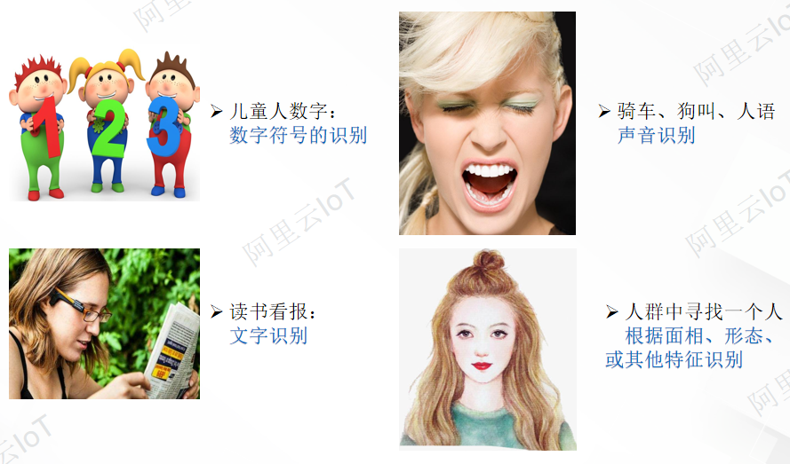

## 分类器概念

人类每时每刻都在完成某种分类的任务，例如读书看报（文字分类）、茫茫人海中寻找一个伙伴（特征分类）、鸟鸣（声音分类)……，人们对外界对象几乎所有的认识都是对其类别的辨别。大脑就像一个分类器，时时刻刻在帮助我们对所见进行类别划分，机器视觉中的分类器就是一个类似于人脑一样帮助机器对处理后的图像进行分类的这样一种算法或模型。

## 分类器种类

分类器的主要目的是通过机器完成对事物的分类，那么实现它的方法可以归纳为两大类：

- **基于知识的方法（Knowledge-based）**
  - AI、专家系统（Expert Systems）
  - 句法模式识别（Syntax PR ）

- **基于数据的方法（Data-based）**
  - 统计模式识别方法（Statistical PR）
  - 人工神经网络（ANN）
  - 支持向量机（SVM）

## 分类器划分

在基于数据的方法中，根据其是否需要对数据进行人工标注又可分为如下两大类：

- **监督学习（Supervised learning）**

  典型算法：回归，分类，K近邻（K-Nearest Neighbors，KNN）、支持向量机（Support Vector Machine，SVM）

- **无监督学习（Unsupervised learning）**

  典型算法：主成分分析（Principal components analysis，PCA）、聚类（K-Means聚类）

**监督学习：** 监督学习中训练集首先需要人为的进行标注后再由机器进行模型训练。

回归分析是一种预测性的建模技术，它研究的是因变量（目标）和自变量（预测器）之间的关系，其通常用于预测分析。
**线性回归：** 是一种非常简单的根据单一变量X，来预测定量变量Y的方法。它假设X和Y之间存在线性关系。在数学上，可以将这种线性关系记为：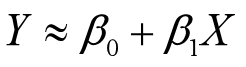
在实践中，由于具体模型位置，所以在做出预测之前，我们必须根据数据集估计系数。
令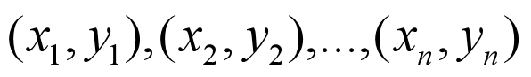表示n组观测，每组都包括X的一个观测值和Y的一个观测值。

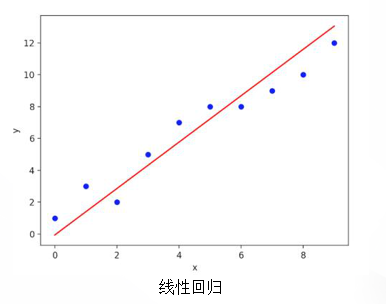

**决策树**：决策树是一类常见用于分类的机器学习方法，模型可解释性强，模型符合人类思维方式，是经典的树形结构。决策树由结点和有向边组成。结点包含了一个根结点、若干个内部结点和若干个叶结点。内部结点表示一个特征或属性，叶结点表示一个类别。简单而言，决策树是一个多层if-else函数，对对象属性进行多层if-else判断，获取目标属性的类别。由于只使用if-else对特征属性进行判断，所以一般特征属性为离散值，即使为连续值也会先进行区间离散化，如可以采用二分法。

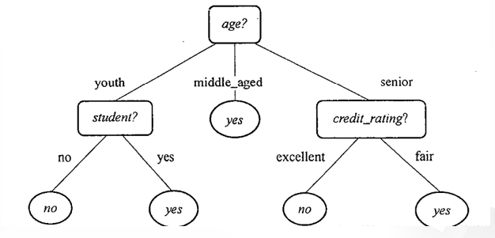

**KNN：** KNN的全称是K-Nearest Neighbors，直译是K个最近的邻居，从这个名字我们就能看出一些KNN算法的蛛丝马迹了。在该方法中毫无疑问，K的取值非常重要。KNN的原理就是当预测一个新的值x的时候，根据它距离最近的K个点是什么类别来判断x属于哪个类别。

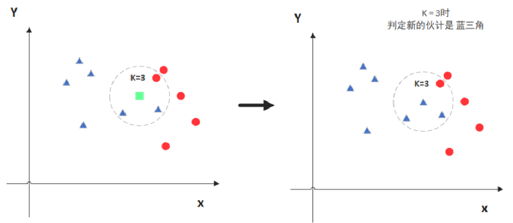

图中绿色的点就是我们要预测的那个点，假设K=3。那么KNN算法就会找到与它距离最近的三个点(这里用圆圈把它圈起来了)，看看哪种类别多一些，比如这个例子中是蓝色三角形多一些，新来的绿色点就归类到蓝三角了。但当K=5时，判定就变成不一样了，这次变成红圆多一些，所以新来的绿点被归类成红圆。

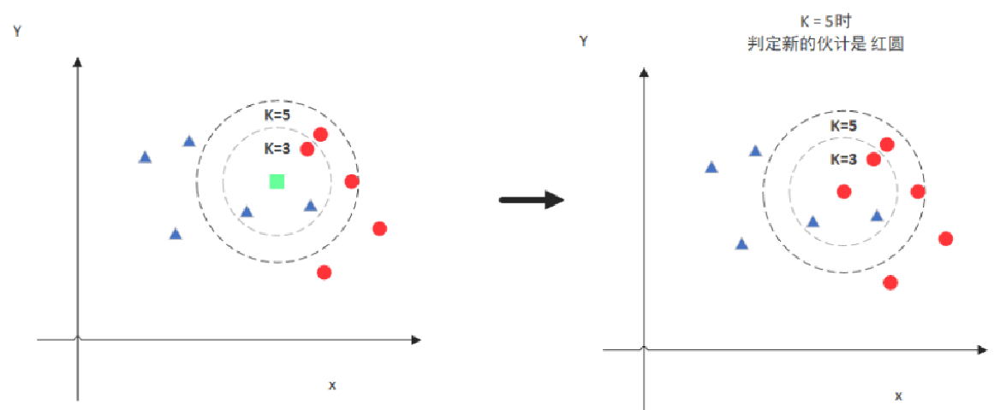

**KNN算法优点：**

- 简单易用，相比其他算法，KNN是比较简洁明了的算法。
- 模型训练时间快。
- 预测效果好。
- 对异常值不敏感。

**KNN算法缺点：**

- 对内存要求较高，因为该算法存储了所有训练数据。
- 预测阶段可能很慢。
- 对不相关的功能和数据规模敏感。

支持向量机（英文：Support Vector Machine，常简称为SVM，又名支持向量网络）是在分类与回归分析中分析数据的监督式学习模型与相关的学习算法。给定一组训练实例,每个训练实例被标记为属于两个类别中的一个或另一个，SVM训练算法创建一个将新的实例分配给两个类别之一的模型，使其成为非概率二元线性分类器。SVM模型是将实例表示为空间中的点，这样映射就使得单独类别的实例被尽可能宽的明显的间隔分开。然后，将新的实例映射到同一空间，并基于它们落在间隔的哪一侧来预测所属类别。

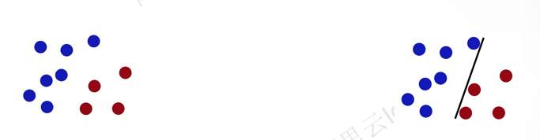

图中假设桌子上放了似乎有规律两种颜色的球,现在要用一根木棍把他们分开，要在放更多球之后任然适用。

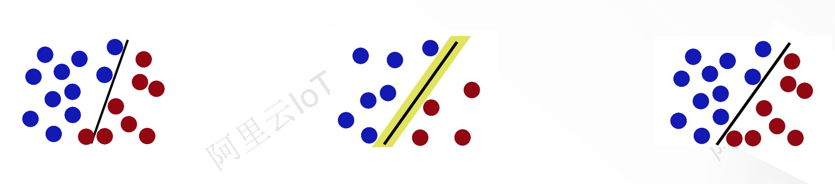

这时候又放入一些红球，可以看到似乎有球跟蓝球混在一起了，此时SVM出场了，SVM就是试图把棍放在最佳位置，好让在棍的两边有尽可能大的间隙。现在即使放了更多的球，棍仍然是一个好的分界线。

**SVM算法优点：**

- 使用核函数可以向高维空间进行映射
- 使用核函数可以解决非线性的分类
- 分类思想很简单，就是将样本与决策面的间隔最大化
- 分类效果较好

**SVM算法缺点：**

- SVM算法对大规模训练样本难以实施
- 用SVM解决多分类问题存在困难
- 对缺失数据敏感，对参数和核函数的选择敏感　

**朴素贝叶斯分类：**

问题一:工科院校的男生和女生的比例为3: 1，在不知学生个人信息的情况下，如何预测某个学生的性别?根据先验概率进行预测

问题二:再给出某个学生的身高和体重，身高180cm，体重70kg，如何来预测学生的性别?

存在一个任务需要对一个工科院校大一学生性别进行统计，发现那一年的男生和女生的比例是3：1，这时候假设随机抽取一个学生，在不知道该学生个人信息情况下，要来预测他的性别，这时候也许会预测这可能是一个男生。为什么呢？因为在这个学校里男生的总体概率大。男生占总人数的3/4，女生为1/4，因此在信息有限的情况下，判别其为男生可能性更高。这种预测法是很粗浅的，而根据日常经验，身高、体重、以及性别的关系，我们都有一些感性的认识，比如说一个身高在180cm左右体重70kg的话，那这个人基本上是男生，而一个体重50kg，身高在160cm左右，那么这个人我们基本上判断是女性，这些都是根据经验，通过对生活的观察，来做出的一个猜测。

两个先验知识：
先验概率：P(w1)和P(w2)       男生女生总体比例表示：男P(w1)、女P(w2)
类条件概率：P(x|w1)和P(x|w2)    男生女生身高180cm，体重70kg的总体比例表示：P(x|w1)、P(x|w2)

有了这两个先验知识后，我们就可以根据下面的这个贝叶斯公式，计算出这个学生是男生还是女生的概率，我们把这个概率称为后验概率把它表示为

后验概率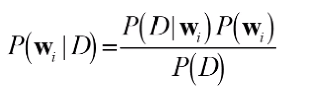

根据后验概率进行决策,这个决策过程就是贝叶斯决策。

先验概率：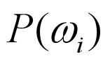
预先已知的或者可以估计的模式识别系统位于某种类型的概率。根据大量统计确定某类事物出现的比例。如P(男生)。
类条件概率：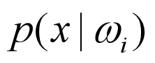
类别状态为Wi时，样本X出现的概率密度。
全概率：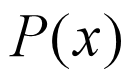
样本x在所有类别里出现的概率之和，也称为x的全概率在两类问题情况下: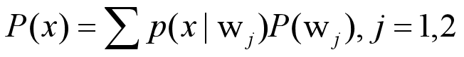
后验概率: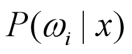
一个具体事物属于某种类别的概率。
后验概率涉及一个具体事物，而先验概率是泛指一类事物，因此P(男生|x)和P(男生)是两个不同的概念。

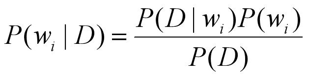

**贝叶斯公式的两个创新点:**

- 用概率表示所有形式的不确定性。
- 引入了“先验”与“后验”的概念;口贝叶斯公式由于其权威性、一致性和典雅性而被列入最优美的数学公式之一。

由贝叶斯公式衍生出贝叶斯决策、贝叶斯估计、贝叶斯学习等诸多理论体系，进而形成一个贝叶斯学派。

**无监督学习：** 非监督学习中训练集不需要人为标注，由计算机自身去学习感知。

**主成分分析（英语：Principal components analysis，PCA）** 是一种统计分析、简化数据集的方法。它利用正交变换来对一系列可能相关的变量的观测值进行线性变换，从而投影为一系列线性不相关变量的值，这些不相关变量称为主成分（Principal Components）。其由卡尔·皮尔逊于1901年发明，用于分析数据及建立数理模型，在原理上与主轴定理相似。之后在1930年左右由哈罗德·霍特林独立发展并命名。
PCA是最简单的以特征量分析多元统计分布的方法。其结果可以理解为对原数据中的方差做出解释：哪一个方向上的数据值对方差的影响最大？换而言之，PCA提供了一种降低数据维度的有效办法；如果分析者在原数据中除掉最小的特征值所对应的成分，那么所得的低维度数据必定是最优化的（也即，这样降低维度必定是失去讯息最少的方法）。主成分分析在分析复杂数据时尤为有用，比如人脸识别。

PCA是最简单的以特征量分析多元统计分布的方法。通常，这种运算可以被看作是揭露数据的内部结构，从而更好地展现数据的变异度。如果一个多元数据集是用高维数据空间之坐标系来表示的，那么PCA能提供一幅较低维度的图像，相当于数据集在讯息量最多之角度上的一个投影。这样就可以利用少量的主成分让数据的维度降低了。
在对多维数据进行模型训练时，很多时候由于特征太多导致可能出现误导模型的情况，这时先通过主成分分析方法对数据集进行降维提取最有代表性的特征排除其他无效干扰，经过处理后的数据再模型训练时机器学习在应对多维度数据模型训练时常用的策略。

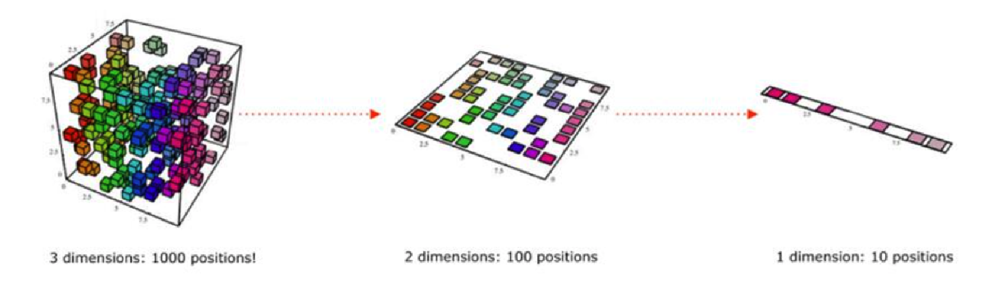

**K-Means算法**是一种聚类算法，它是一种无监督学习算法，目的是将相似的对象归到同一个蔟中。蔟内的对象越相似，聚类的效果就越好。
聚类和分类最大的不同在于，分类的目标事先已知，而聚类则不一样。其产生的结果和分类相同，而只是类别没有预先定义。

算法原理：使各个样本与所在簇的质心的均值的误差平方和达到最小（这也是评价K-Means算法最后聚类效果的评价标准）。

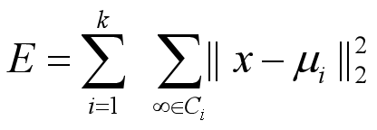

这条公式在一定程度上刻画了簇内样本围绕簇均值向量的紧密程度，E值越小则簇内样本相似度越高。最小化上面的公式并不容易，找到它的最优解需考察样本集D内所有可能的簇划分。因此， K-Means算法采用了贪心策略，通过迭代优化来近似求解上面的公式。

**K-Means聚类过程如下：**

1. 创建k个点作为k个簇的起始质心（经常随机选择）。
2. 分别计算剩下的元素到k个簇中心的相异度（距离），将这些元素分别划归到相异度最低的簇。
3. 根据聚类结果，重新计算k个簇各自的中心，计算方法是取簇中所有元素各自维度的算术平均值。
4. 将其中全部元素按照新的中心重新聚类。
5. 重复第4步，直到聚类结果不再变化。
6. 最后，输出聚类结果。

下图展示了对n个样本点进行K-means聚类的效果，这里k取2。

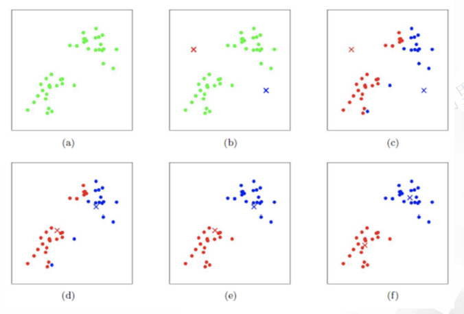
