# 数字图像处理

&emsp;&emsp;
**图像的概念：**图像是对客观存在的物体的一种相似性地，生动地写真或描述。或者说是客观对象的一种表示，它包含了被描述对象的有关信息。

&emsp;&emsp;
**图像的类别：**图像的种类很多，根据人眼的视觉特点图像可分为可见光图像和不可见光图像。可见光图像包括照片，图与画和光学投影。不可见光图像包括不可见光所成的图像比如红紫外线。最后，还有用图加以表示的不可见量，比如温度图，压力图和人口密度图等。

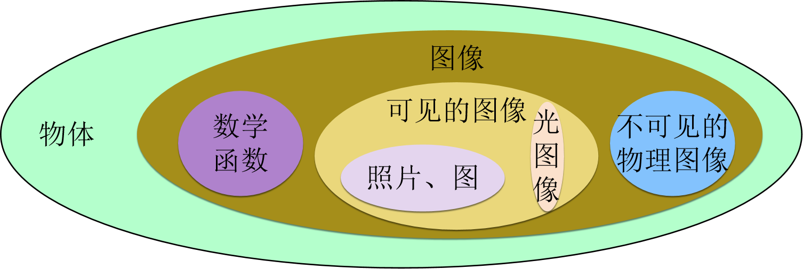

&emsp;&emsp;
在机器视觉系统中，为了消除和抑制图像中的干扰信息增强有用的信息以便于检测和简化数据的处理提高测量精度和可靠性，需要对获取的原始图像进行一系列的运算和处理，这一过程就是数字图像处理。

&emsp;&emsp;
**图像处理的基本特征：**输入输出都是图像，中间包含图像处理系统。

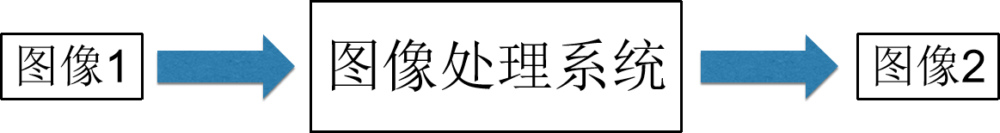

&emsp;&emsp;
普通图像包含的信息量巨大，需要使用计算机对图像进行处理。因此需要把普通图像转变成计算机能处理的数字图像。数字图像类似于光栅图形，由有限行和有限列组成。每个基本单元叫做一个像素（pixel），三维图像的像素也叫做体素（voxel）。通常的二维数字图像是一个矩型，可以用一个二维数组I（xy）来表示，其中xy是二维空间中的某坐标系的坐标，I（xy）表示图像在该点处的灰度值等性质。彩色可以是红绿蓝三个单色的一定灰度值的合成。一般来说，这些坐标和灰度值是实数，不仅依赖于坐标系的选取，还依赖于灰度值的度量单位。但数字计算机只可能表示有限字长的有限个数字，因此必须把灰度值离散化。

&emsp;&emsp;
下图是图像处理技术中常用来检验计算机算法实际效果的标准图像。 这幅图像的名称是Lenna。它是由一组数字组成的。原图像的宽和高都是256个象素，每像素有八位。它在BMP格式下有约66K字节的大小。

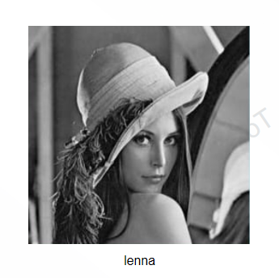

&emsp;&emsp;
**简史：**数字图像的产生远在计算机出现之前。六、七十年代开始，随着计算机硬件的发展和快速傅立叶变换算法的发现使得用计算机能够处理图像。八十年代开始便能处理三维图像了。九十年代以来，随着计算机性能的大幅提高和广泛使用，图像处理技术已经涉及社会的各个角落。图像逐渐在传播媒体中占据了主导地位，产生的许多的新行业新，未来图像处理的发展不可限量。数字图像处理属于计算机科学，但是它的90%依赖于数学，从这个特点来看，对于相关专业的学生来说，数字图像处理技术是一个十分理想的发展方向。

&emsp;&emsp;
**数字图像处理的优点：**首先是精度高，对于一幅图像而言，数字化时不管是用4比特、8比特还是其它比特表示，只需改变计算机中程序的参数其他处理方法不变。所以从原理上讲不管对多高精度的数字图像进行处理都是可能的。而在模拟图像处理中，要想使精度提高一个数量级，就必须对装置进行大幅度改进。

&emsp;&emsp;
另外就是再现性好，不管是什么数字图像，均用数组或数组集合表示。在传送和复制图像时，只在计算机内部进行处理，这样数据就不会丢失或遭破坏，保持了完好的再现性。而在模拟图像处理过程中，就会因为各种干扰因素而无法保持图像的再现性。

&emsp;&emsp;
最后是通用性、灵活性强，对可见图像和不可见光图像（如x光图像、热红外图像和超声波图像等），尽管这些图像生成所用设备规模和精度各不相同，但当把这些图像数字化后对于计算机来说都可同样进行处理，这就是数字处理图像的通用性。

## **图像预处理**

&emsp;&emsp;
一般情况下，成像系统获取的图像即原始图像，由于受到种种条件限制和随机干扰往往不能在机器视觉系统中直接使用，因此需要在初级阶段对原始图像进行灰度校正、噪声过滤等图像预处理操作。对机器视觉系统而言，所用的图像预处理方法并不考虑图像是否降质，只将图像中感兴趣的特征有选择性地突出，去除不需要的特征，预处理后的输出图像并不需要去逼近原图像。因此预处理的目的是改善图像数据、抑制不需要的变形、增强对于后续处理过程中重要的图像特征。
下面重点介绍常见的预处理方法：

- 灰度处理
- 二值化处理
- 图像增强
- 图像滤波
- 图像锐化
- 图形腐蚀及膨胀

**灰度处理**

&emsp;&emsp;
将彩色图像转换成灰度图像的过程称为图像的灰度处理。对于图像而言，灰度化处理就是使彩色的R、G、B分量值相等的过程。在彩色图像中，每个像素的颜色均由R、G、B三个分量决定，即红、绿、蓝三原色来表示彩色，R分量，G分量，B分量的取值范围均为0~255，因此，一个像素可以有1600多万（255×255×255）种颜色的变化。

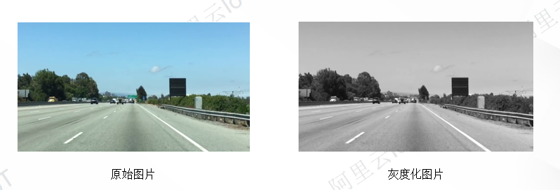

&emsp;&emsp;
像素点是最小的图像单元，一张图片由好多的像素点构成，下图是一张的高跟鞋的图片。

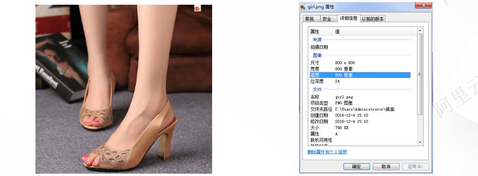

&emsp;&emsp;
查看这张图片的信息可知其尺寸是800 * 800，即宽高都是800像素。也就是说这张图片是由一个800 * 800拥有总计640000个像素点矩阵构成。

&emsp;&emsp;
每一个像素点的颜色是由RGB三个值所表现，所以一个像素点矩阵对应三个颜色向量矩阵，分别是R矩阵，G矩阵，B矩阵，它们也都是800 *800大小的矩阵。下面展示这张图片的一部分颜色矩阵数据：

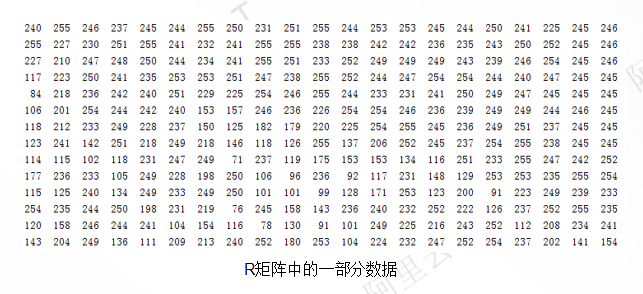

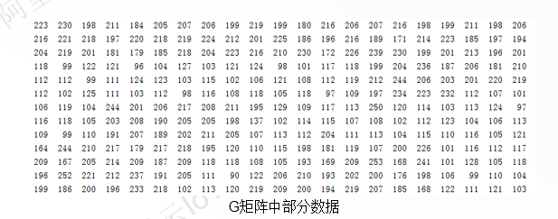

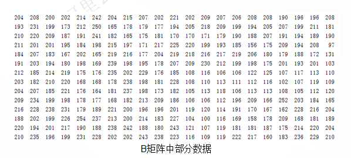

&emsp;&emsp;
每个矩阵的第一行第一列的值分别为：R：240，G：223，B：204，所以这个像素点的颜色就是（240,223,204）。 若要改变某像素点的颜色，只要在该像素点矩阵中找到该像素点的位置，比如第x行，第y列，因为一个像素点的颜色由红、绿、蓝三个颜色变量表示，所以我们通过给这三个变量赋值，来改变这个像素点的颜色，比如改成红色（255，0，0），可以表示为（x，y，（R=255，G=0，B=0））。

&emsp;&emsp;
那什么叫图片的灰度化呢？就是让像素点矩阵中的每一个像素点都满足下面的关系：R=G=B（红黄蓝三色值相等），此时的这个值叫做灰度值。常用的灰度处理方法有分量法、最大值法、平均值法和加权平均法。

&emsp;&emsp;
**分量法：**分量法是一种比较简单的图像灰度化方法。在彩色空间中，每个像素都有3个不同的分量。分量法的原理是选取任意一个值（Ri、Gi或 Bi）为该点的灰度值，并代替每个像素的三个分量。在彩色空间中，每个像素都有3个不同的分量。

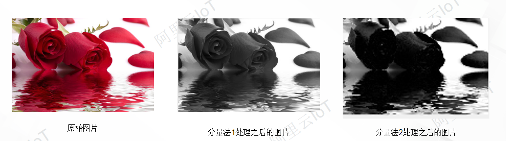

&emsp;&emsp;
**最大值法：**对于每个像素，选取Max（Ri， Gi， Bi）为该点的灰度值，并将其设置为每个像素的三个分量，从而达到图像灰度化的目的。这种方法没有复杂的运算过程，可以在较短的时间内得到彩色图像的灰度化图像。

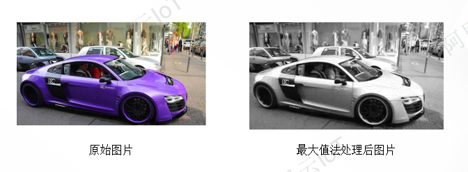

&emsp;&emsp;
**平均值法：**由于彩色图像的每个像素同时拥有几个不同的分量，因此，平均值法的原理是求出每个像素的 Ri、Gi、Bi的平均值，并将这个平均值赋给每个像素的三个分量。

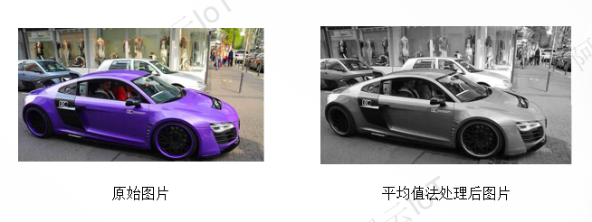

&emsp;&emsp;
**加权平均法：**根据三个分量的重要性和其他指标，对三个分量分配不同的权值、计算加权结果，并将加权结果赋给每个像素的三个分量。

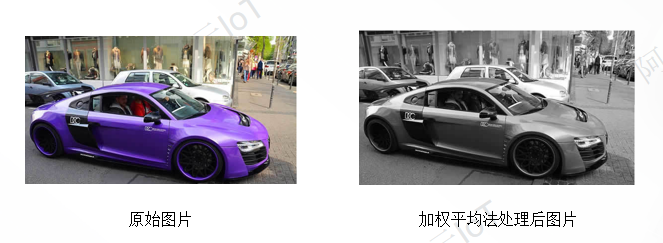

### 二值化处理

&emsp;&emsp;
二值化处理是将整个图像呈现出明显的黑白效果，即将256个亮度等级的灰度图像通过选择适当的阈值作标准，比该值大的颜色就会转换成白色，低于该值的颜色换成黑色，以获得可以反映图像整体和局部特征的二值化图像。在数字图像的处理过程中，二值化图像占有非常重要的地位。将灰度图像二值化，使得在对图像做进一步处理时，操作更简单，数据的压缩量更小。

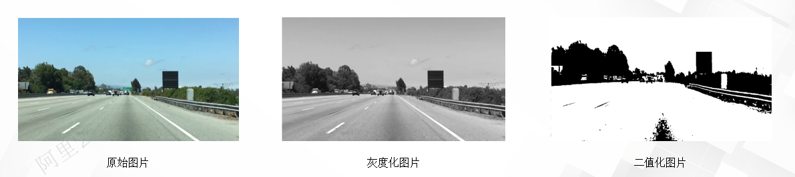

&emsp;&emsp;
为了得到理想的二值化图像，一般采用封闭、连通的边界定义不重叠的区域。所有灰度值大于或等于阈值的像素被判定为特定物体，二值化处理后的图像灰度值为255。否则这些像素被排除在特定物体以外，二值化处理后的图像灰度值为0，表示其为背景或其他的物体区域，即

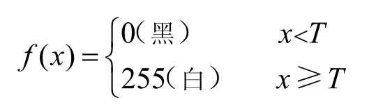

&emsp;&emsp;
式中，x表示灰度值；T代表阈值；f(x)为二值化处理后的图像灰度值。

&emsp;&emsp;
对灰度图像或以灰度模式显示的彩色图像进行二值化处理时，可人工设定阈值，也可以由系统自动求出阈值，从而将图像二值化。比较常用的计算阈值的方法包括双峰法、P参数法、迭代法和OTSU法等。

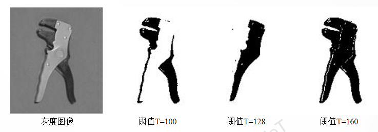

&emsp;&emsp;
**双峰法：**双峰法的基本思想是认为图像由前景和背景组成，如果灰度级直方图呈明显的双峰状，则选取两峰之间的谷底所对应的灰度级作为阈值。

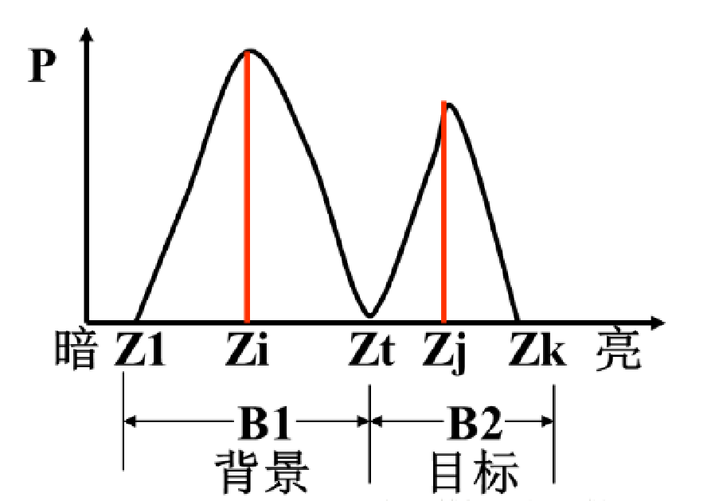

&emsp;&emsp;
**P参数法：**当不同区域之间的灰度有一定重叠时，双峰法的效果就很差了。如果预先知道每个目标占整个图像的比例P，就可以采用P参数法进行二值化处理。
Р参数法具体步骤如下：假设预先知道目标占整个图像的比例为P，且目标偏暗，背景偏亮。假设整个直方图中目标区域所占比例为P1，利用 P参数法计算阈值的步骤如下。
 计算图像的直方图分布 P（t），其中，t=0，1，2，3，…，255。
从最低的灰度值开始，计算图像的累积分布直方图：

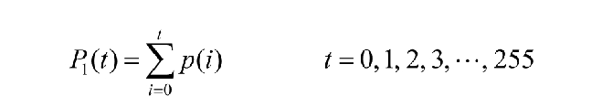

&emsp;&emsp;
计算阈值T：

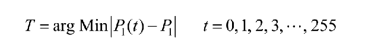

&emsp;&emsp;
由上述计算公式可知，阈值就是与 P1最为接近的累积分布直方图对应的灰度值。

&emsp;&emsp;
**迭代法：**利用迭代法计算阈值的算法基于逼近的思想：首先，选择一个近似的阈值作为估计值的初始值，通过分割产生多个子图像；然后，根据子图像的特性选择新的阈值，并且不断利用新的阈值分割图像；最后，经过多次循环，使得被错误分割的图像像素最少。利用迭代法计算阈值的步骤如下。

&emsp;&emsp;
求出图像的最大灰度值和最小灰度值：Ymax和 Ymin，令初始阈值 Ti为（i=0，1，2，3…）

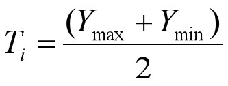

&emsp;&emsp;
根据阈值 Ti将图像分割为前景和后景，分别求出两者的平均灰度值 Y0和 Y1。

&emsp;&emsp;
根据平均灰度值 Y0和 Y1求出新阈值 Ti+1：

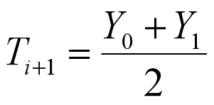

&emsp;&emsp;
若 Ti= Ti+1，则所得即为阈值，否则 i= i+1，继续执行，进行迭代计算。

&emsp;&emsp;
利用迭代法计算阈值的执行步骤如下图所示：

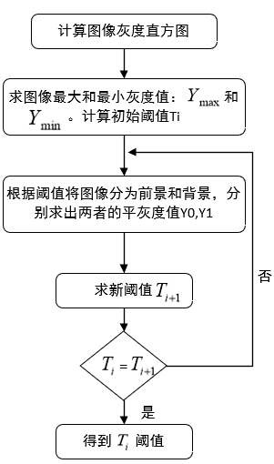

&emsp;&emsp;
迭代法的思路就是在不断的迭代中寻找最优的阈值，由于在求得对每幅图像固定的阈值后，迭代过程不会发生变化，所以在迭代的最后必定存在这个阈值。

&emsp;&emsp;
**OTSU法：**OTSU算法也称最大类间差法，由大津于1979年提出，被认为是图像分割中阈值选取的最佳算法。该方法的基本思想是通过设置阈值将图像分割成两组：一组的灰度值与目标对应；另一组的灰度值与背景对应。这两组灰度值的类内方差最小、类间方差最大。
假设 t为将图像分割成两组的阈值，目标像素数占图像总像素数的比例为W0，平均灰度值为U0；背景像素数占图像总像素数的比例为W1，平均灰度值为U1。图像的总平均灰度值为：

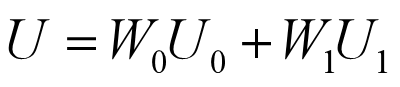

&emsp;&emsp;
从最小灰度值到最大灰度值遍历t，当t使得g最大时，t即为分割的最佳阈值，其中，g为：

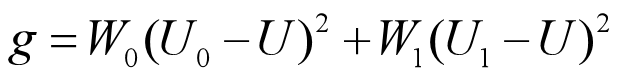

&emsp;&emsp;
可对上式进行如下理解：g表示类间方差，由阈值t分割出的目标部分和背景部分构成了完整的图像。因为方差是灰度分布是否均匀的一种度量指标，方差越大说明构成图像的两部分的差别越大。当部分目标像素被错分至背景部分，或者部分背景像素被错分至目标部分时，都会导致两部分的方差变小，因此，若能令类间方差最大，则意味着像素被错分的概率最小。

### 图像增强

&emsp;&emsp;
**图像增强概念：**图像在传送和转换的过程中，由于噪声、衰减等原因，会造成不同程度的图像质量下降。另外，图像失真、相机的相对运动等都会造成图像模糊。因此，引出了图像增强这个概念。
图像增强的目的是改善图像的视觉效果，或者使图像更适合于人或机器进行分析。处理通过图像增强，可以减少图像中的噪声，提高目标与 背景的对比度强调或抑制图像中的某些细节。

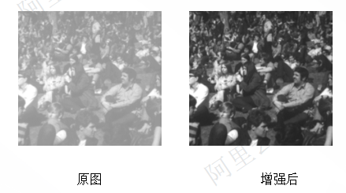

&emsp;&emsp;
**图像增强方法：**图像增强方法从增强的作用域出发，可分为空间域增强和频率域增强两种：
- 空间域增强：简单来说，空间域增强就是指增强构成图像的像素，是直接对这些像素进行操作的过程。
- 频率域增强：是利用某种变换将原来在空间域中的图像转化为频率域中的图像，并通过对频率域中频谱图像的处理及逆变换，将频率域处理后的图像转化到空间域中，从而满足图像的特定应用。

### 图像滤波

&emsp;&emsp;
由于成像系统、传输介质和记录设备等的不完善，数字图像在其形成、传输、记录的过程中往往会受到多种噪声的污染。另外，在图像处理的某些环节，输入的对象也会在图像中引入噪声。这些噪声在图像中常常表现为一个能引起较强视觉效果的孤立像素或像素块。对于数字图像信号，噪声表现为或大或小的极值，这些极值作用于图像像素的真实灰度值上，从而对图像造成亮、暗点干扰，极大降低了图像质量，影响了图像复原、分割、特征提取、图像识别等后续工作。若要构造一种能够有效抑制噪声的滤波器，则必须考虑两个目标：能够有效去除目标和背景中的噪声；能够很好地保护目标图像的形状、大小，以及特定的几何特征和拓扑结构特征。

&emsp;&emsp;
图像滤波的目的是在尽量保留图像细节特征的条件下，对目标图像的噪声进行抑制。图像滤波是图像预处理中不可缺少的操作，其处理效果的好坏将直接影响到后续图像处理、分析的有效性和可靠性。下面介绍一下图像中值滤波方法。

&emsp;&emsp;
**中值滤波：**中值滤波是一种典型的非线性滤波，是基于排序统计理论的一种能够有效抑制噪声的非线性信号处理技术，基本思想是用像素点邻域灰度值的中值来代替该像素点的灰度值，让周围的像素值接近真实的值从而消除孤立的噪声点。该方法在取出脉冲噪声、椒盐噪声的同时能保留图像的边缘细节。利用中值滤波处理图像前后的效果对比如下图所示：

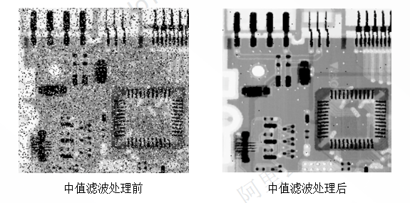

### 图像锐化

&emsp;&emsp;
图像锐化用于补偿图像的轮廓、增强图像的边缘及灰度跳变的部分，使得图像变得清晰。图像锐化前后的效果对比如下所示：

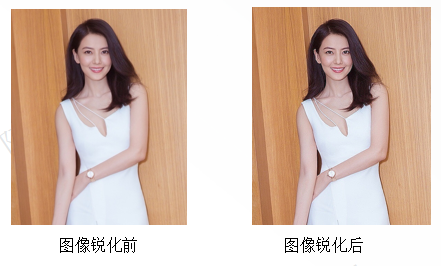

### 图形腐蚀及膨胀

&emsp;&emsp;
腐蚀及膨胀操作是形态学处理的基础（许多形态学的算法都以这两种运算为基础）。 腐蚀的作用是消除物体的边界点，使目标缩小，即消除小于结构元素的噪声点。腐蚀前后的效果对比如图下所示：

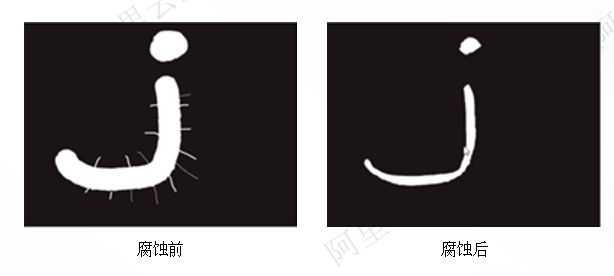

&emsp;&emsp;
膨胀的作用是将与物体接触的所有背景点合并到物体中，使目标增大，填补目标的空洞。膨胀前后的效果对比如图下所示：

