# 机器视觉技术介绍

## 什么是机器视觉？
&emsp;&emsp;
美国制造工程师协会（SME）机器视觉分会和美国机器人工业协会（RIA）自动化视觉分会为机器视觉作了如下定义：“机器视觉是通过光学的装置和非接触的传感器自动地接收和处理一个真实物体的图像，以获得所需信息或用于控制机器人运动的装置”｡通俗地说，机器视觉就是用机器模拟生物宏观视觉功能，代替人眼来做测量和判断｡

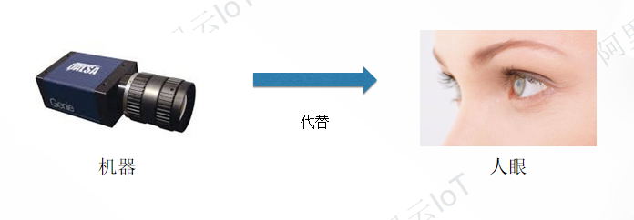

&emsp;&emsp;
我们看到事物的过程首要前提是，外界物体发射或反射的光觉信息经过眼球屈光系统的角膜、晶状体、玻璃体，在眼底视网膜上形成图像，视网膜对这些光觉信息进行分析、整合、转换，以脉冲微电信号的方式，经过视觉传导神经传导至大脑的视觉中枢皮质系统，并形成视觉。而机器视觉是通过摄像机来获取环境图像并将他们转化成数字信号，使用计算机实现对视觉信息进行处理，来认知周围环境的信息。机器视觉不仅能模拟人眼的功能，而且最重要的是机器完成人眼所难以或不能胜任的工作。

&emsp;&emsp;
在现代工业自动化生产中，涉及到各种各样的检验、生产监视及零件识别应用，例如零配件批量加工的尺寸检查，自动装配的完整性检查，电子装配线的元件自动定位，IC上的字符识别等。通常人眼无法连续、稳定地完成这些带有高度重复性和智能性的工作，其它物理量传感器也难有用武之地。由此人们开始考虑利用光电成像系统采集被控目标的图像，而后经计算机或专用的图像处理模块进行数字化处理，根据图像的像素分布、亮度和颜色等信息，来进行尺寸、形状、颜色等的判别。这样，就把计算机的快速性、可重复性，与人眼视觉的高度智能化和抽象能力相结合，由此产生了机器视觉的概念。

## 机器视觉的应用领域
&emsp;&emsp;
由于机器视觉可以快速获取大量信息，而且易于自动处理，人们逐渐将机器视觉系统广泛地用于天文行业、 医药行业、交通航海行业以及军事行业领域等。在国外，机器视觉的应用相当普及，主要集中在电子、汽车、冶金、食品饮料、零配件装配及制造等行业。机器视觉系统在质量检测的各个方间已经得到广泛的应用。

&emsp;&emsp;
随着国内制造业的快速发展，对于产品检测和质量的要求不断提高，各行各业对图像和机器视觉技术的工业自动需求将越来越大，因此机器视觉在未来制造业中将会有很大的发展空间。下面我们来看看机器视觉具体有哪些应用领域。 

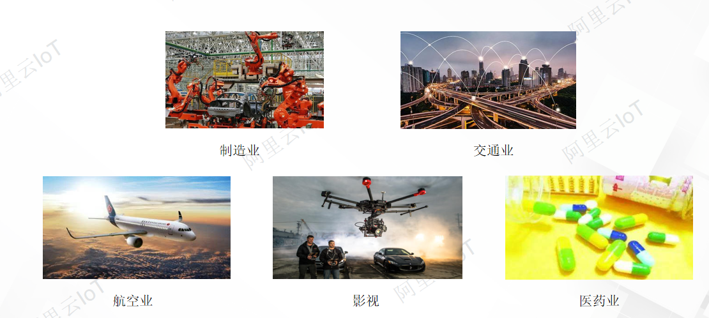

&emsp;&emsp;
- **纺织领域：** 纺织品质量是纺织品生产企业生存的命脉。质量检测作为生产中极其重要的环节，如何有效进行质量管理及时发现产品质量存在的问题，降低次品率，提升产品品质至关重要。目前，国内纺织企业大多采用了自动化程度较高的纺机，但其产品表面质量检测由于缺乏与之配套的检测机械和设备，一直停留在传统的人工检测阶段，检测工人参照给定标准用肉眼寻找纺织品表面缺陷。人工检测方式容易导致视觉疲劳，存在劳动强度大，检测效率低，且检验结果极易受到人为主观因素的影响，误检率、漏检率高等缺点。机器视觉检测技术的引入对流水线进行自动化的改造，使纺织品生产流水线变成快速、实时、准确、高效的流水线，可以大大提高生产效率。

&emsp;&emsp;
- **医学领域：** 在医学领域，机器视觉主要用于医学辅助诊断。首先采集核磁共振、超声波、激光、X射线、γ射线等对人体检查记录的图像，再利用数字图像处理技术、信息融合技术对这些医学图像进行分析、描述和识别，最后得出相关信息，对辅助医生诊断人体病源大小、形状和异常，并进行有效治疗发挥了重要的作用。不同医学影像设备得到的是不同特性的生物组织图像，如X射线反映的是骨骼组织，核磁共振影像反映的是有机组织图像，而医生往往需要考虑骨骼有机组织的关系，因而需要利用数字图像处理技术将两种图像适当地叠加起来，以便于医学分析。

&emsp;&emsp;
- **智能交通领域：** 机器视觉技术在智能交通中可以执行自动导航和车流监测等任务。例如，机器视觉技术在无人驾驶和汽车辅助驾驶方面有着非常重要的作用：通过识别前方车辆、行人、障碍物、道路，以及交通信号灯和交通标识，将给人类带来前所未有的出行体验，重塑交通体系，并构建真正的智能交通时代。如何快速、有效地检测拥堵状态，对于解决交通拥堵而言具有极其重要的意义。机器视觉技术的目标是通过数字图像处理、计算机视觉技术分析交通图像序列，并对车辆、行人等交通目标的运动进行检测、定位、识别和跟踪，以及对目标的交通行为进行分析、理解和判断，从而完成对各种交通数据的采集、交通事件的检测，并快速进行相应处理。

&emsp;&emsp;
- **桥梁检测领域：** 人工检测法和桥检车法都是依靠人工用肉眼对桥梁表面进行检测，其速度慢，效率低，漏检率高，实时性差，影响交通，存在安全隐患，很难大幅应用；无损检测包括激光检测、超声波检测以及声发射检测等多种检测技术，它们仪器昂贵，测量范围小，不能满足日益发展的桥梁检测要求；智能化检测有基于导电性材料的混凝土裂缝分布式自动检测系统和智能混凝土技术，也有最前沿的基于机器视觉的检测方法。导电性材料技术虽然使用方便，设备简单，成本低廉，但是均需要事先在混凝土结构上涂刷或者埋设导电性材料进行检测，而且智能混凝土技术还无法确定裂缝位置、裂缝宽度等一系列问题距实用化还有较长的距离;而基于机器视觉的检测方法是利用CCD相机获取桥梁表观图片，然后运用计算机处理后自动识别出裂缝图像，并从背景中分离出来然后进行裂缝参数的计算的方法，它具有便捷、直观、精确、非接触、再现性好、适应性强、灵活性高、成本低廉的优点，能解放劳动力，排除人为干扰，具有很好的应用前景。

&emsp;&emsp;
机器视觉的诞生和应用，大幅解放了人类劳动力，同时提高了生产自动化水平，装备的使用效率、可靠性及稳定性等。随着新技术、新理论在机器视觉系统中的应用，机器视觉将在国民经济的各领域申发挥更大作用，其应用前景广阔，并为社会的发展带来了新的技术革命。

## 机器视觉的发展历程及现状

&emsp;&emsp;
技术是计算机学科发展的一个重要分支，其功能及应用领域随着工业自动化的快速发展而变得更加广泛和全面。机器视觉技术的发展经历了如下阶段:

&emsp;&emsp;
- **20世纪60年代：** 机器视觉技术的起源。20世纪60年代末，美国学者罗伯兹关于理解多面体的组成，即对“积木世界”的研究成为早期人工智能领域最具代表性的课题之一，当时运用的预处理、边缘检测、对象匹配、轮廓线构成等机器视觉技术一直沿用至今。

&emsp;&emsp;
- **20世纪70年代：** 机器视觉技术的发展。MIT人工智能实验室正式开设“机器视觉”课程，国际上许多知名学者参与视觉理论、算法、系统设计的研究。其中，D.Marr教授于1977年提出了不同于“积木世界”分析方法的视觉计算理论（Vision Computational Theory）。该理论立足于计算机科学，系统地概括了心理生理学、神经生理学等方面取得的重要成果，使得机器视觉研究有了一个明确的体系，大大推动了对机器视觉的研究。D.Marr教授的视觉计算理论将整个机器视觉过程分成三个阶段，依次为初级视觉处理、中级视觉处理和高级视觉处理。

&emsp;&emsp;
- **20世纪80年代：** 机器视觉技术的快速发展。在这个阶段，不仅出现了基于感知特征群的物体识别理论框架、主动视觉理论框架、视觉集成理论框架等概念，而且还产生了很多新的研究方法和理论，无论对一般二维信息的处理水平，还是针对三维图像的模型及算法研究水平都有了很大提高。总之，在这一阶段，机器视觉技术获得蓬勃发展，新概念、新方法、新理论不断涌现。

&emsp;&emsp;
- **20世纪90年代：** 机器视觉技术开始应用在工业领域中。由于机器视觉技术是一种非接触检测方式，在一些不适合人工作业的危险工作环境或人工视觉难以满足要求的场合中，常应用机器视觉代替人工视觉。同时，在大批量重复性的工业生产过程中，利用机器视觉检测方法可以大大提高生产效率和自动化程度。

&emsp;&emsp;
- **21世纪初期：** 机器视觉技术的深入研究。机器视觉作为机器人的“眼睛”，在人工智能快速发展的同时，正逐步走向成熟，即机器视觉技术开始应用到多个领域。例如，工业探伤、自动焊接、医学诊断、跟踪报警、移动机器人、指纹识别、人脸识别、模拟战场、智能交通、无人机与无人驾驶、智能家居等。

&emsp;&emsp;
机器视觉发展至今，早已不是单一的应用产品。机器视觉的软硬件产品已逐渐成为生产制造各个阶段的必要部分，这就对系统的集成性提出了更高的要求。工业自动化企业要求能够与测试或控制系统协同工作的一体化工业自动化系统，而非独立的视觉应用。在现代自动化生产过程中，人们将机器视觉系统广泛地用于工况监视、成品检验和质量控制等领域。随着全球制造中心向中国转移，中国机器视觉市场正在继北美、欧洲和日本之后，成为国际机器视觉厂商的重要目标市场。目前包括中国和日本在内的亚太地区占全球的比重突破15%已经超过欧洲，位居全球第二大区域市场。

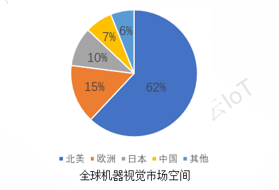

## 机器视觉系统构成

&emsp;&emsp;
机器视觉系统构成包括光源、镜头、相机、图像采集卡、计算机等，如下图所示：

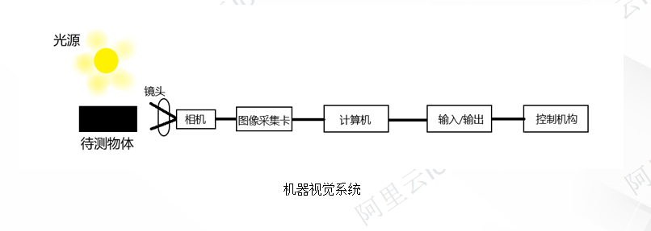

&emsp;&emsp;
其中，光源用于为视觉系统提供足够多的亮度；镜头用于将被测物成像到相机的靶面上，并将其转换成电信号；图像采集卡将电信号转换成数字图像信息；计算机用于实现图像的存储、处理，并给出测量结果和控制信号。

### 光源

&emsp;&emsp;
机器视觉系统的核心是图像采集和处理。所有信息均来源于图像，因此，图像本身的质量对整个机器视觉系统而言极为关键。光源是影响图像质量的重要因素，通过合适的光源照明设计，可使图像中的目标信息与背景信息得到最佳分离，从而大大降低图像处理算法的分割、识别难度，同时提高系统的定位、测量精度，以及系统的可靠性。反之，如果光源设计不当，则会导致在图像处理算法设计和成像系统设计中事倍功半。因此，光源及光学系统设计是机器视觉系统的重要组成部分。在机器视觉系统中，光源的作用至少有以下几种：

- 照亮目标。提高目标亮度。
- 形成有利于图像处理的成像效果。
- 克服环境光干扰，保证图像的稳定性。

&emsp;&emsp;
**1 光源的种类**：目前，机器视觉系统中的光源主要有：荧光灯、卤素灯、LED灯。其中，LED灯由于其具有形状多样、使用寿命长、响应速度快、颜色多样、综合性价比高等特点，在行业内应用广泛。卤素灯适合在高亮度应用场合；荧光灯因为其色还原性好的的特点仍然被广泛使用于色彩检测中。

​				       	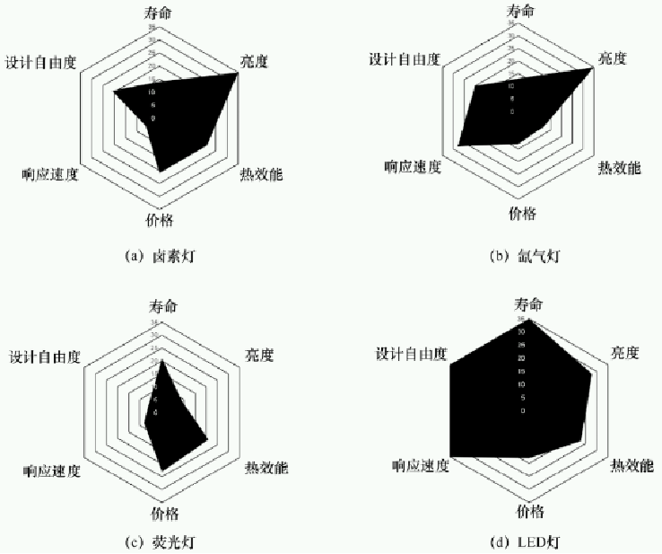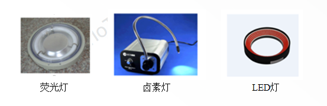

&emsp;&emsp;
**2 LED光源的形状：** 按照形状不同，LED光源通常分为以下几类：

&emsp;&emsp;
**（1）环形光源**：环形光源环形光源的实物图、照射示意图如下图所示。

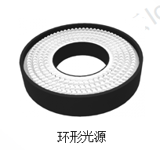

&emsp;&emsp;
环形光源的特点如下：

- 可将不同照射角度、不同颜色的光源组合，从而突出物体的三维信息。
- 采用高密度LED阵列设计，亮度较高。
- 多种紧凑设计，可节省安装空间。
- 可解决对角照射的阴影问题。
- 选用漫射板导光，光线均匀扩散。

&emsp;&emsp;
环形光源可应用于PCB基板检测、芯片检测、显微镜照明、液晶校正、塑胶容器检测、集成电路的印字检查等场景中。

&emsp;&emsp;
**（2）背光源：** 背光源的实物图、照射示意图如下图所示：

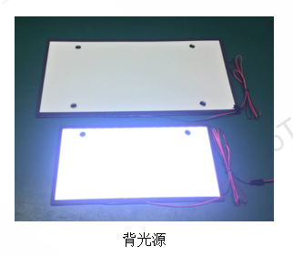

&emsp;&emsp;
其采用高密度LED阵列设计，可提供高强度的背光照明，并突出物体的外形轮廓特征，尤其适合作为显微镜的载物台。背光源分为多种，如红白两用背光源、红蓝两用背光源等。通过调配出不同的颜色，可满足不同被测物的多色要求。背光源可应用在机械零件尺寸的测量、电子元件的检测、芯片的外形检测、胶片污点的检测、透明物体的划痕检测等场景中。

&emsp;&emsp;
**（3） 条形光源：** 条形光源的实物图、照射示意图如下图所示：

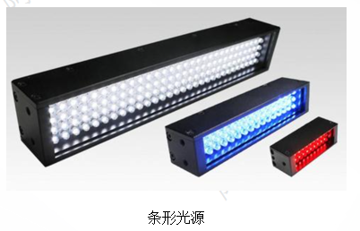

&emsp;&emsp;
条形光源是较大被测物的首选光源，颜色可根据需求搭配自由组合，照射角度可调。
条形光源可应用于金属表面检查、图像扫描、表面裂缝检测、液晶显示器面板检测等场景中。

&emsp;&emsp;
**（4）同轴光源：** 同轴光源的实物图、照射示意图如下图所示：

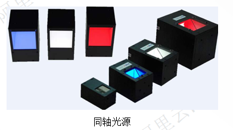

&emsp;&emsp;
同轴光源可以消除因物体表面不平整而引起的阴影，从而减少干扰。同轴光源的特点如下：

- 采用分光镜设计，可减少光损失提高成像的清晰度。
- 可均匀照射物体表面。

&emsp;&emsp;
同轴光源可应用于反射度极高的物体表面划伤检测（如金属、玻璃、胶片、晶片等）芯片和硅晶片的破损检测、Mark点定位、条码识别等场景中。

&emsp;&emsp;
**（5） 点光源：** 点光源的实物图、照射示意图如下图所示：

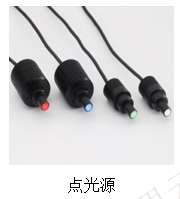

&emsp;&emsp;
点光源的特点如下：

- 功率大、体积小、发光强度高。
- 作为卤素灯的替代品，非常适合作为镜头的同轴光源。
- 具有高效散热装置，大大提高了光源的使用寿命。

&emsp;&emsp;
点光源可应用于芯片检测、Mark点定位、晶片及液晶玻璃的基底校正等场景中。

&emsp;&emsp;
**（6） 碗状光源（球积分光源）：** 碗状光源的实物图、照射示意图如下图所示：

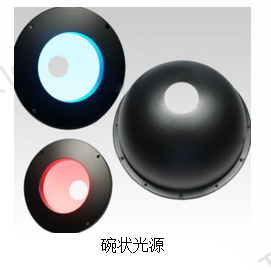

&emsp;&emsp;
碗状光源可均匀反射从底部发出的光线，从而使整个图像的亮度均匀。碗状光源可应用于曲面表面的检测、凹凸表面的检测、弧形表面的检测，以及金属、玻璃等表面反光较强的物体表面检测场景中。

&emsp;&emsp;
**3 光源的颜色：** 常用的光源颜色有白色、蓝色、红色、绿色等，光谱图如下图所示。RGB是工业中的一种颜色标准，通过对红（R）、绿（G）、蓝（B）三个颜色通道的变化，以及它们之间的叠加得到其他颜色。

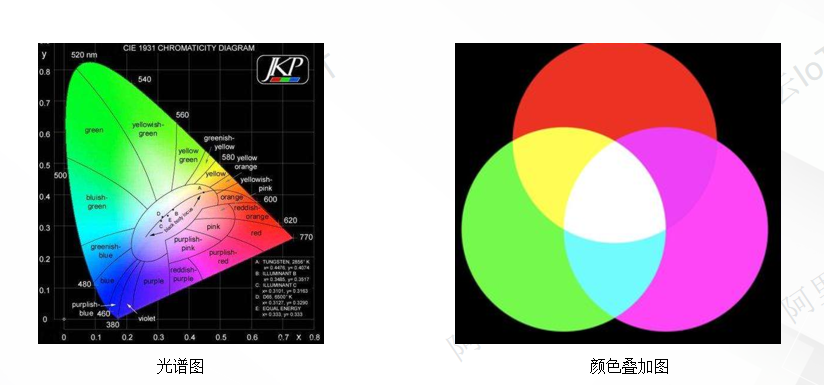

&emsp;&emsp;
- **白色光源：** 白色光源通常利用色温来界定：色温高的颜色偏蓝（冷色，色温大于5000K）；色温低的颜色偏红（暖色，色温小于3300K）；色温界于3300～5000K之间的颜色称为中间色。白色光源的适用性广、亮度高，在拍摄彩色图像时应用较多。

&emsp;&emsp;
- **蓝色光源：** 蓝色光源的波长为430～480nm，适用于银色背景的产品（如钣金、汽车加工件等）、薄膜上的金属印刷品。

&emsp;&emsp;
- **红色光源：** 红色光源的波长为600～720nm。其波长较长，可以穿透一些比较暗的物体。例如，黑色的透明软板孔位、绿色的线路板等。采用红色光源照射时，可提高对比度。

&emsp;&emsp;
- **绿色光源：** 绿色光源的波长为510～530nm。其波长界于红色与蓝色之间，适用于红色背景的产品、银色背景的产品（如钣金、汽车加工件等）。

&emsp;&emsp;
- **红外光源：** 红外光源的波长为780～1400nm。红外光属于不可见光，透过力强，一般应用在LCD屏检测、视频监控等方面。

&emsp;&emsp;
- **紫外光源：** 紫外光源的波长一般为190～400nm。其波长短、穿透力强，主要应用在证件检测、触摸屏ITO检测、布料表面破损检测、点胶溢胶检测，以及金属表面划痕检测等方面。

  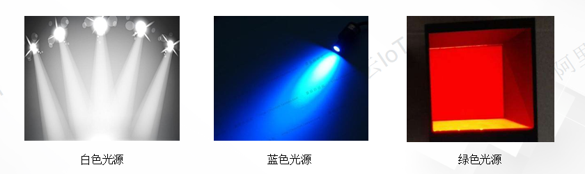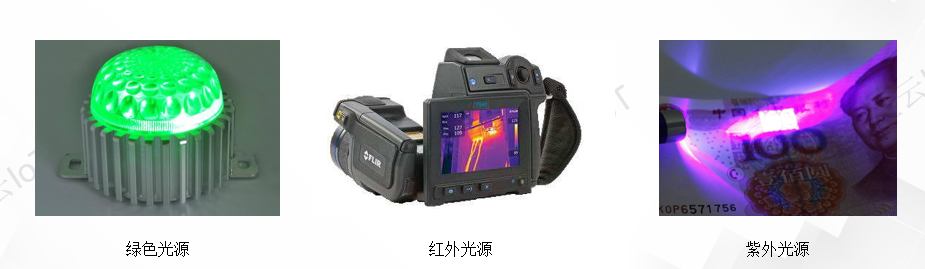

### **镜头**

&emsp;&emsp;
就是在其一端收集物体的光线，并将光线在另一端汇聚为实像，并投影到接收面的物体。 在机器视觉系统中，镜头的主要作用是将目标成像在图像传感器的光敏面上。镜头的质量将直接影响机器视觉系统的整体性能。合理地选择和安装镜头，是设计机器视觉系统的重要环节。

&emsp;&emsp;
**1 视场角：** 什么是视场角？视场角是以镜头为顶点，以被测物可通过镜头的最大范围的两条边构成的夹角，如下图所示：

####

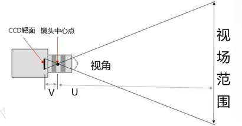

&emsp;&emsp;
在光学系统中，视场角可用FOV表示，其与CCD芯片的关系如下：

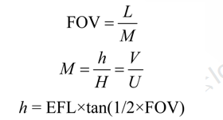

&emsp;&emsp;
式中，L为CCD芯片的高或宽；M为放大率；h为像高；H为物高；V为像距；U为物距；EFL为焦距。按照视场角的大小，镜头可分为标准镜头、广角镜头、远摄镜头。

&emsp;&emsp;
**2 光圈：** 光圈是一个用来控制透过镜头进入相机感光面的进光量的装置。光圈的大小（用f表示）如下图所示：f后面的数值越小，光圈越大，进光量越多，画面越亮，焦平面越窄，主体背景越虚化；f后面的数值越大，光圈越小，进光量越少，画面越暗，焦平面越宽，主体背景越清晰。

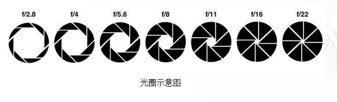

&emsp;&emsp;
**3 焦距：** 所示：

  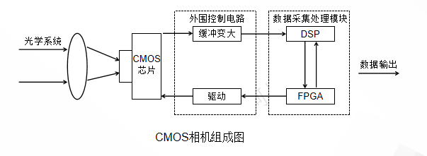

  其工作原理是CMOS芯片可直接输出数字信号，大部分CMOS相机配有FPGA或DSP的数据采集处理模块，可直接对图像数据进行图像滤波和校正等预处理，最后再进行数据输出。

#### （2）按传感器的结构特性分类：线阵相机、面阵相机

- 线阵相机

  线阵相机呈“线”状，只能在两种情况下使用线阵相机： 

  被测视野为细长的带状，线阵相机的典型应用领域是检测连续运动的物体，如金属、塑料、纸和纤维等。被测物通常呈匀速运动，利用一台或多台线阵相机对其进行逐行扫描，以达到对整个表面的均匀检测。

  需要极宽的视野或极高的精度，线阵相机的传感器具有极高的分辨率，可以精确到微米。线阵相机的优点是每行的像元数多（总像元数比面阵相机的总像元数少），并且像元尺寸多样，帧率高，特别适用于对一维动态目标的检测。

- 面阵相机

  面阵相机的应用范围较广，如面积、形状、尺寸、位置甚至温度等。面阵相机可以快速、准确地获取二维图像的信息，并且能够非常直观地测量图像。面阵相机的缺点是总像元数太多，每行的像元数比线阵相机的像元数少，帧率受到限制。

#### （3）按输出信号方式分类：模拟相机、数码相机

- 模拟相机模拟相机输出的信号形式为标准的模拟量视频信号，需要通过专用的图像采集卡将模拟量视频信号转化为计算机可以处理的数字信号，以便对视频信号进行处理与应用。模拟相机的优点是通用性好、成本低；缺点是分辨率低、采集速度慢，并且在图像传输中容易受到噪声干扰，导致图像质量下降，所以大多用在对图像质量要求不高的机器视觉系统中。其视频输出接口的形式主要为BNC、S-VIDEO等，所搭配的机器视觉主机大多采用“工控机+视频采集卡”的形式，整机成本较高。目前，在主要的高清机器视觉应用场景中，模拟相机的使用越来越少。
- 数码相机，顾名思义其相机的视频输出信号为数字信号。数码相机的内部集成了A/D转换电路，可直接将模拟量的图像信号转化为数字信号。其具有抗干扰能力强，视频信号格式多样，分辨率高和视频输出接口丰富等特点。其视频输出接口主要为IEEE 1394、USB 3.0、GigE（千兆网口）等。

#### （4）按输出色彩方式分类：黑白相机、彩色相机

- 黑白相机将光信号转换成图像灰度值，生成的图像为灰度图像。灰度图像只包含亮度信息，不含色彩信息。在计算机中，一个字节为8位，所以，灰度图像可以包含256个信息。
- 彩色相机可以将三原色的光信号进行转换，输出的是彩色图像，一般情况下，可以表示16777216种颜色（256×256×256=16777216），这种情况称为全彩色图像。

#### 相机的参数

#### （1）芯片尺寸

&emsp;&emsp;
芯片尺寸表示图像传感器感光区域的面积大小，直接决定了整个系统的物理放大率。相机的芯片尺寸如图下图所示：

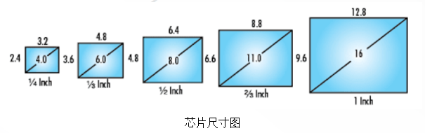

#### （2）分辨率

&emsp;&emsp;
分辨率表示每英寸包含的像素数。对于图像来说，分辨率是非常重要的，决定了图像是否能够清晰地呈现。相机的分辨率越高，成像后对细节的展示就越明显。相机分辨率的高低，取决于相机中CCD芯片上的像素数量。CCD芯片上的像素数量越多，相机的分辨率就越高。例如，相机的像素为30万，则其分辨率为640×480（640表示在X方向的像素数，480表示在Y方向的像素数）。分辨率的示意图如下图所示：若视野为640mm×480mm，相机的像素为640×480，则通过公式“定位精度=视野/相机的像素”可知，X方向的定位精度为1mm，Y方向的定位精度为1mm。

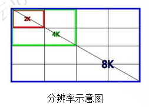

#### （3）像元尺寸

&emsp;&emsp;
像元尺寸表示相机芯片上每个像元的实际物理尺寸。通过选择大的像元尺寸可弥补图像亮度的不足。常见的像元尺寸有3.45μm、3.75μm、4.4μm、4.8μm、5.8μm、7.4μm等。例如，若采用1/3inch的芯片，在一定条件的制约下，由30万像素的相机采集的图像亮度仍然不能达到要求，此时可以考虑使用1/2inch芯片，从而提高图像的亮度。

#### （4）帧率：
&emsp;&emsp;
帧率表示图像处理器在1s内能够采集图像的数量。高的帧率可以得到更流畅、更逼真的动画。一般来说，帧率应大于30fps，若将性能提升至60fps，则可以明显提升交互感和逼真感。若帧率超过75fps，则不易察觉到是否提升了流畅度（如果帧率超过监视器的刷新率，监视器不能以这么快的速度刷新，则超过刷新率的帧率就被浪费了）。所以在实际应用中，应合理选择与应用目标相匹配的帧。

#### （5）相机接口：
&emsp;&emsp;
相机是机器视觉的采集设备，需要与图像处理设备连接，并将采集到的图像数据传输给图像处理设备。相机接口分为模拟接口与数字接口，模拟接口的数据传输速度慢，稳定性和精度较低。数字接口为目前的主流技术，常用的数字接口包括USB 2.0、USB 3.0、IEEE 1394a、IEEE1394b、GigE、Camera Link、CoaXPress等。

- USB 2.0接口具有传输速度快，支持热插拔，携带方便，标准统一和可连接多个设备的特点，已广泛应用在各类外部设备中。USB 2.0的传输速率可以达到480Mbps，并且可以向下兼容USB1.1。
- USB 3.0接口极大地提高了带宽（传输速率高达5Gbps），能够更好地实现电源管理，以及使主机为设备提供更多的功率输出，更快地识别器件和处理数据。
- GigE是一种基于千兆以太网通信协议开发的相机接口，其数据传输速率较快，传输距离最远可达100m。GigE允许用户在很长的距离内利用标准线缆进行图像的快速传输，可在不同厂商的软、硬件之间轻松实现切换操作。
- Camera Link是在Channel Link技术的基础上增加一些传输控制信号，并定义了一些相关传输标准的接口。任何具有Camera Link标志的产品均可方便地连接，其抗干扰性强，并且传输速率高达5.4Gbps。
- CoaXPress是一种非对称的，高速点对点的串行通信数字接口。该接口具有如下特点：允许设备（如数码相机）通过单根同轴电缆连接到主机（如计算机中的数据采集设备），并以高达6.25Gbps的传输速率传输数据（4根线缆可达25Gbps）。传输距离可超过100m（在不使用集线器和中继器的情况下），可实现低延迟的实时数据传输。另外使用的线缆材料一般稳定（可以使用标准的同轴电缆），如RG59和RG6可在一根电缆上实现视频传输，串口通信控制和供电，支持热插拔。

### 图像采集卡
&emsp;&emsp;
图像采集卡主要完成对模拟视频信号的数字化过程，即图像采集卡用于将各种模拟视频信号经A/D转换成数字信号，并送入计算机，以供计算机进行处理，存储和传输等操作。图像采集卡在具有模/数转换功能的同时，还具有对视频图像的分析和处理的功能，可对相机进行有效控制。一般情况下，图像采集卡以可插入计算机，或者脱离计算机独立使用的板卡形式出现，是视频信号从相机到计算机之间传输的桥梁。数字信号的实现过程如下图所示：

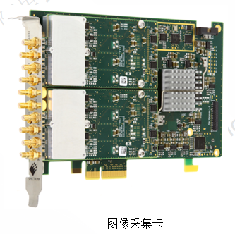

&emsp;&emsp;
同步分离器将同步脉冲从输入的视频信号中分离。水平同步表示新的一行的开始，垂直同步表示新的一场或一帧的开始。通常情况下，在视频信号与图像采集卡连接后，在图像采集卡的工作稳定之前，需要一段时间进行初始化，否则当从一个视频源切换到另一个视频源时，就可能产生错误。为了避免发生长时间的初始化，视频源必须与外部同步，即采用锁相机制。一些图像采集卡带有用于产生同步信号的同步产生器，但这些同步信号是TTL电平，而非视频标准脉冲电平。因此视频源必须能够与TTL信号协同工作。另外还需注意，同步分离器与同步产生器是相互独立的，并且不是直接与视频源相连。尽管图像采集卡这一机器视觉系统中的重要组成部分，正面临着巨大的挑战（采用IEEE 1394或USB 2.0接口的工业相机的出现，让许多机器视觉系统不再需要任何图像采集卡），但就目前的市场而言图像采集卡的价格优势仍是这些新相机所不具备的，因此在未来很长的一段时间里图像采集卡仍将发挥固有的作用。

## 机器视觉的五大研究内容

&emsp;&emsp;
机器视觉研究可以分为五大研究内容:

- **输入设备**
- **低层视觉**
- **中层视觉**
- **高层视觉**
- **体系结构**

&emsp;&emsp;
人们对上述几个研究内容进行了卓有成效的研究，研究出大量的技术和算法，并且在各个领域中得到广泛的应用。

### 输入设备（Input Device）

&emsp;&emsp;
输入设备包括成像设备和数字化设备。成象设备是指通过光学摄像机或红外，激光，超声，X射线对周围场景或物体进行探测成象，得到关于场景或物体的二维或三维数字化图像。获取数字化图像是机器视觉系统的最基本的功能，目前用于视觉研究的大多数输入设备都是商品化产品，如CCD黑白或彩色摄像机，数字扫描仪，超声成象探测仪，CT成象设备等。但这些商品化的输入设备远远不能满足实际需要，因此仍有许多研究人员在研究各种性能先进的成象系统，如红外成象系统，激光成象系统，还有所谓的计算成象系统（Computational Imaging），即每一个像素元(或若干像素元)对应一个简单的处理器，这样可以适应复杂场景动态变化的场合。

### 低层视觉（Low Level）

&emsp;&emsp;
低层视觉主要是对输入的原始图像进行处理。这一过程借用了大量的图像处理技术和算法，如图像滤波、图像增强、边缘检测等，以便从图像中抽取诸如角点，边缘，线条，边界以及色彩等关于场景的基本特征。这一过程还包含了各种图像变换（如校正），图像纹理检测和图像运动检测等。

### 中层视觉（Middle Level）

&emsp;&emsp;
中层视觉的主要任务是恢复场景的深度，表面法线方向和轮廓等有关场景的2.5维信息。实现的途径有立体视觉（Stereovision），测距成像（Rangefinder），运动估计（Motion Estimation），明暗特征和纹理特征等所谓的从X恢复形状的估计方法。系统标定和系统成像模型等研究内容一般也是在这个层次上进行的。

### 高层视觉（High Level）

&emsp;&emsp;
高层视觉的任务是在以物体为中心的坐标系中，在原始输入图像，图像基本特征和2.5维图的基础上，恢复物体的完整三维图，建立物体三维描述，识别三维物体并确定物体的位置和方向。

### 体系结构（System Architecture）

&emsp;&emsp;
体系结构这一术语最通常的含义系指在高度抽象的层次上，根据系统模型而不是根据实现设计的具体例子来研究系统的构。为了说明这一点，可以考虑建筑设计中某一时期的建筑风格（如清朝时期）和根据这一风格设计出来的具体建筑之间的区别。体系结构研究涉及一系列相关的课题：并行结构，分层结构，信息流结构，拓扑结构以及从设计到实现的途径。

## 机器视觉与相关学科的关系

&emsp;&emsp;
与机器视觉有关的学科有许多，本节主要讨论一些与机器视觉密切相关的领域。

### 图像处理 （Image Processing）

&emsp;&emsp;
图像处理通常是把一幅图像变换成另外一幅图像，也就是说图像处理系统的输入是图像，输出也仍然是图像，信息恢复任务则留给人来完成。

### 计算机图形学 （Computer Graphics）

&emsp;&emsp;
计算机图形学通过几何基元，如线，圆和自由曲面等来生成图像。它在可视化（Visualization）和虚拟现实（Virtual Reality）等领域中起着很重要的作用。

### 模式识别 （Pattern Recognition）

&emsp;&emsp;
模式识别研究分类问题，主要用来确定符号，图画和物体等输入对象的类别。强调一类事物区别于其它事物所具有的共同特征，一般不关心三维世界的恢复问题。

### 人工智能 （Artificial Intelligence）

&emsp;&emsp;
人工智能涉及到智能系统的设计和智能计算的研究。在经过图像处理和图像特征提取过程后，接下来要用人工智能方法对场景特征进行表示，并分析和理解场景。

### 人工神经网络（Artificial neural networks, ANNs）

&emsp;&emsp;
人工神经网络是一种信息处理系统，它是由大量简单的处理单元（称为神经元）通过具有强度的连接（Connection）相互联系起来以实现并行分布式处理的一种网络。人工神经网络的最大特点是可以通过改变连接强度来调整系统，使之适应复杂的环境，实现类似人的学习，归纳和分类等功能。人工神经网络已经在许多工程技术领域得到了广泛的应用。神经网络作为一种方法和机制将用于解决机器视觉中的许多问题。

## Marr视觉计算理论

&emsp;&emsp;
20世纪80年代初 ，视觉计算领域创始人Marr 于1982年首次从信息处理的角度综合了图像处理，心理物理学 ，神经生理学及临床神经病学等方面已取得的重要研究成果。提出了第一个较为完善的视觉系统框架 ，使计算机视觉研究有了一个比较明确的体系 。虽然这个理论还需要通过研究不断改进和完善 ，但 Marr 的视觉计算理论是第一个提出的阐述视觉机理的系统理论，并且对人类视觉和计算机视觉的研究都产生了深远的推动作用。下面简要介绍 Marr 视觉理论的基本思想及理论框架。

&emsp;&emsp;
Marr认为视觉是一个信息处理系统，对此系统研究应分为：计算理论层次，表示与算法层次和硬件实现层次三个层次。三层与的对应需解决的问题如下表所示：

| 计算理论层                                    | 表示和算法层                                   | 硬件实现层            |
| :--------------------------------------- | ---------------------------------------- | ---------------- |
| 计算的目的是什么？  为什么这一计算是合适的？ 执行计算的策略是什么？ | 如何实现这个计算？ 输入、输出分别表示的是什么？ 表示与表示之间的变换是什么？ | 在物理上如何实现这些表示和算法？ |

&emsp;&emsp;
根据Marr的理论，计算视觉理论要回答视觉系统的计算目的和策略是什么，或视觉系统的输入和输出是什么以及如何由系统的输入求出系统的输出。在这个层次上，信息系统的特征是将一种信息（输入）映射为另一种信息（输出）。比如系统输入是二维灰度图像，输出则是三维物体的形状，位置和姿态。视觉系统的任务就是如何建立输入输出之间的关系和约束，如何由二维灰度图像恢复物体的三维信息。表示与算法层次是要进一步回答如何表示输入和输出信息，如何实现计算理论所对应的功能的算法，以及如何由一种表示变换成另一种表示，比如创建数据结构和符号。一般来说不同的输入，输出和计算理论，对应不同的表示。而同一种输入，输出或计算理论可能对应着若干种表示。在解决了理论问题和表示问题后，最后一个层次是解决用硬件实现上述表示和算法的问题，比如计算机体系结构及具体的计算装置及其细节。从信息处理的观点来看至关重要的仍是最高层次，即计算理论层次。这是因为构成知觉的计算本质，取决于解决计算问题本身，而不取决于用来解决计算问题的特殊硬件。换句话说通过正确理解待解决问题的本质将有助于理解并创造算法。 如果考虑解决问题的机制和物理实现则可能对理解算法无济于事。

&emsp;&emsp;
视觉表示框架：视觉过程划分为三个阶段：

- **第一阶段：** 将输入的原始图像进行处理，抽取图像中诸如角点，边缘，纹理，线条和边界等基本特征。另外这些特征的集合称为基元图。
- **第二阶段：** 指在以观测者为中心的坐标系中，由输入图像和基元图恢复场景可见部分的深度，法线方向和轮廓等。这些信息的包含了深度信息，但不是真正的物体三维表示，因此称为二维半图。
- **第三阶段：** 在以物体为中心的坐标系中，由输入图像，基元图，二维半图来恢复，表示和识别三维物体。

&emsp;&emsp;
Marr理论是计算机视觉研究领域的划时代成就，但该理论不是十分完善的，许多方面也还具有争议。比如， 该理论所建立的视觉处理框架基本上是自下而上，没有反馈。 另外该理论没有足够地重视知识的应用。尽管如此，Marr理论给了我们研究计算机视觉许多珍贵的哲学思想和研究方法，同时也给计算机视觉研究领域创造了许多研究起点。

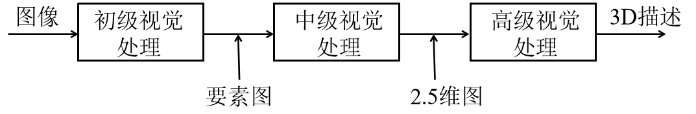
