# 神经网络

## 教学目标
&emsp;&emsp;
通过本章内容的学习，使学生能够掌握神经网络中的基本概念和层次结构，熟悉常见的神经网络类型及其应用领域，熟悉近年来流行的CNN模型层次结构及其特点，了解CNN常用的压缩算法，最后通过一个实践案例实现深度学习的入门。

## 教学安排

- 教学时长（理论4学时）
- 本章知识点：神经网络介绍、CNN经典结构、CNN压缩、CNN实践
- 本章重点：神经网络基础知识、CNN经典结构
- 本章难点：CNN经典结构
- 课后作业：完成本章的课后习题部分

## 教学内容

### 神经网络介绍

&emsp;&emsp;
人工神经网络（Artificial Neural Network，ANN），是20世纪80年代以来人工智能领域兴起的研究热点。它从信息处理角度对人脑神经元网络进行抽象， 建立某种模型，按不同的连接方式组成不同的网络。在工程与学术界也常直接简称为神经网络。最近十多年来，人工神经网络的研究工作不断深入，已经取得了很大的进展，其在模式识别、智能机器人、自动控制、预测估计、生物、医学、经济等领域已成功地解决了许多现代计算机难以解决的实际问题，表现出了良好的智能特性。

&emsp;&emsp;
人工神经网络是一种模仿生物神经网络的结构和功能的数学模型或计算模型，它由大量的人工神经元联结进行计算。生物神经元大致可以分为树突、突触、细胞体和轴突。树突为神经元的输入通道，其功能是将其他神经元的动作电位传递至细胞体。其他神经元的动作电位由位于树突分支上的多个突触传递至树突上。

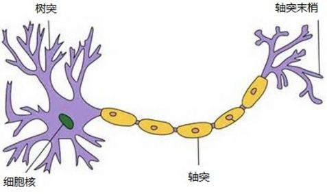

&emsp;&emsp;
神经细胞可以视为有两种状态的机器，激活时为“是”，不激活时为“否”。神经细胞的状态取决于从其他神经细胞接收到的信号量，以及突触的性质（抑制或加强）。当信号量超过某个阈值时，细胞体就会被激活，产生电脉冲。电脉冲沿着轴突并通过突触传递到其它神经元。

&emsp;&emsp;
人工神经元模型的设计灵感正是来源于生物系统。它是一个包含输入、输出与计算功能的模型。输入可以类比为神经元的树突，而输出可以类比为神经元的轴突，计算则可以类比为细胞核。下图是一个典型的神经元模型：包含有3个输入，1个输出，以及2个计算功能。中间的箭头线可以称为“连接”，每条连接都有对应的“权值”。

&emsp;&emsp;
我们使用a来表示输入，用w来表示权值。一个表示连接的有向箭头可以这样理解：在初端，传递的信号大小仍然是a，端中间有加权参数w，经过这个加权后的信号会变成aw，因此在连接的末端，信号的大小就变成了aw。我们将神经元中的所有变量用符号表示，并且写出输出的计算公式。可见z是对输入和权值的线性加权和叠加了一个非线性函数的结果。这里的非线性函数是sgn函数，也就是取符号函数，当输入大于0时，输出1，否则输出0。

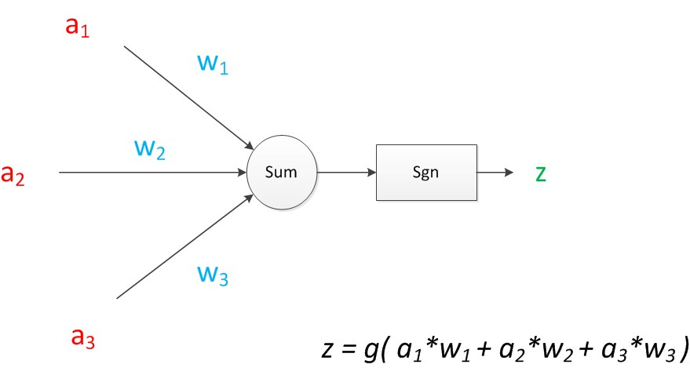

&emsp;&emsp;
神经元可以看作一个计算与存储单元。计算是指神经元对其输入进行计算功能；存储是指神经元会暂存计算结果，并传递到下一层。
	如果将多个神经元按层次联结起来，便可以得到一个全连接网络。自左至右分别是输入层、隐藏层、输出层。层次之间通过权值矩阵联结。

&emsp;&emsp;
人工神经网络模型中常见的类型有以下几种：

- 卷积神经网络（Convolutional Neural Networks，CNN）
- 循环神经网络（Recurrent Neural Network，RNN）
- 生成对抗网络（Generative Adversarial Networks，GAN）

&emsp;&emsp;
在机器视觉领域，应用最广的神经网络模型是CNN，随着其研究的不断深入，被广泛应用于图像识别，图像分割，目标检测，目标追踪等。由于CNN被广泛应用于机器视觉领域，是本课程的核心内容，因此后文将对其进行详细介绍，其他几种类型仅做简单概述。

#### CNN层次结构

&emsp;&emsp;
卷积神经网络与普通神经网络（如前面介绍的全连接网络）的区别在于，卷积神经网络还包含了卷积层和池化层。卷积层的作用是特征提取，池化层的作用是降采样。在此基础上，一个卷积神经网络的层次可以划分为：

- 输入层： 数据输入层主要是对原始数据进行初步处理，使卷积神经网络能有更好的效果。
- 卷积层：  卷积层是卷积神经网络的核心。卷积是数学上的一种计算，而在神经网络中可以理解为一种可以提取图像特征的运算。
- 激活层：卷积和全连接运算是一种线性的运算，而自然中很多的关系都是非线性的，因此，需要给卷积和全连接的计算结果通过一个激活函数加一个非线性的关系。
- 池化层：池化层是对输入的数据进行压缩，提取主要特征的过程。可分为最大池化和平均池化。
- 全连接层： 输入向量与权重矩阵相乘，作线性变换。

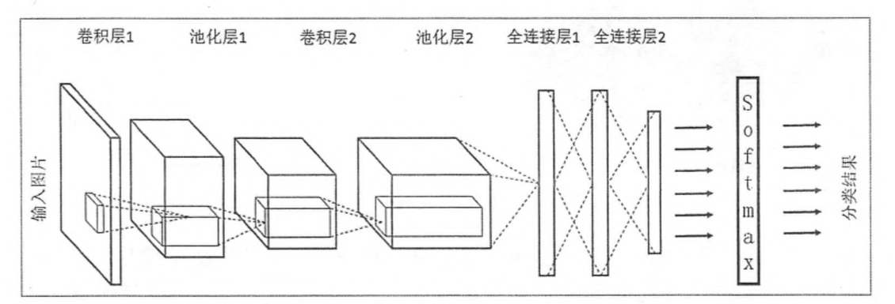

#### 卷积层

&emsp;&emsp;
卷积层的核心是对输入数据进行卷积运算，并将结果传递给下一层。假设输入图像为下图的5 * 5矩阵，其对应的卷积核为一个3 * 3的矩阵。同时，假定卷积操作时每做一次卷积，卷积核移动一个像素位置，即卷积步长（Stride）为1。第一次卷积操作从图像（0，0）像素开始，由卷积核中参数与对应位置图像像素逐位相乘后累加作为一次卷积操作结果。类似地，在步长为1时，卷积核按照步长大小在输入图像上从左至右、自上而下依次将卷积操作进行下去，最终输出3 * 3大小的特征图作为结果，同时该结果将作为下一层操作的输入。

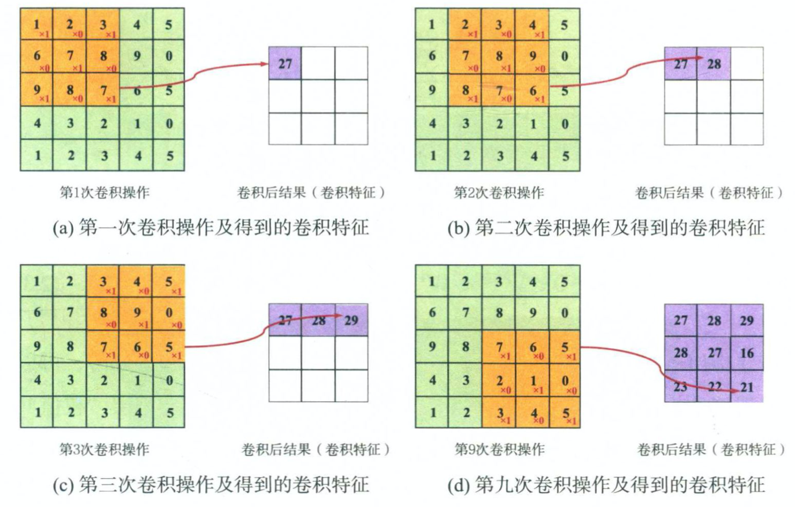

&emsp;&emsp;
在卷积的过程中，出于以下几方面的考虑：

- 为了不过多丢弃原图信息；
- 为了保持特征图的大小与原图一致；
- 为了让更深层依旧保持有足够大的信息量；

&emsp;&emsp;
这时可以采用Padding的方法，即每次卷积前，先给特征图周围都补一圈空白（补0值）。

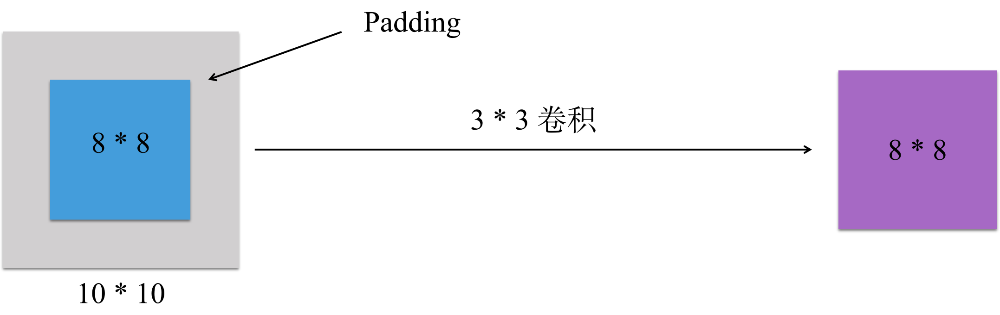

#### 激活层

&emsp;&emsp;
激活层对输入数据施加一个激活函数（非线性函数），目的是增加整个网络的表达能力。否则，若干线性操作层的堆叠仍然只能起到线性映射的作用，无法形成复杂的函数。直观上，激活函数模拟了生物神经元特性：接受一组输入信号并产生输出。在神经科学中，生物神经元通常有一个阈值，当神经元所获得的输入信号累积效果超过了该阈值时，神经元就被激活而处于兴奋状态；否则处于抑制状态。

&emsp;&emsp;
在人工神经网络中，因Sigmoid型函数可以模拟这一生物过程，从而在神经网络发展历史进程中曾处于相当重要的地位。经过Sigmoid型函数作用后，输出响应的值域被压缩到[0，1]之间，而0对应了生物神经元的“抑制状态”，1则恰好对应了“兴奋状态”。

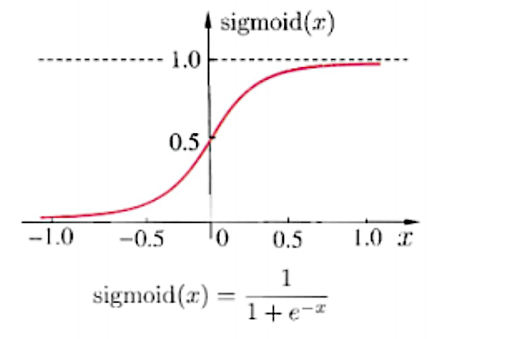

&emsp;&emsp;
在Sigmoid函数两端的值都会被压缩到1或0，如此便带来一个严重问题：“饱和效应”。两端的梯度接近0，这会导致在误差反向传播过程中，导数处于该区域的误差将很难甚至根本无法传递至前层，进而导致整个网络无法训练（导数为0将无法更新网络参数）。此外，在参数初始化的时候还需特别注意，要避免初始化参数直接将输出值域带入这一区域。一种可能的情形是当初始化参数过大时，将直接引发梯度饱和效应而无法训练。

&emsp;&emsp;
在为了避免梯度饱和效应的发生，Nair和Hinton于2010年提出了ReLU函数。ReLU函数是目前深度卷积神经网络中最为常用的激活函数之一。另外，根据ReLU函数改进的其他激活函数也展示出很好的性能。

&emsp;&emsp;
ReLU函数的优点：

- ReLU函数对 x ≥ 0 部分完全消除了Sigmoid型函数的梯度饱和效应。

- 同时，在实验中还发现相比Sigmoid型函数，ReLU函数有助于随机梯度下降方法收敛，收敛速度约快6倍左右。

&emsp;&emsp;
正是由于ReLU函数的这些优秀特性，ReLU函数已成为目前卷积神经网络及其他深度学习模型（如RNN）激活函数的首选之一。其函数图像和梯度图像如下：

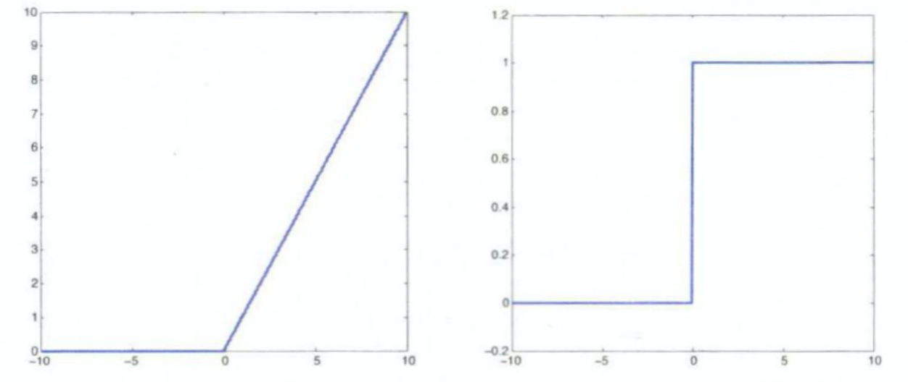

#### 池化层

&emsp;&emsp;
通常使用的池化操作为平均值池化和最大值池化。

- 平均值池化在每次操作时，将池化核覆盖区域中所有值的平均值作为池化结果。

- 最大值池化在每次操作时，将池化核覆盖区域中所有值的最大值作为池化结果。

&emsp;&emsp;
一般也将池化操作称为“汇合”，这更形象地代表了其中的操作过程。同卷积层操作不同，池化层不包含需要学得的参数。下图为2*2大小、步长为1的最大值池化操作示例。

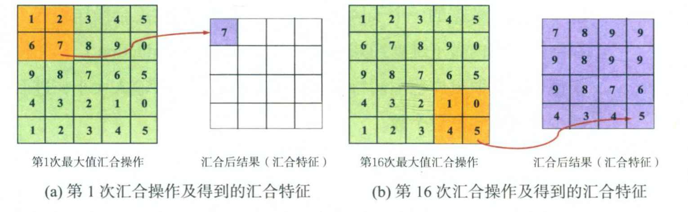

&emsp;&emsp;
池化操作后的特征图尺寸相比其输入减小了，其实池化操作实际上就是一种“降采样”操作。池化层有如下三种功能：

- 特征不变性。池化操作使模型更关注是否存在某些特征而不是特征具体的位置。可将其看作一种很强的先验，使特征学习包含某种程度的自由度，能容忍一些特征微小的位移。
- 特征降维。由于池化操作的降采样作用，池化结果中的一个元素对应于原输入数据的一个子区域，因此池化操作相当于在空间范围内做了维度约减，从而使模型可以抽取更广范围的特征。同时减小了下一层输入大小，进而减少计算量和参数个数。
- 在一定程度上防止过拟合，更方便优化。

#### 全连接层

&emsp;&emsp;
全连接层在整个卷积神经网络中起到“分类器”的作用。全连接层的每一个节点都与上一层每个节点连接，把前一层的输出特征都综合起来，所以该层的权值参数是最多的。

&emsp;&emsp;
全连接层也称为线性层，其实质是输入向量与权重矩阵相乘，作线性变换后起到升维或者降维的作用。如下图所示的网络结构，它只包含一个全连接层。其中x1、x2、x3为全连接层的输入，a1、a2、a3为输出，每一条连接线均对应一个权值w，分别记为w11, w12, ∙∙∙ , w32, w33 。

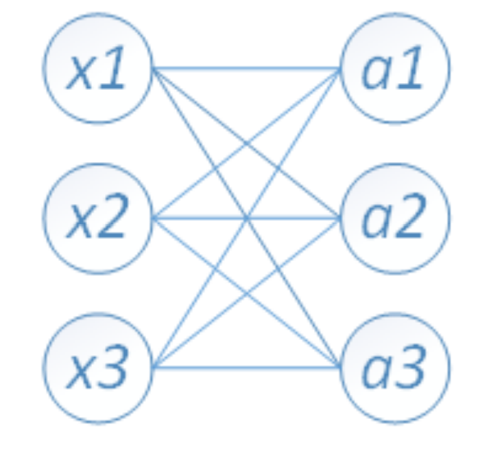

&emsp;&emsp;
其中的计算过程如下：

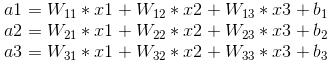

&emsp;&emsp;
可以写成如下矩阵形式：

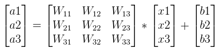

&emsp;&emsp;
如果将多个全连接层串接起来，便可以得到如下图所示的网络结构。输入x1、x2、x3、x4构成了一个四维向量，输出y1、y2、y3构成了一个三维向量。中间经过了6个全连接层，也就是输入向量与6个权重矩阵依次相乘，做了6次线性变换，最终得到输出向量。

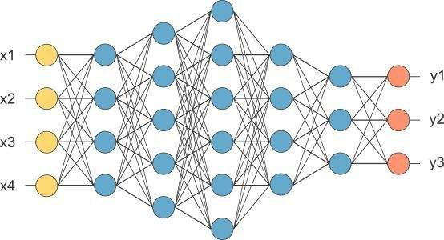

#### 感受野

&emsp;&emsp;
感受野（Receptive Field）原指听觉、视觉等神经系统中一些神经元的特性，即神经元只接受其所支配的刺激区域内的信号。由于现代卷积神经网络拥有多层卷积操作，随着网络深度的加深，后层神经元在输入层的感受野会随之增大。这说明：小卷积核通过多层叠加可取得与大卷积核同等规模的感受野。此外，由于小卷积核需多层叠加，因此加深了网络深度进而增大了网络容量和复杂度。

#### CNN应用

&emsp;&emsp;
CNN目前在图像处理和计算机视觉等领域被广泛应用。根据任务不同，一般可分为图像分类、目标检测、图像分割等。

- 图像分类：是对于一张输入图像，根据内容判定其类别，同时也是视觉领域最基本的任务。
- 图像分割：是指将图像分成若干具有相似性质的区域的过程。简单来说，分割是对图像做像素级别的分类。具体可以分为：
  - 语义分割：是把图像中每个像素赋予一个类别标签，用不同的颜色来表示。
  - 实例分割：不需要对每个像素进行标记，只需要找到感兴趣物体的边缘轮廓。

- 目标检测：即找出图像中所有感兴趣的物体。它包含物体定位和物体分类两个子任务，即同时确定物体的类别和位置。目标检测是计算机视觉和数字图像处理的一个热门方向，广泛应用于机器人导航、智能视频监控、工业检测、航空航天等诸多领域，通过计算机视觉减少对人力资本的消耗，具有重要的现实意义。

#### RNN

&emsp;&emsp;
循环神经网络（Recurrent Neural Network，RNN）是一类用于处理序列数据的神经网络。如时间序列数据，文本序列数据等，这类数据的特点是：序列上前后的数据有着很强的相关性。比如“我喜欢旅游，其中最喜欢的地方是云南，以后有机会一定要去____”。显然空缺了“云南”一词。RNN在自然语言处理（NLP）领域有着广泛的应用，如情感识别、人机对话、机器翻译等。

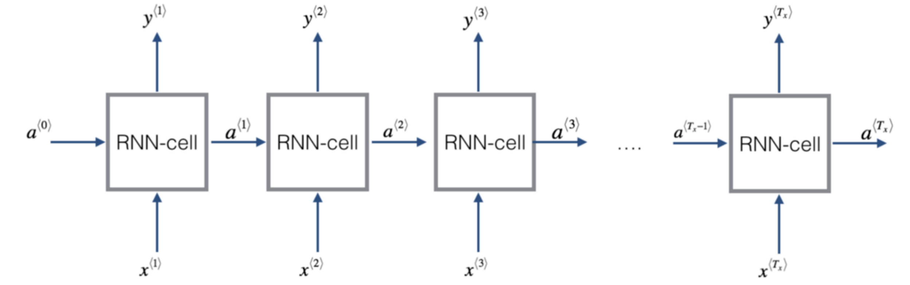

#### GAN

&emsp;&emsp;
相比于传统的神经网络模型，生成对抗网络（GAN）是一种全新的非监督式的架构。GAN包括了两套独立的网络，两者之间作为互相对抗的目标。第一套网络是我们需要训练的分类器（下图中的D），用来分辨是否是真实数据还是虚假数据；第二套网络是生成器（下图中的G），生成类似于真实样本的随机样本，并将其作为假样本。训练后的产物是一个质量较高的自动生成器和一个判断能力较强强的分类器。前者可以用于机器创作，而后者则可以用来机器分类。

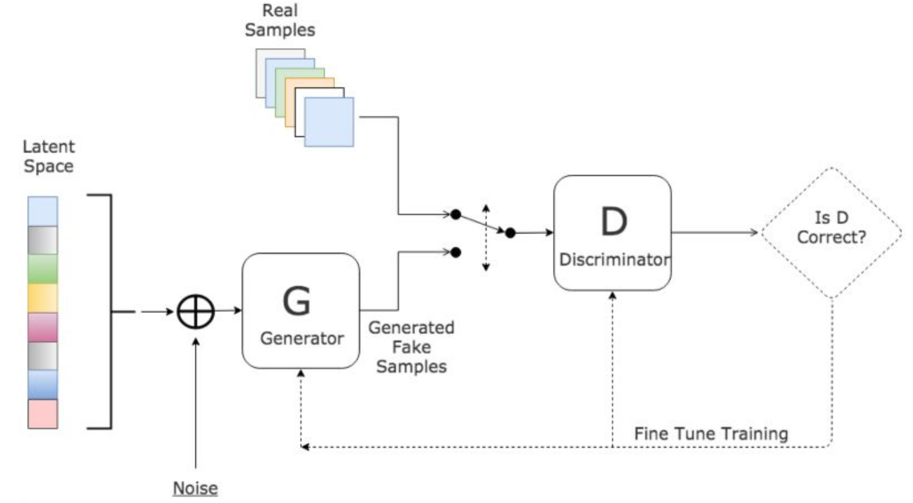

### CNN经典结构

#### LeNet-5

&emsp;&emsp;
LeNet-5是卷积网络用于识别的开山之作，由被誉为“卷积网络之父”的Yann LeCun于1994年提出。虽然这网络结构现在已经很少使用，但是它对后续卷积网络的发展起到了奠基作用。这个网络虽然很小，但是它包含了深度学习的基本模块：卷积层，池化层，全连接层。是其他深度学习模型的基础。同时，其中也体现了前述的设计思想：局部感受野、权值共享、下采样。

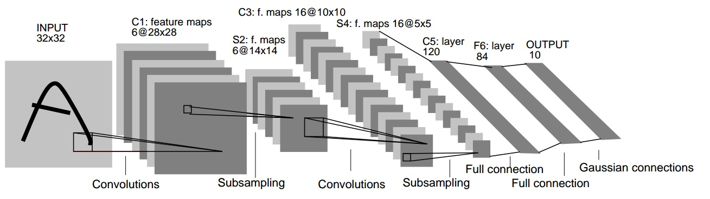

- C1层由6个28 * 28的特征图组成，每个特征图中的任一个元素与该层的输入中一个5 * 5的区域相连接。

- S2层是一个池化层，由6个14 * 14的特征图组成，每一个特征图中元素都

  与C1层中对应的特征图中一个2 * 2的相邻区域相连，相当于图像大小减半，因此卷积后的28 * 28图像经2 * 2池化后就变为14 * 14，而特征图的个数没有改变。 

- C3层由16个10 * 10的特征图组成，卷积核大小为5 * 5。 

- S4池化层与S2层类似，池化单位为2 * 2，该层与C3一样共有16个特征图，每个特征图的大小为5 * 5。 
- C5是一个类似C3的卷积层，核大小为5 * 5，该层由120个1 * 1的特征图组成。
- F6是一个简单的全连接层，它由84个神经元构成。
- 输出层为一个10维向量，对应0-9共10个类别。

#### Alex-Net

&emsp;&emsp;
Alex-Net是计算机视觉领域中首个被广泛关注并使用的卷积神经网络。特别是Alex-Net在2012年ImageNet竞赛中以超越第二名10.9个百分点的优异成绩一举夺冠，从而打响了卷积神经网络乃至深度学习在计算机视觉领域中研究热潮的“第一枪”。Alex-Net由加拿大多伦多大学的Alex Krizhevsky、llya Sutskever 和Geoffrey E. Hinton提出，网络名“Alex-Net” 即取自第一作者名。	

&emsp;&emsp;
2019年3月27日，ACM公布了2018年图灵奖得主——三位深度学习巨头：Geoffrey Hinton、Yann LeCun和Yoshua Bengio。

&emsp;&emsp;
如图所示是Alex-Net的网络结构，共含五层卷积层和三层全连接层。其中，Alex-Net的上下两支是为方便同时使用两片GPU并行训练。对比前节提到的LeNet可以发现，单在网络结构或基本模块方面， Alex-Net的改进非常微小，构建网络的基本思路变化不大，仅在网络深度、复杂度上有较大优势。

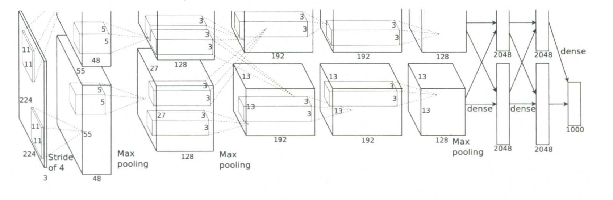

&emsp;&emsp;
Alex-Net的成功之处在于以下几点重大贡献：

- 首次将卷积神经网络应用于计算机视觉领域的海量图像数据集ImageNet（该数据集共计1000类图像，图像总数约128多万张），揭示了卷积神经网络拥有强大的学习能力和表示能力。自此便引发了深度学习、特别是卷积神经网络在计算机视觉领域中“井喷”式的研究。
- 一些训练技巧的引入。如ReLU激活函数、局部响应规范化操作、为防止过拟合而采取的数据增广（Data Augmentation）和随机失活（Dropout）等，这些训练技巧不仅保证了模型性能，更重要的是为后续深度卷积神经网络的构建提供了范本。实际上，此后的卷积神经网络大体都遵循这网络构建的基本思路。
- 利用GPU实现网络训练。在上一轮神经网络研究热潮中，由于计算资源发展受限，研究者无法借助更加高效的计算手段，这也较大程度地阻碍了当时神经网络的研究进程。在Alex-Net中，研究者借助GPU将原本需数周甚至数月的网络训练过程大大缩短至5~6天。这无疑也大大缩短了深度网络和大型网络模型开发研究的周期并降低了时间成本。缩短了迭代周期，正是得益于此，数量繁多、立意新颖的网络模型和应用才能像雨后春笋一般层出不穷。

#### VGG-Nets

&emsp;&emsp;
VGG-Nets由英国牛津大学著名研究组VGG（Visual Geometry Group）提出，是2014年ImageNet竞赛定位任务第一名和分类任务第二名做法中的基础网络。

&emsp;&emsp;
由于VGG-Nets具备良好的泛化性能，因而其在ImageNet数据集上的预训练模型被广泛应用于除最常用的特征抽取外的诸多问题，如物体候选框生成、细粒度图像定位与检索、图像协同定位等。其模型结构如下图：

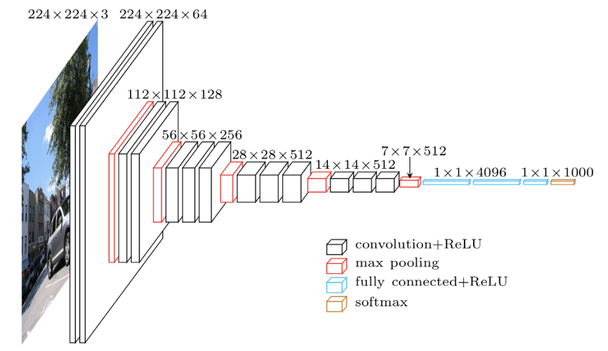

&emsp;&emsp;
相比Alex-Net，VGG-Nets特点：

- 3 * 3小卷积核。
- 通过Padding保持特征图大小。

&emsp;&emsp;
其目的是在增加网络深度时确保各层尺寸随深度增加而不急剧减小。同时，卷积层的通道数也从3→64→128→256→512逐渐增加。

&emsp;&emsp;
如前所述，小卷积核通过多层叠加可取得与大卷积核同等规模的感受野。此外，由于小卷积核需多层叠加，因此加深了网络深度进而增大了网络容量和复杂度。

&emsp;&emsp;
同时，VGG-Nets也存在以下问题：

- 虽然VGG减少了卷积层参数，但实际上其参数空间比Alex Net更大，其中绝大多数的参数都是来自于第一个全连接层，耗费更多计算资源。在随后的NIN中发现将这些全连接层替换为全局平均池化，对于性能影响不大，同时显著降低了参数数量。
- 训练得到的VGG模型，相对其他的方法参数空间很大，所以训练一个VGG模型通常要花费更长的时间，所幸有公开的预训练模型让我们很方便的使用。

#### Network-In-Network

&emsp;&emsp;
Network-In-Network（NIN）是由新加坡国立大学LV实验室提出的异于传统卷积神经网络的一类经典网络模型。

&emsp;&emsp;
线性卷积层的复杂度有限，利用线性卷积进行层间映射也只能将上层特征或输入进行简单的线性组合形成下层特征。因此NIN与其他卷积神经网络的最大差异是用多层感知机（多层全连接层和非线性函数的组合）替代了先前卷积网络中简单的线性卷积层。这样的想法也被后期出现的残差网络和Inception等网络模型所借鉴。

&emsp;&emsp;
具体而言：NIN采用了复杂度更高的多层感知机作为层间映射形式：

- 提供了网络层间映射的一种新可能。
- 增加了网络卷积层的非线性能力，使得上层特征可以更复杂地被映射到下层。

&emsp;&emsp;
相对先前卷积网络来讲，NIN在模型可解释性上的一个优势：NIN模型摒弃了全连接层作为分类层的传统，改用全局平均池化操作。NIN最后一层共有C张特征图，分别对应分类任务的C个类别。全局池化操作分别作用于每张特征图，最后将池化结果映射到样本真实标记。其模型结构如下：

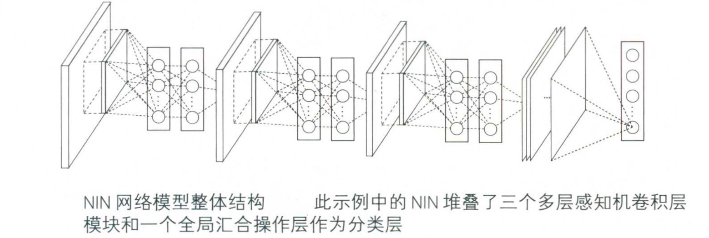

#### ResNet

&emsp;&emsp;
ResNet（Residual Neural Network）由微软研究院的Kaiming He等四名华人提出。其通过使用ResNet Unit成功训练出了152层的神经网络，并在ILSVRC 2015比赛中取得冠军，在top5上的错误率为3.57%，同时参数量比VGG-Nets低，效果非常突出。

&emsp;&emsp;
ResNet的结构可以极快的加速神经网络的训练，模型的准确率也有比较大的提升。同时ResNet的推广性非常好，甚至可以直接用到Inception Net网络中。

&emsp;&emsp;
ResNet的主要思想是在网络中增加了直连通道（也称Shortcut）。此前的网络结构是对输入做一个非线性变换，而ResNet允许原始输入信息直接传到后面的层中。

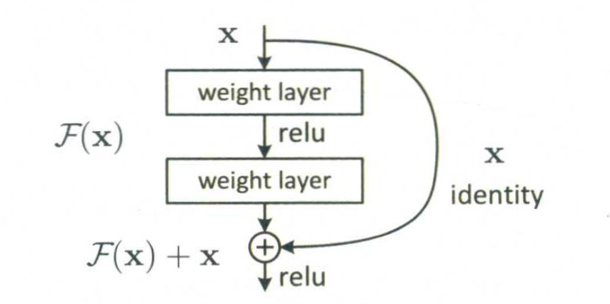

&emsp;&emsp;
设计出发点：随着深度的增加，训练会变得愈加困难。这主要是因为在基于随机梯度下降的网络训练过程中，误差信号的多层反向传播非常容易引发梯度“弥散”（梯度过小会使回传的训练误差极其微弱）或者“爆炸”（梯度过大会导致模型训练出现NaN）现象。ResNet通过直接将输入信息绕道传到输出，保护信息的完整性，整个网络只需要学习输入、输出差别的那一部分（残差），简化学习目标和难度。

&emsp;&emsp;
网络结构：用到两种残差模块:

- 一种是以两个3 * 3的卷积网络串接在一起作为一个残差模块。*
- 另外一种是1 * 1、3 * 3、1 * 1的3个卷积网络串接在一起作为一个残差模块。

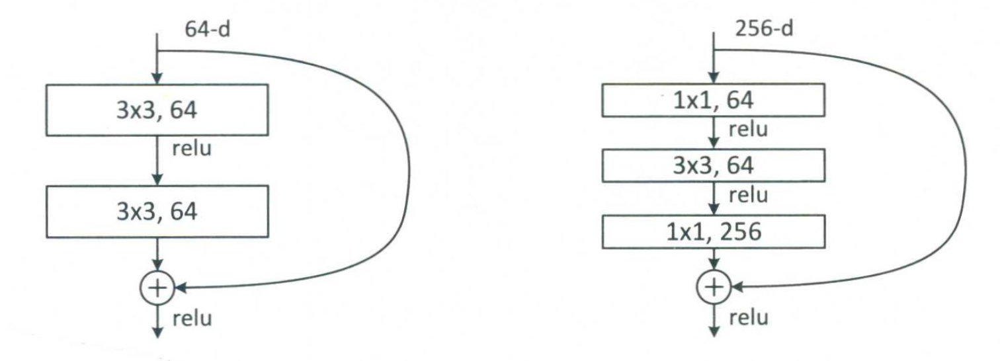

&emsp;&emsp;
ResNet整体模型有几种不同版本，也即层数规模不同。比较常用的是50-layer，101-layer，152-layer。它们都是由上述的残差模块堆叠在一起实现的。

&emsp;&emsp;
相比于VGG：残差网络以全局平均池化替代了VGG网络结构中的全连接层。这样的优势在于：

- 使得参数大大减少；
- 降低了过拟合风险。

#### MobileNet V1

&emsp;&emsp;
Mobile Net由谷歌在2017年提出，是一款专注于在移动设备和嵌入式设备上的轻量级神经网络，并迅速衍生了 v1，v2，v3 三个版本。相比于传统的 CNN 网络，具有轻量级，低时延的特点。

&emsp;&emsp;
其设计的关键点在于：深度可分离（ Depthwise Separable）卷积，把一步标准的卷积分成两步  Depthwise卷积 + Pointwise卷积。这样的效果是：在准确率小幅降低的前提下，大大减小模型参数和运算量（减小到 1/8 左右）。

- Depthwise卷积：前述的卷积运算实际上作用在了多个通道。Depthwise是指不跨通道的卷积。这样，特征图的每个通道有一个独立的卷积核，并且这个卷积核仅作用在这个通道之上。

- Pointwise卷积：就是用1 * 1的卷积核进行卷积，作用是对Depthwise卷积后的特征进行升维或降维。对于每个像素点：其实就是各通道数值加权求和。

&emsp;&emsp;
前述卷积可称为标准卷积，而Mobile Net V1中提出了深度可分离（ Depthwise Separable）卷积，二者对比如图：

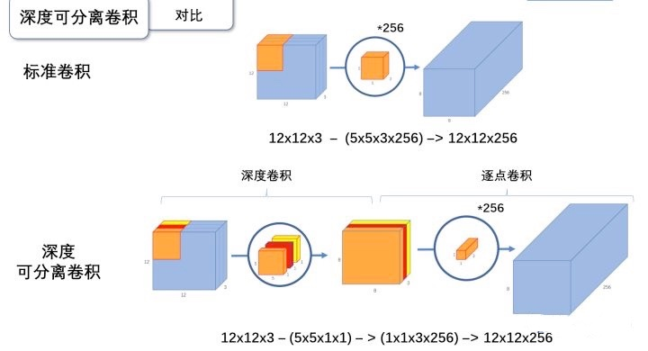

#### MobileNet V2

&emsp;&emsp;
2018年，谷歌提出了MobileNet V2。MobileNet V2是对V1版本的改进，同样是一个轻量化卷积神经网络。改进的出发点在于MobileNet V1中存在的两个问题：

- 由于Depthwise卷积本身的计算特性，决定了其没有改变通道数的能力。因此如果上一层输出的通道数很少，Depthwise部分也只能在低维空间提取特征，因此效果不够好。
- Depthwise卷积部分的卷积核容易失效，也即训练完以后发现卷积核参数值大量为0，作者认为这是由于ReLU激活函数所导致。

&emsp;&emsp;
针对这两点问题，作者分别进行了改进，并分别称为逆残差结构（Inverted Residuals）和线性瓶颈结构（Linear Bottlenecks）。

&emsp;&emsp;
逆残差结构（Inverted Residuals）：我们已经知道Pointwise卷积可以改变通道数，也就是可以用来升维和降维。因此可以在Depthwise卷积之前添加一层Pointwise卷积来增加通道数，在一个更高维的空间中进行Depthwise卷积操作来提取特征。前面已经提到ResNet使用了残差结构，其中进行了通道压缩、卷积提取特征、通道扩张。而在V2中则分别进行了通道扩张、卷积提取特征、通道压缩。这与ResNet中的过程相反，因此称为逆残差结构，对比如下图：

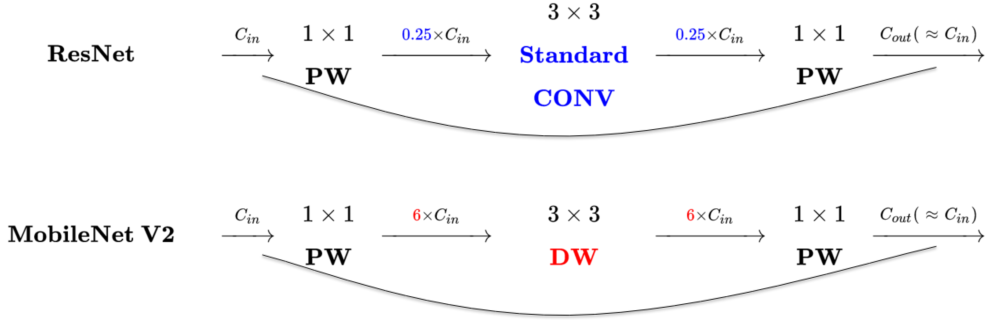

&emsp;&emsp;
线性瓶颈（Linear Bottlenecks）：在高维空间上，ReLU激活函数能有效增加特征的非线性表达，但是仅限于高维空间中。如果降低维度，再使用ReLU则会破坏特征，因此在MobileNet V2中提出了Linear Bottlenecks结构，也就是在执行了降维的Pointwise卷积层后面，不再加入类似 ReLU等激活函数进行非线性转化，而是直接线性输出，这样做的目的是尽可能不造成信息丢失。

&emsp;&emsp;
综合前述的逆残差结构，V2相对于V1的整体改进如下图：

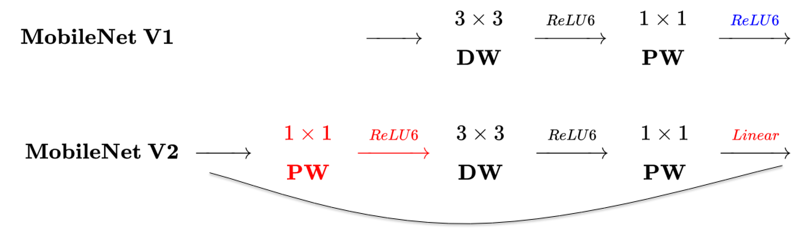

&emsp;&emsp;
MobileNet V2的模型结构如图，可以看到主体部分是Bottleneck结构的堆叠。

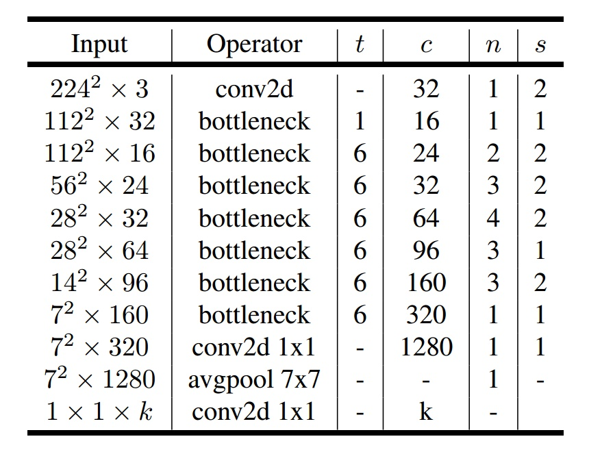

#### MobileNet V3

&emsp;&emsp;
MobileNet V3是谷歌在2019年提出的网络架构，同样是在V1和V2的基础上改进得到的轻量级卷积神经网络。其中的主要改进点在于：

- 对于V2的尾部结构进行改进，在V2中全局平均池化层之前是一个1 * 1卷积层用来增加通道数，因此就能得到更高维度的特征，供分类层使用，但是同时也引入了额外的计算成本与延时。在V3中将该1 * 1卷积层移到了全局平均池化层的后面。同时V3也删减了部分层次，如下图。

  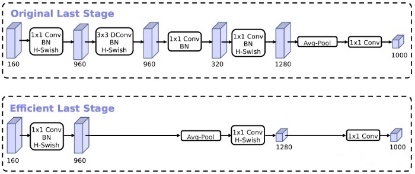

- 引入了基于Squeeze-and-Excitation结构的轻量级注意力模型（SE模块），放在Depthwise卷积层之后。其目的是通过这样的注意力机制，使网络自动学习到每个特征通道的重要程度（权重），如下图红色框部分。

  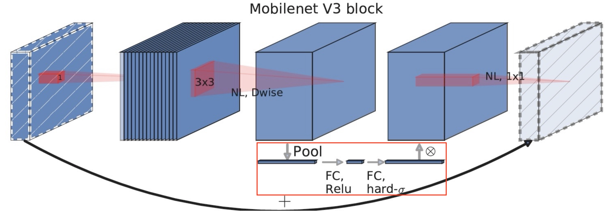

- 引入新的H-Swish激活函数，它是最近的Swish函数的改进版本，计算速度更快，更易于量化，精度上没有明显差异，且网络越深越能够有效的减少网络参数量。

  ​												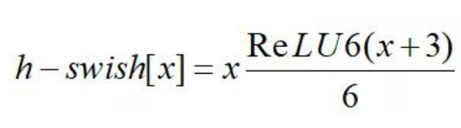

&emsp;&emsp;
经过这些调整，MobileNet V3的模型结构如下：

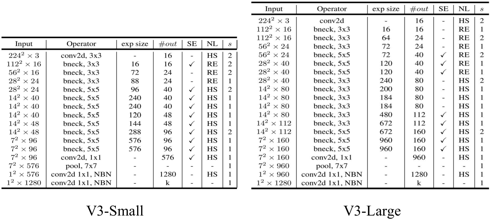

#### 目标检测模型

&emsp;&emsp;
目标检测：是一项实际且具有挑战性的计算机视觉任务，其可以看作图像分类与定位的结合，给定一张图片，目标检测系统要能够识别出特定的目标并给出其位置。由于图片中目标数是不定的，且要给出目标的精确位置，因此目标检测相比分类任务更复杂。近几年来，目标检测算法取得了很大的突破，比较流行的算法可以分为两类。

- 一类是基于候选框（Region Proposal）的二阶段（Two Stage）算法，这需要先使用启发式方法或者CNN网络产生候选框，然后再在候选框上做分类与回归。这类算法的特点是准确度高，但是速度慢。
- 另一类是YOLO、SSD为代表的单阶段（One Stage）算法，其仅仅使用一个CNN网络直接预测目标的类别与位置。其主要思路是均匀地在图片的不同位置进行密集抽样，抽样时可以采用不同尺度和长宽比，然后利用CNN提取特征后直接进行分类与回归。这类算法的特点是速度快，但是准确性要低一些。

&emsp;&emsp;
YOLO算法的全称是You Only Look Once: Unified, Real-Time Object Detection，其只需要一次CNN运算即可完成端到端的目标检测任务，而实时（Real-Time）体现的是YOLO算法相较于之前的检测算法速度更快。整个系统如下图所示，首先将输入图片调整大小，然后送入CNN网络，最后处理网络预测结果得到检测的目标。

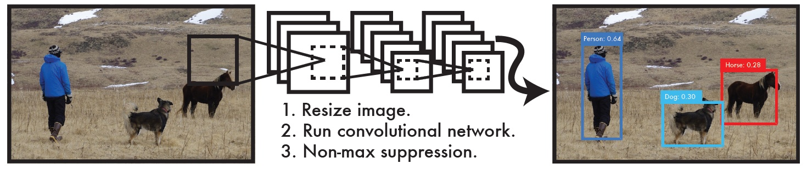

&emsp;&emsp;
具体来说，YOLO的CNN网络将输入的图片分割成若干网格，然后每个单元格负责去检测那些中心点落在该格子内的目标。如下图所示，可以看到狗这个目标的中心落在左下角一个单元格内，那么该单元格负责预测狗目标。每个单元格会预测产生边界框（Bounding Box）以及边界框的置信度。置信度包含两个方面，一是这个边界框含有目标的可能性大小，二是这个边界框的准确度。

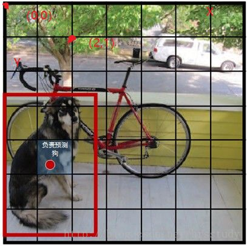

&emsp;&emsp;
YOLO采用卷积网络来提取特征，然后使用全连接层来得到预测值。网络结构参考GoogLeNet模型，包含24个卷积层和2个全连接层。其整体结构如下图：

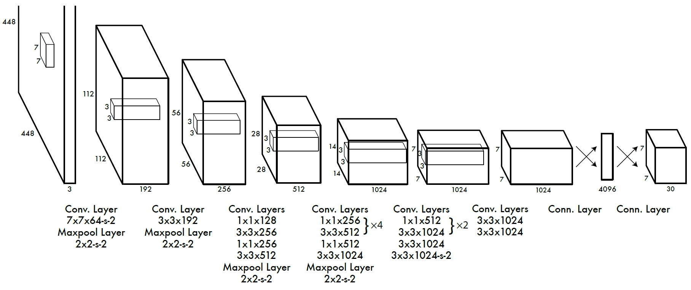

&emsp;&emsp;
SSD算法（Single Shot MultiBox Detector）同样是单阶段的目标检测算法。SSD采用VGG-16作为基础模型并新增了部分卷积层来获得更多的特征图以用于检测。相比YOLO，SSD主要有以下不同：

- 在YOLO中，每个单元预测多个边界框，但是真实目标的形状是多变的，YOLO需要在训练过程中自适应目标的形状。而SSD在每个特征图单元设置长宽比不同的先验框，预测的边界框是以这些先验框为基准的，在一定程度上减少训练难度。如下图，每个单元使用了4个不同的先验框，图片中猫和狗分别采用最适合它们形状的先验框来进行训练。

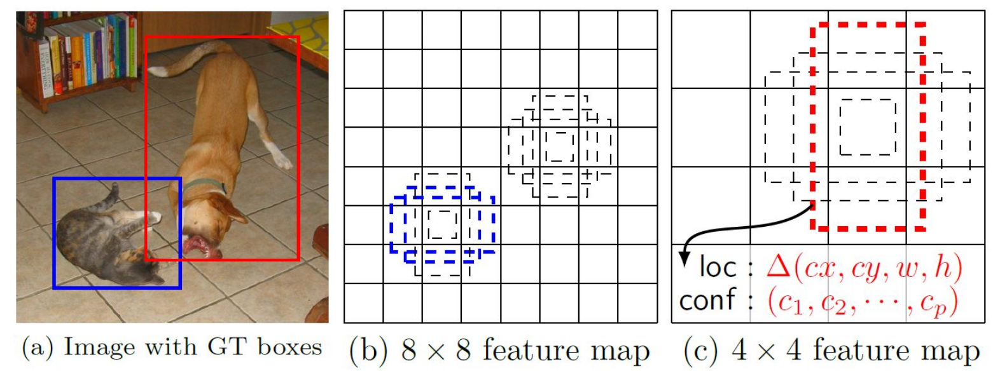

- SSD是一个全卷积网络，没有全连接层，而YOLO在卷积层后接有全连接层以进行检测。在模型结构不同的基础上，YOLO在检测时只利用了最高层特征图信息。而SSD采用金字塔结构，通过提取不同尺度的特征图来做检测，大尺度特征图（模型前部）可以用来检测小物体，而小尺度特征图（模型后部）用来检测大物体。对比如下：

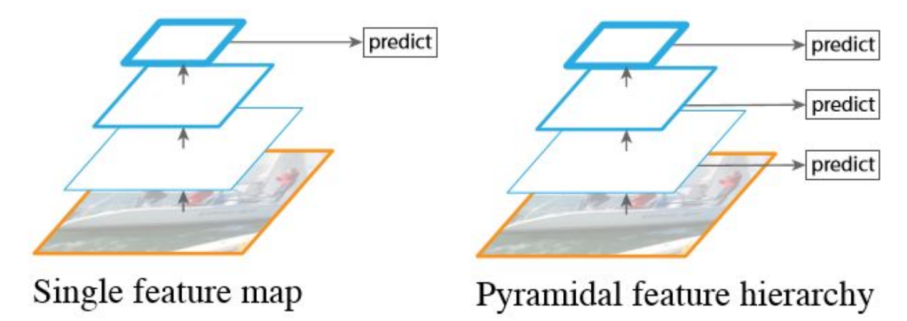

&emsp;&emsp;
结合前述的VGG网络模型以及SSD和YOLO之间的区别，二者模型结构对比如下图：

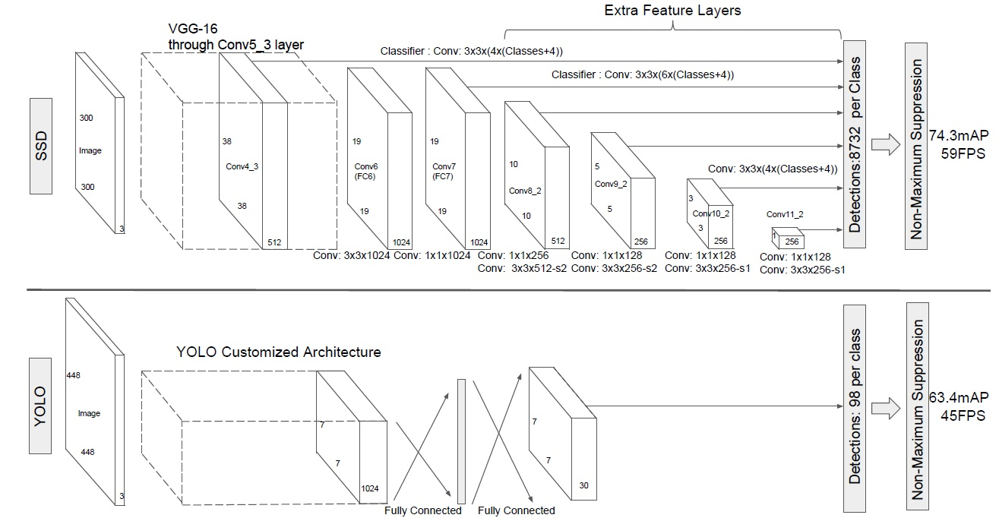

### CNN压缩

&emsp;&emsp;
尽管CNN在计算机视觉、自然语言处理等领域均取得了极佳的效果，但其动辄过亿的参数数量却使得诸多实际应用（特别是基于嵌入式设备的应用）望而却步。以经典的VGG-16网络为例：

- 其参数数量达到了1亿3千多万。
- 占用逾500MB的磁盘存储空间。
- 需要进行309亿次浮点运算才能完成一张图像的识别任务。

&emsp;&emsp;
如此巨大的存储代价以及计算开销，严重制约了深度网络在移动端等小型设备上的应用。另一方面，许多研究表明，深度神经网络面临着严重的过参数化（Over-Parameterization），即模型内部参数存在着巨大的冗余。

&emsp;&emsp;
研究发现，只给定很小一部分的参数子集（约全部参数量的5%），便能完整重构出剩余的参数，从而揭示了模型压缩的可行性。

&emsp;&emsp;
鉴于此，神经网络的压缩逐渐成为当下深度学习领域的热门研究课题。研究者们提出了各种新颖的算法，在追求模型高准确度的同时，尽可能降低其复杂度，以期达到性能与开销上的平衡。

&emsp;&emsp;
按照压缩过程对网络结构的破坏程度，将模型压缩技术分为“前端压缩”与“后端压缩”。

&emsp;&emsp;
所谓“前端压缩”，是指不改变原网络结构的压缩技术。主要包括：

- 知识蒸馏。
- 紧凑化的模型结构设计。
- 卷积核层面的剪枝。

&emsp;&emsp;
“后端压缩”其目标在于尽可能减小模型大小，因而会对原始网络结构造成大程度的改造。压缩方法主要包括：

- 低秩近似
- 未加限制的剪枝
- 参数量化
- 二值网络。

&emsp;&emsp;
两类压缩技术对比：由于“前端压缩”未改变原有的网络结构，仅仅只是在原模型的基础上减少了网络的层数或者滤波器的个数，其最终的模型可完美适配现有的深度学习库。

&emsp;&emsp;
相比之下，“后端压缩”为了追求极致的压缩比，对原有的网络结构进行改造，如对参数进行量化表示等，这样的改造往往是不可逆的。同时，为了获得理想的压缩效果，必须开发相配套的运行库，甚至是专门的硬件设备，其最终的结果往往是一种压缩技术对应于一套运行库，从而带来了巨大的维护成本。

&emsp;&emsp;
当然，上述两种压缩策略并不存在绝对的好与坏，各种方法均有其各自的适应场景。同时，两种压缩技术可以相互结合，能够在最大程度上降低模型的复杂度。

#### CNN剪枝

&emsp;&emsp;
给定一个预训练好的网络模型，常用的剪枝算法一般都遵从如下的操作流程：

1. 衡量神经元的重要程度，这也是剪枝算法中最重要的核心步骤。根据剪枝粒度的不同，神经元的定义可以是一个权重连接，也可以是整个滤波器。衡量其重要程度的方法也是多种多样的，从一些基本的启发式算法，到基于梯度的方案，它们的计算复杂度与最终的效果也是各有千秋。
2. 移除掉一部分不重要的神经元。根据上一步的衡量结果，剪除掉部分神经元。这里可以根据某个阈值来判断神经元是否可以被剪除，也可以按重要程度排序，剪除掉一定比例的神经元。一般而言，后者比前者更加简便，灵活性也更高。
3. 对网络进行微调。由于剪枝操作会不可避免地影响网络的精度，为防止对分类性能造成过大的破坏，需要对剪枝后的模型进行微调。对于大规模图像数据集，微调会占用大量的计算资源。因此，对网络微调到什么程度，也是一件需要斟酌的事情。
4. 返回第1步，进行下一轮剪枝。

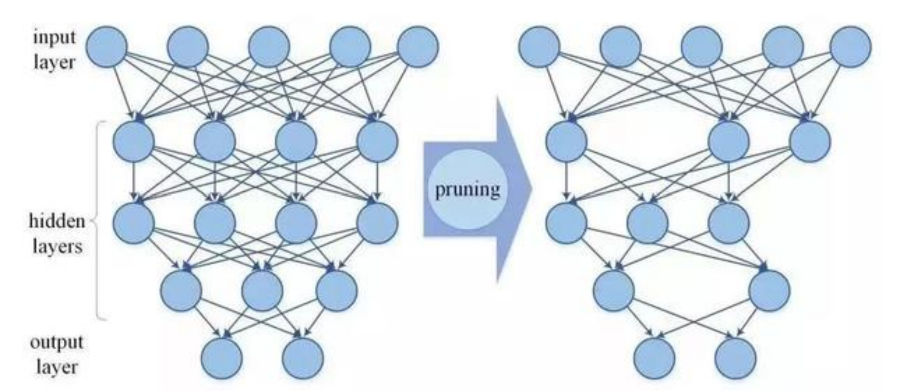

&emsp;&emsp;
剪枝是一项有效减小模型复杂度的通用压缩技术，其关键是如何衡量个别权重对于整体模型的重要程度。在这个问题上，人们对各种权重选择策略也是众说纷纭。尤其是对于深度学习，几乎不可能从理论上确保某一选择策略是最优的。

&emsp;&emsp;
另一方面，由于剪枝操作对网络结构的破坏程度极小，这种良好的特性往往被用于网络压缩过程的前端处理。将剪枝与其他后端压缩技术相结合，能够达到网络模型的最大程度压缩。

#### 参数量化

&emsp;&emsp;
相比于剪枝操作，参数量化则是一种常用的后端压缩技术。所谓“量化”，是指从权重中归纳出若干“代表”，由这些“代表”表示某一类权重的具体数值。“代表”被存储在码本（Codebook）中，而原权重矩阵只需记录各自“代表”的索引即可，从而极大地降低了存储开销。其中，最简单也是最基本的一种量化算法便是标量量化。

&emsp;&emsp;
该方法的基本思路是，对于每一个权重矩阵，首先将其转化为向量形式。之后对该权重向量的元素进行k个簇的聚类，这可借助于经典的K-Means聚类算法快速完成。

&emsp;&emsp;
这样，只需将k个聚类中心存储在码本之中即可，而原权重矩阵则只负责记录各自聚类中心在码本中的索引。如果不考虑码本的存储开销，则该算法能将存储空间减小为原来的logk/32。

&emsp;&emsp;
基于K-Means聚类算法的标量量化不仅简单，在很多应用中也非常有效，在保持网络性能不受显著影响的情况下，可将模型大小减小8~16倍。其不足之处在于，当压缩率比较大时很容易造成分类精度的大幅下降。

&emsp;&emsp;
对于下图所示的权重矩阵，首先对所有的权重值进行聚类。取k=4，可获得4个聚类中心，并将其存储在码本之中，而原矩阵只负责记录相应的索引。4个聚类中心只需2个比特位即可，从而极大地降低了存储开销。

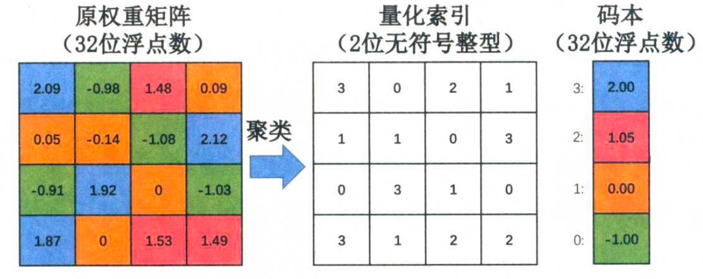

### CNN实践

&emsp;&emsp;
MNIST手写数字识别堪称CNN入门的“Hello World”。下面，我们将在PyTorch深度学习框架中构建一个简单的卷积神经网络（LeNet-5），并使用MNIST数据集训练它识别手写数字。

&emsp;&emsp;
MNIST包含7万张手写数字图像：6万张用于训练，1万张用于测试。每一张图像是单通道灰度图，28 * 28像素且居中，以减少预处理和加快运行。

&emsp;&emsp;
本章侧重于理论教学，关于PyTorch环境搭建，请详见官方文档。(https://pytorch.org/get-started/locally/)

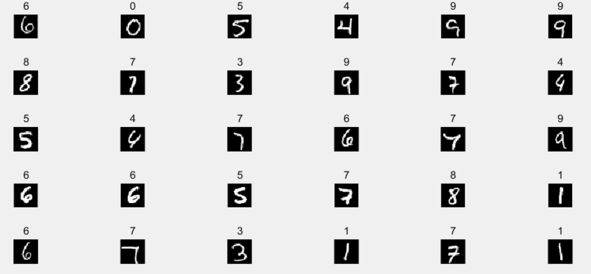

&emsp;&emsp;
首先，导入以下Python模块。其中PyTorch框架自带了MNIST数据集；torchvision.transforms库中包含了一些对图像预处理的工具类；NumPy是一个扩展程序库，支持维度数组与矩阵运算，此外也针对数组运算提供大量的数学函数。

```python
from torchvision.datasets import MNIST
from torchvision.transforms import ToTensor, Compose, Normalize
from torch.utils.data import DataLoader
import torch
import torch.nn.functional as F
import torch.nn as nn
import os
import numpy as np
```

&emsp;&emsp;
下面准备数据集。这其中包括了归一化和转为张量（Tensor）两步预处理。预处理以后，将得到实例data_loader，对其进行迭代可获得每一张图像。

```python
path = './data'

# 使用Compose 将tensor化和正则化操作打包
transform_fn = Compose([
    ToTensor(),
    Normalize(mean=(0.1307,), std=(0.3081,))
])
mnist_dataset = MNIST(root=path, train=True, transform=transform_fn)

data_loader = torch.utils.data.DataLoader(dataset=mnist_dataset, batch_size=2, shuffle=True)

# 1. 构建函数,数据集预处理
BATCH_SIZE = 128
TEST_BATCH_SIZE = 1000
def get_dataloader(train=True, batch_size=BATCH_SIZE):
    '''
    train=True, 获取训练集
    train=False 获取测试集
    '''
    transform_fn = Compose([
        ToTensor(),
        Normalize(mean=(0.1307,), std=(0.3081,))
    ])
    dataset = MNIST(root='./data', train=train, transform=transform_fn)
    data_loader = DataLoader(dataset=dataset, batch_size=BATCH_SIZE, shuffle=True)
    return data_loader
```

&emsp;&emsp;
按照前述的LeNet-5模型的层次结构，构建模型。如图：

```python
class MnistModel(torch.nn.Module):
    def __init__(self):
        super(MnistModel, self).__init__()
        self.conv1 = torch.nn.Conv2d(kernel_size=5, in_channels=1, out_channels=6)
        self.pooling = torch.nn.MaxPool2d(2)
        self.conv2 = torch.nn.Conv2d(kernel_size=5, in_channels=6, out_channels=16)
        self.fc1 = torch.nn.Linear(256, 120)
        self.fc2 = torch.nn.Linear(120, 84)
        self.fc3 = torch.nn.Linear(84, 10)

    def forward(self, x):
        x = torch.relu(self.pooling(self.conv1(x)))
        x = torch.relu(self.pooling(self.conv2(x)))
        x = x.view(-1, 256)
        x = torch.relu(self.fc1(x))
        x = torch.relu(self.fc2(x))
        return self.fc3(x)
```

&emsp;&emsp;
构建好模型以后，即可进行训练，同时还将打印损失的下降过程。

```python
mnist_model = MnistModel()
optimizer = torch.optim.Adam(params=mnist_model.parameters(), lr=0.001)

# 如果有模型则加载
if os.path.exists('./model'):
    mnist_model.load_state_dict(torch.load('model/mnist_model.pkl'))
    optimizer.load_state_dict(torch.load('model/optimizer.pkl'))
    
    def train(epoch):
    data_loader = get_dataloader()
    
    for index, (data, target) in enumerate(data_loader):
        optimizer.zero_grad()  # 梯度先清零
        output = mnist_model(data)
        loss = F.nll_loss(output, target)
        loss.backward()  # 误差反向传播计算
        optimizer.step()  # 更新梯度
        
        if index % 100 == 0:
            # 保存训练模型
            torch.save(mnist_model.state_dict(), 'model/mnist_model.pkl')
            torch.save(optimizer.state_dict(), 'model/optimizer.pkl')
            print('Train Epoch: {} [{}/{} ({:.0f}%)]\tLoss: {:.6f}'.format(
                epoch, index * len(data), len(data_loader.dataset),
                       100. * index / len(data_loader), loss.item()))
                       
for i in range(epoch=5):
    train(i)
```

&emsp;&emsp;
模型训练完成后，通过其在测试集上的分类准确率来评估其性能。可以看到，虽然LeNet-5结构简单，但却可以达到约96%的准确率。这也说明了CNN具有很强的特征提取能力。

```python
def test():
    loss_list = []
    acc_list = []
    
    test_loader = get_dataloader(train=False, batch_size = TEST_BATCH_SIZE)
    mnist_model.eval()  # 设为评估模式
    
    for index, (data, target) in enumerate(test_loader):
        with torch.no_grad():
            out = mnist_model(data)
            loss = F.nll_loss(out, target)
            loss_list.append(loss)
            
            pred = out.data.max(1)[1]
            acc = pred.eq(target).float().mean()  # eq()函数用于将两个tensor中的元素对比，返回布尔值
            acc_list.append(acc)
           
        
    print('平均准确率, 平均损失', np.mean(acc_list), np.mean(loss_list))

test()
# 平均准确率, 平均损失 0.9662777 0.12309619
```

例如：对于一张包含数字4的图像，其经过卷积提取特征、池化下采样、全连接维度压缩这一系列过程，最终得到的10维向量在4号位置响应值最大，即成功对数字4进行分类。如下图：

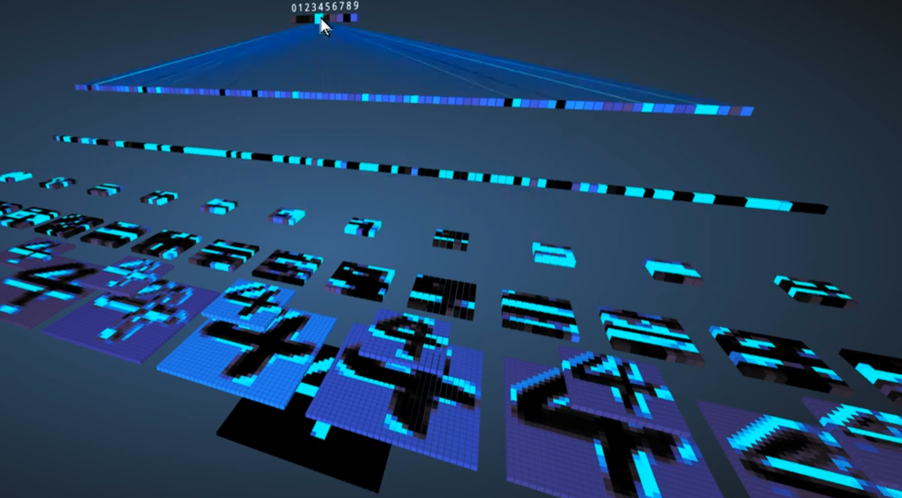

