# 算法调优理论

## 性能调优

&emsp;&emsp;
不管是在实际工程中进行部署还是参加竞赛，我们训练神经网络的目的都是得到一个表现优异的模型。而获得一个优秀的模型需要考虑许多方面的影响：

+ 首先是使用哪种类型的模型——是线性回归，SVM还是CNN？

+ 其次是该模型中要包含哪些自变量（也称为特征选择）；
+ 完成这些任务后，要考虑的第三个方面是超参数调整，目的是找到所要使用的最佳超参数。

&emsp;&emsp;
这就是为什么我们应该关心超参数调整的原因：就像模型选择或特征选择一样，它具有极大地提高模型准确性的能力。

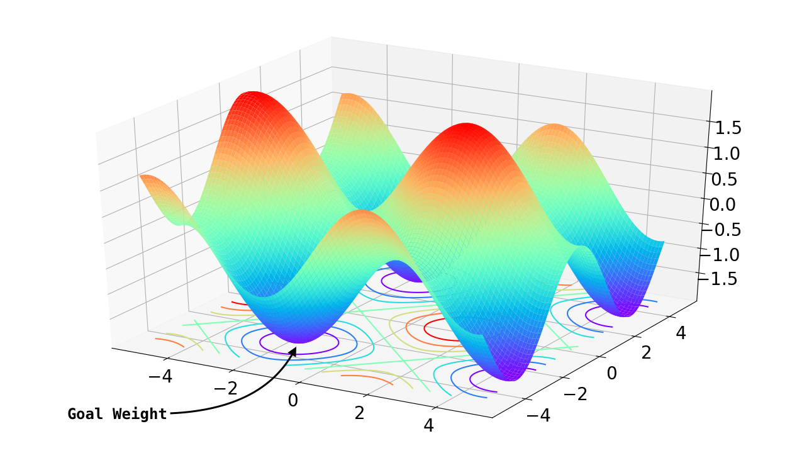

&emsp;&emsp;
**参数**：我们知道机器学习其实就是机器通过某种算法学习数据的计算过程，通过学习得到的模型本质上是一些列数字，如树模型每个节点上判断属于左右子树的一个数，或者逻辑回归模型里的一维数组，这些都称为模型的参数（Parameter）；

&emsp;&emsp;
**超参数**：那么定义模型属性或者定义训练过程的参数，我们称为超参数（Hyperparameter），例如我们定义一个神经网络模型有9527层网络并且都用RELU作为激活函数，这个9527层和RELU激活函数就是一组超参数，又例如我们定义这个模型使用RMSProp优化算法和learning rate为0.01，那么这两个控制训练过程的属性也是超参数。

&emsp;&emsp;
简而言之：通过训练模型找到参数；训练前由数据科学家设置超参数。

## 超参数调优

&emsp;&emsp;
那么如何选择合适的超参数呢？常用的调优方法有如下几种：

&emsp;&emsp;
**数据增广**：无论添加的是新样本还是噪声，增加数据始终是非常简便和有效的方法。如果没有办法快速获得大量新的数据，对已有数据进行进一步处理也是可行的。

&emsp;&emsp;
**批次大小**：批次大小（Batch Size）是指一次迭代中使用的训练样本的数量。尤其是在CNN中，网络模型对批次大小的调整十分敏感。

&emsp;&emsp;
**学习率**：学习率（Learning Rate）是指在优化算法中更新网络权重的幅度大小。学习率可以是恒定的、逐渐降低的、基于动量的或者是自适应的，采用哪种学习率取决于所选择优化算法的类型，如SGD、Adam、Adagrad、AdaDelta或RMSProp等算法。

&emsp;&emsp;
**epoch**：当一个完整的数据集通过了神经网络一次并且返回了一次，这个过程称为一次epoch。也就是说所有训练样本在神经网络中都进行了一次正向传播和一次反向传播，再通俗一点，一个epoch就是将所有训练样本训练一次的过程。

&emsp;&emsp;
**激活函数**：在多层神经网络中，上层节点的输出和下层节点的输入之间具有一个函数关系，这个函数称为激活函数（Activation Function），激活函数用于在网络中引入非线性。常用的激活函数有Sigmoid，tanh，ReLU以及它们的变体等。

&emsp;&emsp;
**正则化**：正则化（Regularization）是一种为了减小测试误差的行为（有时候会增加训练误差）。我们在构造机器学习模型时，最终目的是让模型在面对新数据的时候，可以有很好的表现。当我们用比较复杂的模型比如神经网络，去拟合数据时，很容易出现过拟合现象（训练集表现很好，测试集表现较差），这会导致模型的泛化能力下降，这时候，我们就需要使用正则化，降低模型的复杂度。

&emsp;&emsp;
正则化的常用方法有如下四种：

+ L1正则化
+ L2正则化
+ 最大范数约束
+ Dropout

&emsp;&emsp;
**预处理**：最简单的预处理方法有零均值化和归一化。零均值化的主要目的是，当数据有过大的均值可能导致参数的梯度过大，如果有后续的处理，可能要求数据零均值；而归一化则是为了让不同维度的数据具有相同的分布。

&emsp;&emsp;
**微调**：很多state-of-the-arts神经网络模型被开源出来，这些预训练的模型泛化能力（generalization abilities）很强，因此可以在这些模型的基础上根据自己的任务微调。微调涉及两个重要的因素：新数据集的大小和两个数据集的相似度。

&emsp;&emsp;
在调参过程中，如果实在找不到一组参数，可以让模型收敛，那么就需要检查，是不是其他地方出了问题，例如模型实现，数据等等。

+ 可以尝试人工构造10条数据，用神经网络反复训练，看看损失曲线是否下降，如果还不下降，那么可能网络的代码有bug，需要认真检查了。如果损失曲线下降，在这10条数据上做预测，看看结果是不是符合预期。那么很大可能网络本身是正常的。那么可以试着检查一下超参和数据是不是有问题。
+ 先从最简单的网络开始实验，不要仅仅看损失曲线，还要看一看神经网络的预测输出是什么样子，确保能跑出预期结果。例如做语言模型实验的时候，先用一层RNN，如果一层RNN正常，再尝试LSTM，再进一步尝试多层LSTM。
+ 如果可能的话，可以输入一条指定数据，然后自己计算出每一步正确的输出结果，再检查一下神经网络每一步的结果，是不是一样的。

## 手动调参实践

&emsp;&emsp;
通过实验来调整epoch和batch size大小，观察采用了不同激活函数的模型在MNIST数据集上的表现。

&emsp;&emsp;
导入所需的keras库和matplotlib库

```python
import matplotlib.pyplot as plt
import keras
from keras.datasets import mnist
from keras.models import Sequential
from keras.layers import Dense, Dropout
from keras.optimizers import RMSprop
from keras.layers.advanced_activations import LeakyReLU
```

&emsp;&emsp;
读取MNIST数据集并划分为训练集和测试集，分别进行预处理

```python
(x_train, y_train), (x_test, y_test) = mnist.load_data()

num_classes = 10
x_train = x_train.reshape(60000, 784)
x_test = x_test.reshape(10000, 784)
x_train = x_train.astype('float32')
x_test = x_test.astype('float32')
x_train /= 255
x_test /= 255
y_train = keras.utils.to_categorical(y_train, num_classes)
y_test = keras.utils.to_categorical(y_test, num_classes)
```

&emsp;&emsp;
设定batch size和epoch两个超参数

```python
batch_size = 256
epochs = 30
```

&emsp;&emsp;
进行训练并绘制结果

```python
for activation in [None, 'sigmoid', 'tanh', 'relu']:
    model = Sequential()
    model.add(Dense(512, activation=activation, input_shape=(784,)))
    model.add(Dense(num_classes, activation='softmax'))
    model.compile(loss='categorical_crossentropy’, optimizer=RMSprop(), metrics=['accuracy'])
    history = model.fit(x_train, y_train, batch_size=batch_size,
                    epochs=epochs, verbose=1, validation_data=(x_test, y_test))
    # 绘制曲线
    plt.plot(history.history['val_accuracy'])
```

&emsp;&emsp;
下图是将epoch调整为30，batch size为256时不同激活函数下准确率的变化曲线：

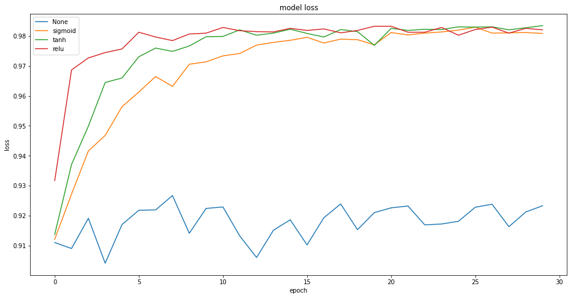

## 优化策略

&emsp;&emsp;
不同模型会有不同的最优超参数组合，找到这组最优超参数大家会根据经验、或者随机的方法来尝试，这也是为什么现在的深度学习工程师也被称为“调参工程师”。前面我们调优时使用的学习率等都是超参数。

&emsp;&emsp;
即使有深入的领域知识，手动优化模型超参数的任务也可能非常耗时。由于不存在一组完美的超参数适合所有模型，调参看起来是个工程问题，有可能用数学或者机器学习模型来解决模型本身超参数的选择问题吗？答案显然是有的，而且通过一些数学证明，我们使用算法“很有可能”取得比常用方法更好的效果。

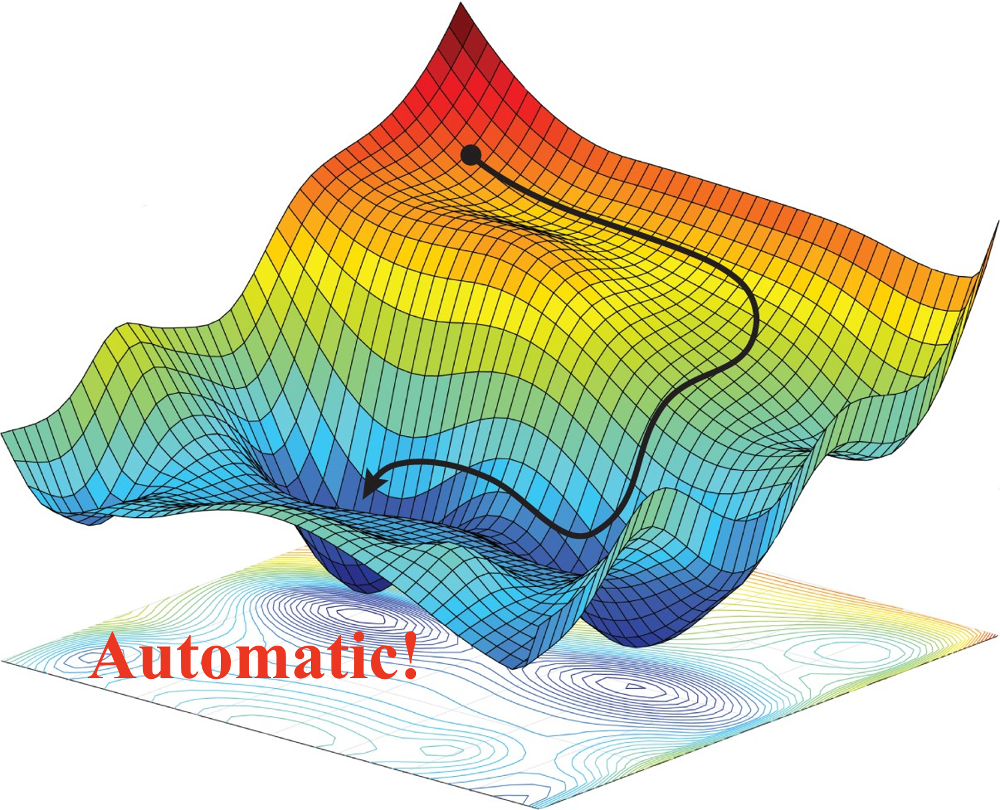

&emsp;&emsp;
**优化过程**：根据某种性能指标来检测给定项目中给定模型的最佳超参数集的自动过程。

&emsp;&emsp;
典型的优化过程定义了可能的超参数集以及针对该特定问题要最大化或最小化的度量。因此，实际上，任何优化过程都遵循以下经典步骤：

1. 将手头的数据分为训练和测试子集；
2. 重复优化循环固定次数或直到满足条件：
   + 选择一组新的模型超参数；
   + 使用选定的超参数集在训练子集上训练模型；
   + 将模型应用于测试子集并生成相应的预测；
   + 使用针对当前问题的适当评分标准（例如准确性或平均绝对误差）评估测试预测。存储与选定的超参数集相对应的度量标准值。
3. 比较所有度量值，然后选择产生最佳度量值的超参数集。

&emsp;&emsp;
机器学习模型超参数调优一般认为是一个黑盒优化问题，所谓黑盒问题就是我们在调优的过程中只看到模型的输入和输出，不能获取模型训练过程的梯度信息，也不能假设模型超参数和最终指标符合凸优化条件，否则的话我们通过求导或者凸优化方法就可以求导最优解，不需要使用这些黑盒优化算法，而实际上大部分的模型超参数也符合这个场景。

&emsp;&emsp;
其次是模型的训练过程无论是花费的时间成本还是耗费的计算资源，都是相对高昂的，不能通过快速计算获取大量样本。虽说我们也可以用增强学习来训练超参数调优的模型，但实际上使用一组超参数训练一个模型需要几分钟、几小时甚至几天的时间，无法快速获取这么多样本数据，因此需要有更“准确和高效”的方法来调优超参数。

&emsp;&emsp;
下图可以直观地看到各类优化算法的搜索路径和达到收敛的速度，接下来地章节中我们将详细介绍其中的一部分。

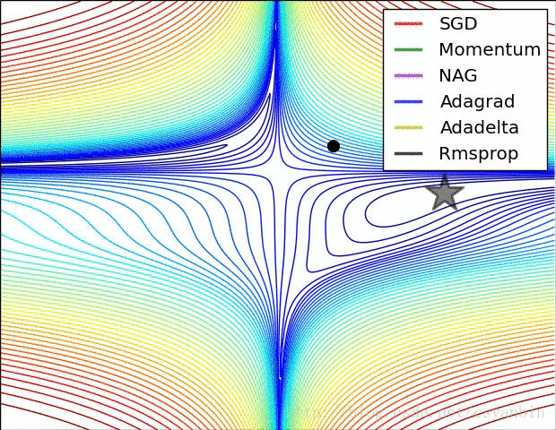

## 网格搜索与随机搜索

&emsp;&emsp;
**网格搜索**（Grid Search）：执行超参数优化的传统方式是网格搜索或参数扫描，它只是通过学习算法的超参数空间的手动指定子集进行的详尽搜索。

&emsp;&emsp;
网格搜索算法必须以某种性能度量为指导，通常通过对训练集进行交叉验证或对保留的验证集进行评估来衡量。由于机器学习者的参数空间可能包括某些参数的实值或无限制值空间，因此在应用网格搜索之前，可能需要手动设置边界和离散化。

&emsp;&emsp;
例如，网格搜索[0，10]范围内的超参数值，步长为0.1。颜色深度反映了在生成的超参数候选序列中的位置。浅色点对应于过程中较早生成的超参数值，深色点对应于稍后生成的超参数值。

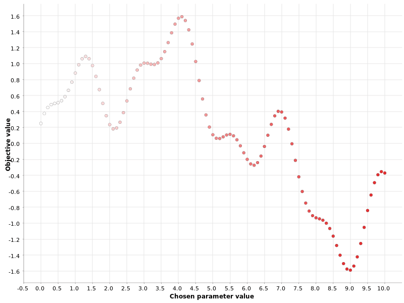

&emsp;&emsp;
**随机搜索**（Random Search）：对于随机搜索策略，顾名思义，超参数的值是随机选择的。在多个超参数的情况下，通常首选此策略，并且当某些超参数对最终指标的影响大于其他参数时，此策略特别有效。

&emsp;&emsp;
同样地，随机搜索在[0，10]范围内随机生成N个超参数。N越大，模型达到最佳状态的可能性就越高，但是所需的计算资源也就越高。

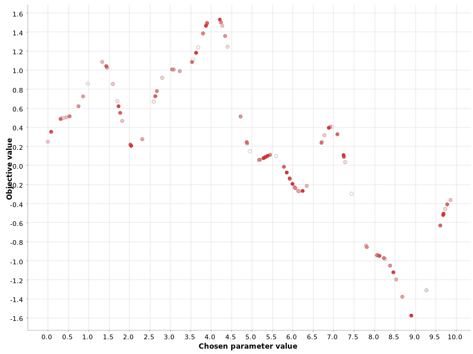

### 网格搜索与随机搜索对比

&emsp;&emsp;
网格搜索策略在单个参数的情况下可以很好地工作，但是当必须同时优化多个参数时，它的效率将非常低下。以随机搜索为对比，我们假设有两个超参数，下图是网格搜索和随机搜索候选超参数的选择结果。

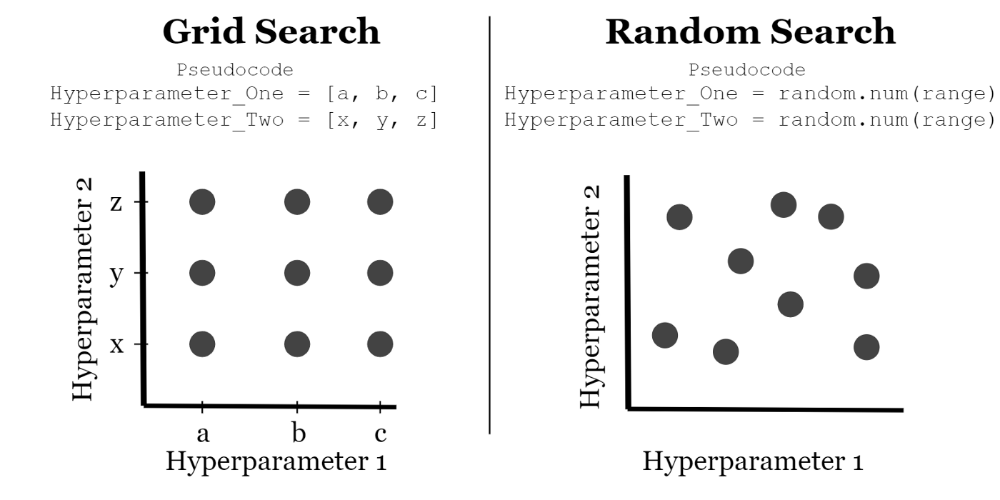

&emsp;&emsp;
我们以蓝色的深浅来假定模型的表现效果，蓝色越深表明效果欠佳，越浅则代表效果越优。

&emsp;&emsp;
两种搜索方法都能找到表现还不错的超参数集，并且在实际计算过程中，随机搜索还有一定的几率并不会落入浅色的区域内。

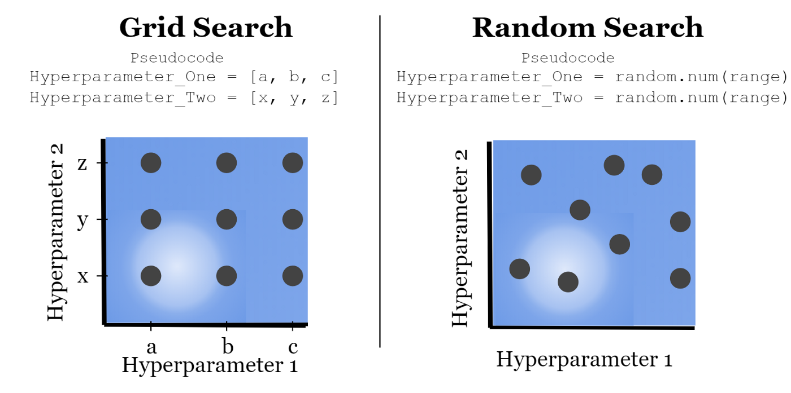

&emsp;&emsp;
那么，假如两个超参数对模型效果的影响比重不一致呢？

&emsp;&emsp;
如下图所示，超参数1的权重大于超参数2的权重时，只要找到合适的超参数1，无论超参数2是什么值，模型的表现看上去都会不错。但是因为候选的超参数1表现均不佳，采用网格搜索的模型就很难继续进行收敛。

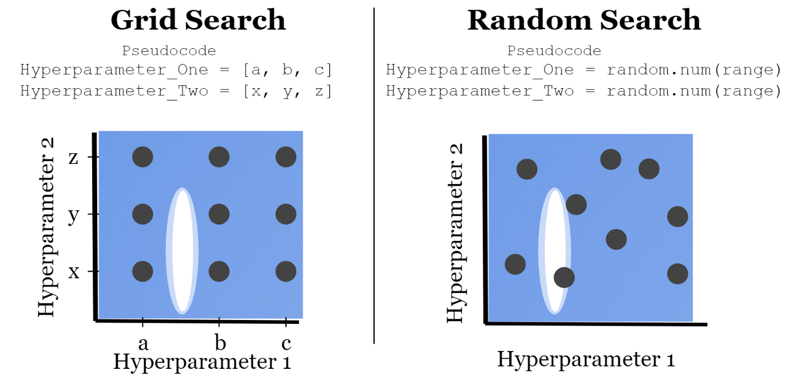

&emsp;&emsp;
这是因为网格搜索看上去似乎均匀覆盖了整个搜索区域，但是实际上对于每个超参数而言，如本例中，都只选取了3个不同的值。相对而言，随机搜索则是为每个超参数都选择了9个不同的取值。在通常情况下，随机搜索的表现被认为是优于网格搜索的。

## 贝叶斯优化

&emsp;&emsp;
网格搜索和随机搜索算法与我们在学习算法时入门学到的暴力算法似乎是“同门”。所以显然它们的表现有时甚至不如有经验的建模工程师直接选择的经验超参数，特别是在计算资源有限的情况下。

&emsp;&emsp;
而贝叶斯优化则就是一个“很可能”比普通开发者或者建模工程师调参能力更好的算法。为了介绍贝叶斯优化，我们首先从介绍爬山算法开始。

&emsp;&emsp;
**爬山算法**（Hill Climbing）：每次迭代的爬山方法都会在超参数空间中选择最佳方向，以选择下一个超参数值。如果没有邻居改善最终指标，则优化循环将停止。

&emsp;&emsp;
在[0，10]范围内对超参数值进行爬山搜索。颜色深度反映了在生成的超参数候选序列中的位置。浅色点对应于过程中较早生成的超参数值，深色点对应于稍后生成的超参数值。

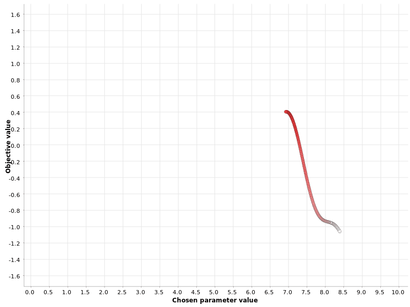

&emsp;&emsp;
**贝叶斯优化**（Bayesian Optimization）策略根据先前迭代中的函数输出选择下一个超参数值，类似于爬坡策略。与爬山不同，贝叶斯优化会全局查看过去的迭代，而不仅仅是最后一次。

&emsp;&emsp;
贝叶斯优化通常分为两个阶段：

1. 在称为预热的第一阶段中，将随机生成超参数值。在用户定义的数量N个此类超参数的随机生成之后，第二阶段开始。
2. 在第二阶段中，在每次迭代中，都会估计类型为P（输出|过去超参数）的“替代”模型，以描述输出值在过去迭代中对超参数值的条件概率。该替代模型比原始函数更容易优化。因此，该算法优化了替代，并建议将替代模型的最大值处的超参数值也作为原始函数的最佳值。第二阶段的一小部分迭代还用于探测最佳区域之外的区域。这是为了避免局部最大值的问题。

&emsp;&emsp;
在[0，10]范围内的超参数值的贝叶斯优化。 除了之前出现过的红点，灰点表示在策略的第一个随机阶段生成的超参数集。

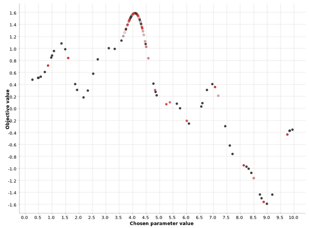

## 梯度下降法

&emsp;&emsp;
**梯度下降法**是最早最简单，也是最为常用的最优化方法。梯度下降法实现简单，当目标函数是凸函数时，梯度下降法的解是全局解。一般情况下，其解不保证是全局最优解，梯度下降法的速度也未必是最快的。梯度下降法的优化思想是用当前位置负梯度方向作为搜索方向，因为该方向为当前位置的最快下降方向，所以也被称为是“最速下降法”。最速下降法越接近目标值，步长越小，前进越慢。梯度下降法的搜索迭代示意图如下图所示：

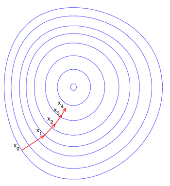

&emsp;&emsp;
梯度下降法与爬山算法似乎很相近，都采用了贪心的策略，都应用于查找局部最小值（或最大值） 。但两者之间的主要区别在于它们移动达到局部最小值（或最大值）的方向。

&emsp;&emsp;
+ 在“爬山”中，我们仅移动向量空间中的一个元素，然后计算出函数的值，并在函数值提高时将其替换。我们一直在改变向量的一个元素，直到无法朝着改善位置的方向移动。在3D空间中，移动可以可视化为沿x，y或z轴在任一坐标轴方向上移动。
+ 在“梯度下降”中，我们朝当前点的负梯度方向采取步骤，以达到最小值（在最大值情况下为正）。例如，在3D空间中，方向并不一定是沿坐标轴方向。

&emsp;&emsp;
梯度下降法的缺点：

+ 在靠近极小值时收敛速度减慢；
+ 直线搜索时可能会产生一些问题；
+ 可能会“之字形”下降。

&emsp;&emsp;
在机器学习中，基于基本的梯度下降法发展了三种梯度下降方法，分别为随机梯度下降法和批量梯度下降法，以及对前两者进行了结合的小批量梯度下降法。

&emsp;&emsp;
我们以一个线性回归模型为例，假设下面的$h(x)$是要拟合的函数，$J(\theta)$为损失函数，$θ$是参数，要迭代求解的值， $θ$求解出来了那最终要拟合的函数$h(\theta)$就出来了。其中m是训练集的样本个数，n是特征的个数。

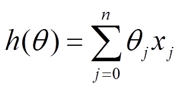

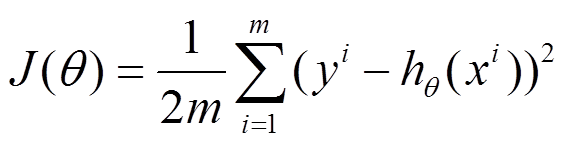

### 批量梯度下降法

&emsp;&emsp;
**批量梯度下降法**（Batch Gradient Descent，BGD）。是最原始的形式，它的具体思路是每次更新使用了所有的训练数据，最小化损失函数。当目标函数为凸函数时，批量梯度下降一定能够得到全局最优解。

&emsp;&emsp;
批量梯度下降法的伪代码如下。可以注意到，它得到的是一个全局最优解，但是每迭代一步，都要用到训练集所有的数据，此时利用矩阵进行运算，实现了并行。样本个数m，x为n维向量，一次迭代需要把m个样本全部带入计算，迭代一次计算量为mn^2​^。如果m很大，那么可想而知这种方法的迭代速度会相当的慢。

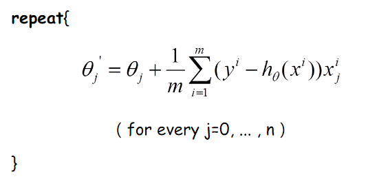

&emsp;&emsp;
批量梯度下降法的收敛图如下图所示。我们可以看到，批量梯度下降法迭代的次数相对较少，并且每次都是朝着极小值进行迭代的。由全数据集确定的方向能够更好地代表样本总体，从而更准确地朝向极值所在的方向。

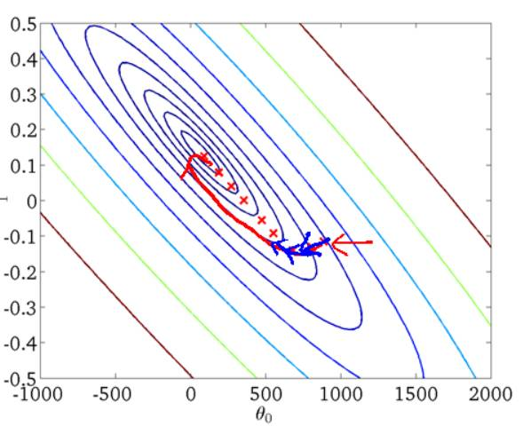

### 随机梯度下降法

&emsp;&emsp;
由于批梯度下降每跟新一个参数的时候，要用到所有的样本数，所以训练速度会随着样本数量的增加而变得非常缓慢。随机梯度下降法（Stochastic Gradient Descent，SGD）正是为了解决这个办法而提出的。

&emsp;&emsp;
随机梯度下降法的伪代码如下。由于批梯度下降每跟新一随机梯度下降是通过每个样本来迭代更新一次，如果样本量很大的情况（例如几十万），那么可能只用其中几万条或者几千条的样本，就已经将$θ$迭代到最优解了。但是，随机梯度下降法伴随的一个问题是噪音较多，这意味着并不是每次迭代都向着整体最优化方向。随机梯度下降每次迭代只使用一个样本，迭代一次计算量为n^2^​，当样本个数m很大的时候，随机梯度下降迭代一次的速度要远高于批量梯度下降法。

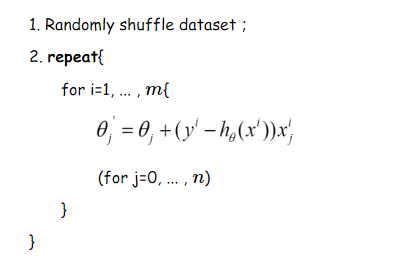

&emsp;&emsp;
随机梯度下降法的下降收敛图如下图所示。有可能由于训练数据的噪声点较多，那么每一次利用噪声点进行更新的过程中，就不一定是朝着极小值方向更新，导致随机梯度下降法迭代的次数较多，在解空间的搜索过程看起来很盲目。但是由于更新多轮，整体方向还是大致朝着极小值方向更新，又提高了速度。

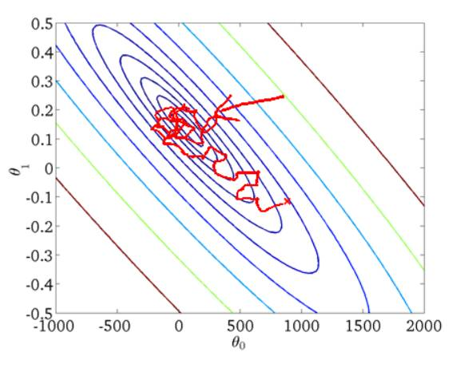

### 小批量梯度下降法

&emsp;&emsp;
我们从上面两种梯度下降法可以看出，其各自均有优缺点，那么能不能在两种方法的性能之间取得一个折衷呢？即，算法的训练过程比较快，而且也要保证最终参数训练的准确率，而这正是**小批量梯度下降法**（Mini-batch Gradient Descent，简称MBGD）的初衷。不同问题所对应的batch size是不一样的，我们假定batch size为10，小批量梯度下降法的伪代码如下所示：

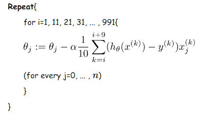

&emsp;&emsp;
如下图所示，将批量梯度下降法、随机梯度下降法、小批量梯度下降法三者的下降收敛曲线进行对比。在实际的一般情况下，通常采用小批量梯度下降法。

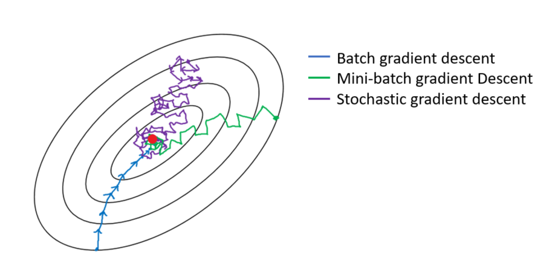

&emsp;&emsp;
小批量梯度下降法的优点：

+ 通过矩阵运算，每次在一个batch上优化神经网络参数并不会比单个数据慢太多。
+ 每次使用一个batch可以大大减小收敛所需要的迭代次数，同时可以使收敛到的结果更加接近梯度下降的效果。
+ 可实现并行化。

&emsp;&emsp;
但是如何选择batch size又是一个新的问题。在合理的范围内，增大batch size有这些好处：

+ 提高内存利用率，大矩阵乘法的并行化效率提高。
+ 跑完一次epoch（全数据集）所需的迭代次数减少，对于相同数据量的处理速度进一步加快。
+ 在一定范围内，一般来说batch size越大，其确定的下降方向越准，引起训练震荡越小。

&emsp;&emsp;
但是我们也不能盲目增大batch size：

+ 内存利用率提高了，但是内存容量可能撑不住了。
+ 跑完一次epoch（全数据集）所需的迭代次数减少，要想达到相同的精度，其所花费的时间大大增加了，从而对参数的修正也就显得更加缓慢。
+ batch size增大到一定程度，其确定的下降方向已经基本不再变化。

### Momentum

&emsp;&emsp;
随机梯度下降法在遇到沟壑时容易陷入震荡。为此，可以为其引入**动量**（Momentum），加速随机梯度下降法在正确方向的下降并抑制震荡。在计算梯度的过程中加入了与上一步相关梯度的动量，这意味着参数更新方向不仅由当前的梯度决定，也与此前累积的下降方向有关。这使得参数中那些梯度方向变化不大的维度可以加速更新，并减少梯度方向变化较大的维度上的更新幅度。由此产生了加速收敛和减小震荡的效果。回顾优化策略中的动图，结合下图，可以看见引入动量有效的加速了梯度下降收敛过程。

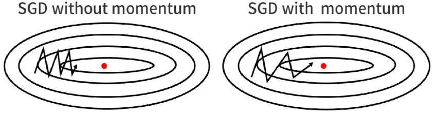

### NAG

&emsp;&emsp;
更进一步地，我们希望下降的过程更加智能：算法能够在目标函数有增高趋势之前，减缓更新速率。 **Nesterov梯度加速法**（Nesterov Accelerated Gradient，简称NAG）即是为此而设计的。参考下图，动量的步长计算了当前梯度（短蓝向量）和动量项 （长蓝向量）。然而，既然已经利用了动量项来更新 ，那不妨先计算出下一时刻 的近似位置 （棕向量），并根据该未来位置计算梯度（红向量），然后使用和引入动量的随机梯度下降法中相同的方式计算步长（绿向量）。这种计算梯度的方式可以使算法更好的「预测未来」，提前调整更新速率。

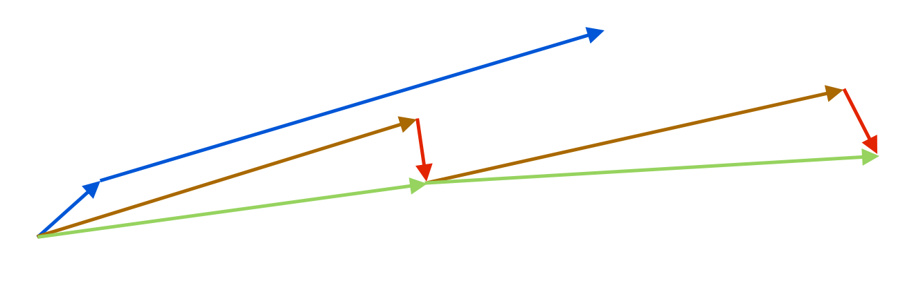

## 自适应学习率优化算法

&emsp;&emsp;
在机器学习中，学习率是一个非常重要的超参数，但是学习率是非常难确定的，虽然可以通过多次训练来确定合适的学习率，但是一般也不太确定多少次训练能够得到最优的学习率，对人为的经验要求比较高，所以是否存在一些策略自适应地调节学习率的大小，从而提高训练速度。目前的自适应学习率优化算法主要有：AdaGrad算法，AdaDelta算法，RMSProp算法以及Adam算法。

&emsp;&emsp;
**AdaGrad算法**，独立地适应所有模型参数的学习率，缩放每个参数反比于其所有梯度历史平均值总和的平方根。具有代价函数最大梯度的参数相应地有个快速下降的学习率，而具有小梯度的参数在学习率上有相对较小的下降。

&emsp;&emsp;
AdaGrad算法优化策略一般可以表示为：

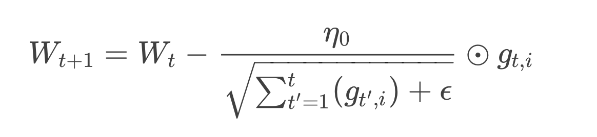

&emsp;&emsp;
假定一个多分类问题，$i$表示第$i$个分类，*t*表示第*t*迭代同时也表示分类$i$累计出现的次数。$\eta_0$表示初始的学习率取值一般为0.01，$\epsilon$是一个取值很小的数（一般为1e-8）为了避免分母为0。$Wt$表示t时刻即第$t$迭代模型的参数，$g_{t,i}=\Delta J(W_{t,i})$表示$t$时刻，指定分类$i$，代价函数$J(\cdot)$关于$W$的梯度。

&emsp;&emsp;
AdaGrad算法优点在于：

+ 每个训练参数的学习率都会变化。
+ 无需手动调整学习速度。
+ 能够训练稀疏数据。

&emsp;&emsp;
同时缺点也很明显：

+ 由于需要计算二阶导数，因此非常耗费计算资源。
+ 随着迭代次数增多，学习率会越来越小，最终会趋近于0，导致训练缓慢。

&emsp;&emsp;
**RMSProp算法**修改了AdaGrad的梯度积累为指数加权的移动平均，使得其在非凸设定下效果更好。

&emsp;&emsp;
RMSProp算法的一般策略可以表示为：

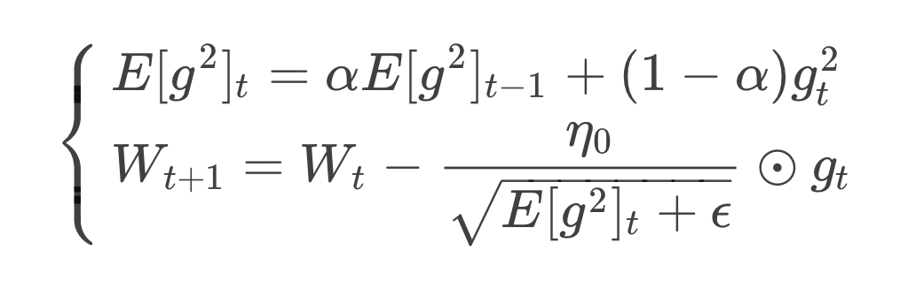

&emsp;&emsp;
RMSProp算法在经验上已经被证明是一种有效且实用的深度神经网络优化算法。目前它是深度学习从业者经常采用的优化方法之一。性能调优章节的小实验中我们也用到了RMSProp算法。

&emsp;&emsp;
AdaGrad算法和RMSProp算法都需要指定全局学习率，**AdaDelta算法**结合两种算法每次参数的更新步长。AdaDelta算法策略可以表示为：

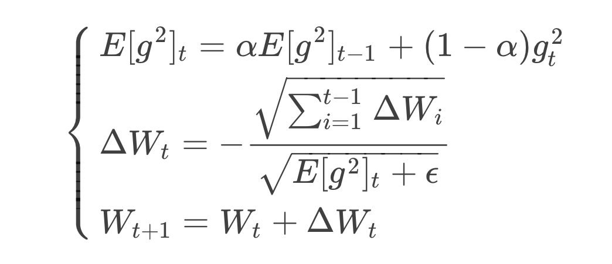

&emsp;&emsp;
从表达式可以看出，AdaDelta不需要设置一个默认的全局学习率。

+ 在模型训练的初期和中期，AdaDelta表现很好，加速效果不错，训练速度快。

+ 在模型训练的后期，模型会反复地在局部最小值附近抖动。

&emsp;&emsp;
**Adam**（Adaptive Moment Estimation）本质上是带有动量项的RMSprop，它利用梯度的一阶矩估计和二阶矩估计动态调整每个参数的学习率。相比于缺少修正因子导致二阶矩估计可能在训练初期具有很高偏置的RMSProp，Adam包括偏置修正，修正从原点初始化的一阶矩（动量项）和（非中心的）二阶矩估计。Adam的优点主要在于经过偏置校正后，每一次迭代学习率都有个确定范围，使得参数比较平稳。Adam算法策略可以表示为：

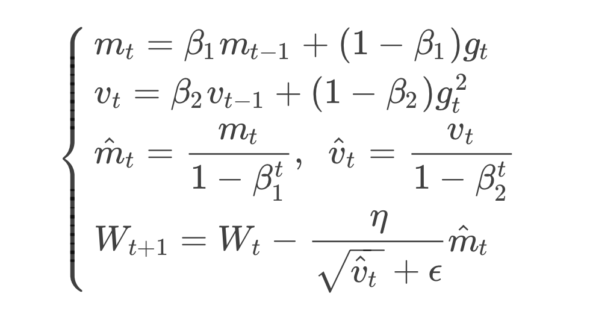

### 自适应学习率优化算法实践

&emsp;&emsp;
当然，在实际训练过程中，收敛过程不会那么顺滑。我们通过一个复杂的案例来绘制四种优化算法的损失曲线。

&emsp;&emsp;
选用tensorflow框架，导入我们所需的numpy库和matplotlib库

```python
import numpy as np
import tensorflow as tf
from tensorflow.examples.tutorials.mnist import input_data
from tensorflow.contrib.layers import variance_scaling_initializer
import matplotlib.pyplot as plt
```
&emsp;&emsp;
定义超参数的初始值

```python
learning_rate = 0.001
training_epochs = 200
batch_size = 50
display_step = 20
```
&emsp;&emsp;
定义SGD、Momentum、 RMSProp、Adam四个算法的优化器

```python
train_step1 = tf.train.GradientDescentOptimizer(learning_rate).minimize(cross_entropy)
train_step2 = tf.train.MomentumOptimizer(learning_rate, momentum=0.9, use_nesterov=True).minimize(cross_entropy)
train_step3 = tf.train.RMSPropOptimizer(learning_rate).minimize(cross_entropy)
train_step4 = tf.train.AdamOptimizer(learning_rate).minimize(cross_entropy)
```
&emsp;&emsp;
初始化全局参数和定义交叉熵损失函数

```python
init = tf.global_variables_initializer()
cross_entropy = tf.reduce_mean(tf.nn.softmax_cross_entropy_with_logits(labels=y_, logits=y_conv))
```
&emsp;&emsp;
以SGD为例，进行模型训练

```python
with tf.Session() as sess1:
    sess1.run(init)
    
    avg_loss_sgd = np.zeros(training_epochs)
    for epoch in range(training_epochs):
        batch_xs, batch_ys = mnist.train.next_batch(batch_size)
        _, loss = sess1.run([train_step1, cross_entropy], feed_dict={x: batch_xs, y_: batch_ys, keep_prob: 0.5})
        avg_loss_sgd[epoch] = loss
        # 计算训练过程中模型的准确率
        if epoch % display_step == 0:
            train_accuracy = accuracy.eval(feed_dict={x:batch_xs, y_:batch_ys, keep_prob: 1.0})
```
&emsp;&emsp;
最后，如下图所示，绘制得到四种算法的损失曲线。

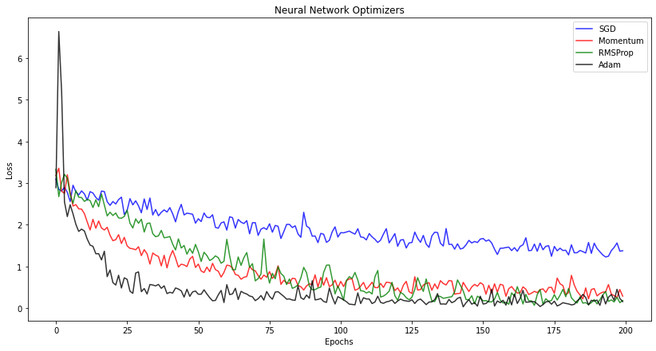

