# 算法调优经典方法

## 神经结构搜索

&emsp;&emsp;
时下无论是在实际部署还是学术前沿中，适用于各自任务的神经网络层出不穷，如图像识别、语音识别、机器翻译等等。

&emsp;&emsp;
在上一章中，我们提到在搭建神经网络时，建议可以参考相关开源的神经网络模型结构，根据自己的数据集在此基础上进行微调。这些模型通常都是各位专家通过不断调整网络结构和超参数才开发出来的。尽管总结出了不少经验，但是显然这不仅非常耗时，还是个不断试错的过程。并且遇到一个新任务时，当修改超参数不能达到我们的预期目标时，我们就不得不开始考虑修改网络结构的问题了。

&emsp;&emsp;
如果神经网络的结构也那作为一个超参数，这是否意味着我们可以通过算法来寻找合适的网络结构呢？这就是**神经结构搜索**（Neural Architecture Search，简称NAS）想要解决的问题。由Thomas Elsken，Jan Hendrik Metzen和Frank Hutter于2017年的ICML提出的使用强化学习的方法巧妙地应用神经结构搜索来优化网络结构，将这一研究方向推向了热潮。

&emsp;&emsp;
神经结构搜索是一种自动设计神经网络的技术，可以通过算法根据样本集自动设计出高性能的网络结构，在某些任务上甚至可以媲美人类专家的水准，甚至发现某些工程师之前未曾提出过的网络结构，这可以有效的降低神经网络的实现成本。

&emsp;&emsp;
NAS的原理是给定一个称为搜索空间的神经网络结构候选集合，用某种算法从中搜索出表现最优网络结构。神经网络结构的优劣即性能用某些指标，例如准确率、推理速度来度量，称为性能评估。这一过程如下图所示。

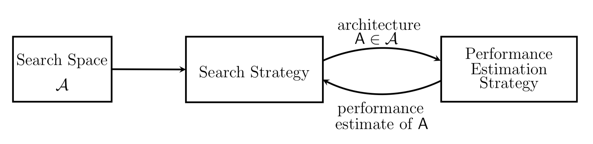

&emsp;&emsp;
NAS的研究重点之一就在于如何构造一个高效的**搜索空间**。网络的拓扑结构，网络有多少个层，这些层之间的连接关系，从简单的图结构到任意的DAG也反映了整个神经网络结构的发展历程。最简单的神经网络是线性链式结构，其对应的图的每个节点最多只有一个前驱，一个后续，类似于数据结构中的链表。早期的全连接神经网络，卷积神经网络都是这种拓扑结构。Inception、ResNet、DenseNet中的节点允许有多个前驱，多个后续，从而形成了多分支、跨层连接结构，它们是更复杂的图。这些典型的拓扑结构如下图所示。

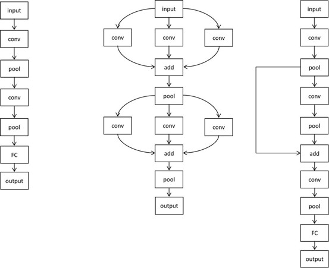

&emsp;&emsp;
**搜索策略**定义了如何找到最优的网络结构，通常是一个迭代优化过程，本质上是超参数优化问题。目前已知的搜索方法有随机搜索，贝叶斯优化，遗传算法，强化学习，基于梯度的算法。其中强化学习，遗传学习，基于梯度的优化是目前的主流算法。其他算法在上一章我们有所涉猎，这里介绍一下强化学习。

&emsp;&emsp;
基于强化学习的NAS算法将神经网络结构设计看作一个强化学习问题，学习得到一个产生网络结构的最优策略。这里的智能体是设计神经网络结构的算法，用于输出神经网络结构描述，强化学习算法使得生成的神经网络的性能最优化。为了用强化学习求解，可以将神经网络的设计看做一个动作序列，每次执行动作确定网络的一部分结构如层。神经网络在验证集上的性能值是强化学习中的奖励值。

&emsp;&emsp;
搜索策略的目标是找到一个神经网络结构，最大化某种性能度量指标，如在之前未见的数据集上的精度。为了指导搜索过程，NAS算法需要估计一个给定神经网络结构的性能，这称为**性能评估**策略。

&emsp;&emsp;
对于搜索策略搜索出的神经网络结构，首先在一个训练集上训练，然后在验证集上测试精度值。训练和验证过程非常耗时，因此有必要采取措施以降低性能评估的成本。降低训练成本的简单做法有减少训练时间（迭代次数），在训练样本的一个子集上进行训练，在低分辨率的图像上进行训练，或者在训练时减少某些层的卷积核的数量。这些做法在降低计算成本的同时可能会导致性能评估值的偏差。虽然搜索策略只需对各种网络结构的优劣进行排序，无需知道它们准确的性能指标，但这种近似可能还是会导致排序结果的偏差。

## 量化压缩

&emsp;&emsp;
所谓量化，本来是信号处理的一个概念，是模拟信号转换成数字信号的其中一个步骤。主要的工作是将一个实数映射到整数。模型由大量的浮点型权重组成，如果能用float32替代原有的float64表示，模型就近乎减小一倍的体积，量化也是最容易实现的一种压缩方式。如下图，ReLU的输入输出仍然是float，但是内部的计算使用8bit来完成。

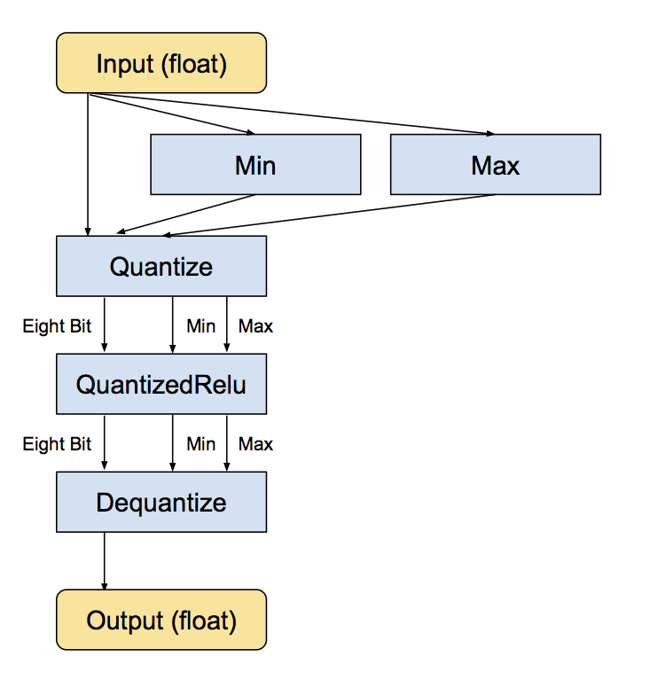

&emsp;&emsp;
模型的精度量化并不是简单的将高精度的权重用低精度权重表示就好了，这里面涉及到许多适配硬件的因素。先来看下神经元权重是如何在计算机里表示的。目前深度学习中大部分都是用32bit float类型进行计算的，bit位数的多少直接限制了数据类型能够表达的数据范围，比如float 32的数据是由1bit表示符号，8bit表示整数部，23位表示分数部组成。

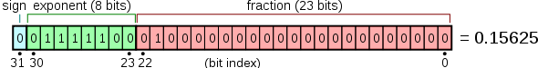

&emsp;&emsp;
所以，如果要压缩模型，从float32压缩到多少变得关键，目前主流的方式是压缩到int8。压缩到int8意味着内存的节省，节约了3/4，同时也提升了计算效率，因为在GPU这样的硬件上，低位的浮点计算速度会远远高于高位浮点计算速度。实际操作过程中，由于数据分布经常是不均匀的，很容易造成明显的精度损失，所以我们还会对右侧进行饱和截取。选取一个阈值T，低于阈值的全部饱和映射到-127上，如下图中上方的三个红点。阈值T就变成了一个超参数，如何确定T的取值又变成了一个最优化问题。

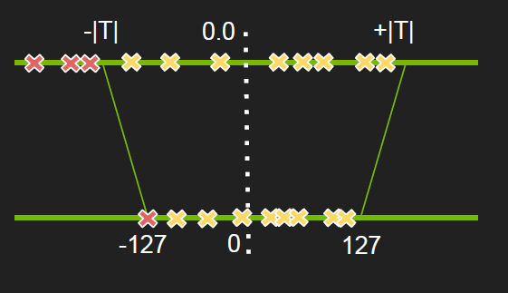

## 模型压缩

&emsp;&emsp;
整个机器学习领域正在逐渐从理论派向工程派延伸。什么是理论派呢？从业务的角度看，理论派就是做一些理论验证工作，通过建模证明机器学习在哪个业务能落地。而工程派指的是如何能让机器学习应用的更高效，模型压缩就是工程派的一个重要落地方向。理论上来说，现在的GPU处理性能越来越强，云计算的快速发展也让我们越来越不依赖本地硬件，那么模型压缩的意义是什么呢？

&emsp;&emsp;
模型压缩更多地是应用到复杂的深度模型上，并且越来越受到重视，因为当模型的准确度达到一定程度后，如何用更少的硬件成本去做模型服务变的有意义。

&emsp;&emsp;
假设在模型优化前，原始模型处理每个视频要10秒，一分钟只能处理6个视频。假设模型的峰值是1000人同时使用，那么这家公司至少要有167张GPU才能满足需求，不然就会出现服务排队现象。如果模型压缩技术能让模型变小许多，使得每个视频处理只需要1秒，那么该公司可能只需要17张卡就能满足业务需求，省下的150张GPU的采购和使用成本，就是模型压缩技术的价值。

&emsp;&emsp;
Deep Compression由韩松，毛慧子，William J. Dally在ICLR 2016发表，并且获评为最佳论文。Deep Compression三个阶段的压缩工作：剪枝（pruning）、量化（quantization）、哈夫曼编码（Huffman encoding）。

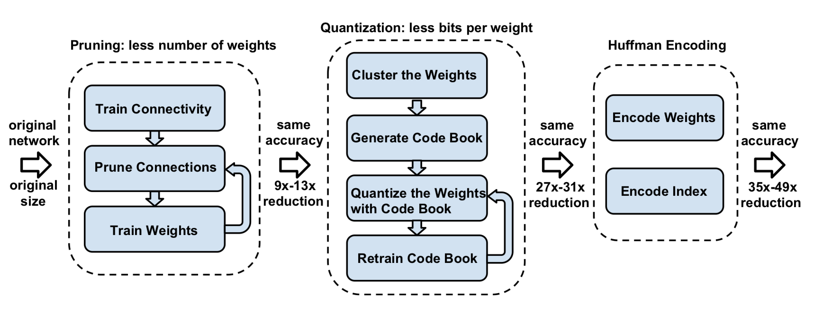

&emsp;&emsp;
**剪枝**：深度学习模型可以看作是一个复杂树状结构，如果能减去一些对结果没什么影响的旁枝，就可以实现模型的减小。

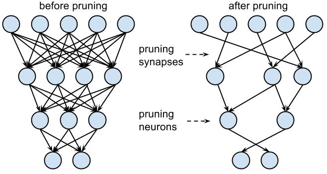

&emsp;&emsp;
模型的构成是由许多浮点型的神经元相连接，每一层根据神经元的权重将信息向下传递。但是有一些神经元的权重非常小，这类神经元对整个模型的加载的信息的影响也就微乎其微。如果可以把这些权重较小的神经元删减掉，既减少了模型大小，也不会对模型的效果带来大的影响。

&emsp;&emsp;
每一层把数值小的神经元去掉，但是究竟剪枝粒度维持到多大是很有讲究的。剪多了，模型精度影响会比较大，剪少了没有效果。所以这里面需要大量的尝试和迭代，在实践中，剪枝是一个迭代的过程，这通常叫做迭代式剪枝（Iterative Pruning）：修剪-训练-重复（Prune / Train / Repeat）。

&emsp;&emsp;
**量化与权重共享**。量化已经在前文介绍过了，权重共享有点像提取公因数，假设模型的每一层都有公用的公因数，是否可以提取出来在结果处做一次运算，而不是每一层都算一次。通过对权重进行量化之后，使得许多连接共享同一权重，并且只需要存储码本（即有效的权重）和索引。

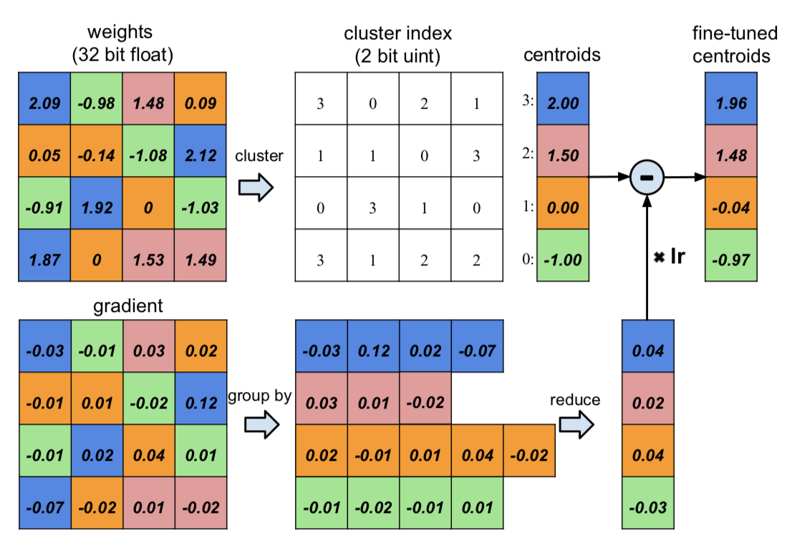

&emsp;&emsp;
举个例子，当CNN模型在识别下面这张图片的时候，需要卷积核去全图扫描这个图像，找出每个边缘的特点，但是这种对称图像一定存在一些形状的重复性，比如下图蓝色框出的这些结构。这些重复结构意味着卷积核在计算权重的时候会有部分权重的相似性，这些相似性是全局可共享的。那么如果可以通过聚类的方式挖掘出这些可以共享的权重系数，并且以类别的方式让它们共享一些权重，就可以实现模型的压缩。

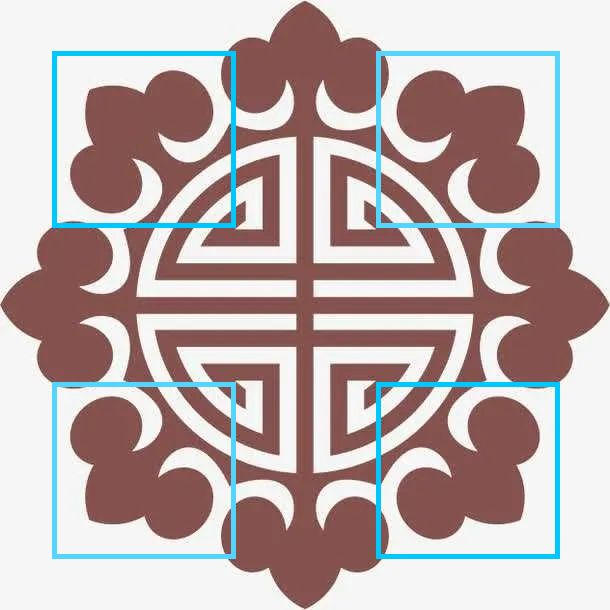

&emsp;&emsp;
**哈夫曼编码**按照符号出现的概率来进行变长编码。下面的权重以及索引分布来自于AlexNet的最后一个全连接层。由图可以看出，其分布是非均匀的，因此我们可以利用Huffman编码来对其进行处理，最终可以使的网络的存储减少20%~30%。

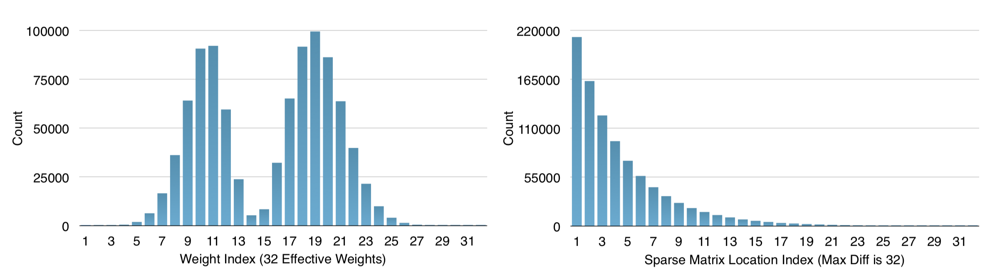

### PAI Blade

&emsp;&emsp;
PAI-Blade是PAI推出的通用推理优化框架，可以通过模型系统联合优化，使模型达到最优推理性能。PAI-Blade机融合了Blade Graph Optimizer、TensorRT、PAI-TAO（Tensor Accelerator and Optimizer）、Blade Custom Optimizer、Blade INT8（Mixed-Precision）及Blade Auto-Compression等多种优化技术，会先对模型进行分析，再对其部分或全部应用优化技术。

&emsp;&emsp;
PAI-Blade的所有优化技术均面向通用性设计，可以应用于不同的业务场景。同时，PAI-Blade对每一步优化的数值结果都进行了准确性验证，从而确保优化结果不会对模型的精度或指标产生非预期影响。

&emsp;&emsp;
PAI-Blade的优化过程包括但不限于如下内容：

+ 通用图优化
+ 基于理解的计算图等效变换
+ 算子融合
+ 对计算图算子丰富且高效的实现进行组合优化
+ JIT编译
+ 基于模板及历史数据实现的半自动或自动Codegen
+ 启发式的Auto-Tuning
+ 模型压缩及剪裁
+ 模型低精度及混合精度量化
+ 以模型低精度量化为前提的精度恢复技术

&emsp;&emsp;
为了能够让用户更好地了解和使用通用推理优化工具，PAI-Blade提供了一个可以试用且容易验证的环境及若干模型，构成BBS（Blade Benchmark Suite）。PAI-Blade BBS中共有8个不同类型的深度学习模型，涵盖图像分类、文字检测、自然语言处理等场景，TensorFlow、Caffe及ONNX等深度学习框架：CRNN （Convolutional Recurrent Neural Network）、PoseNet、OCRDet、Bert、MobilenetV1、MobilenetV1_050、RefineDet、InceptionV2。

&emsp;&emsp;
TensorFlow模型推理速度测试结果

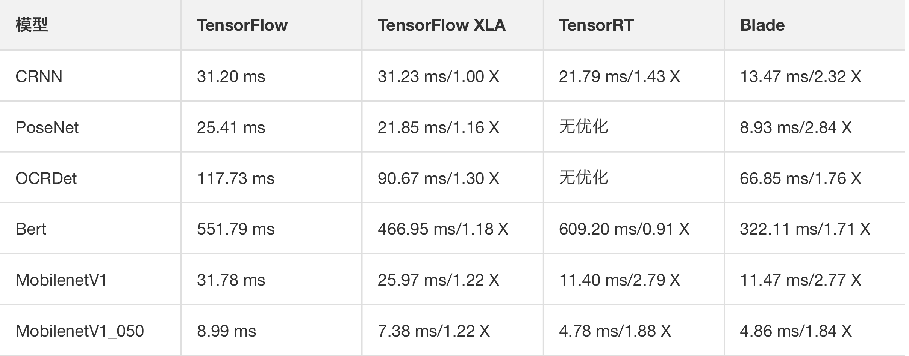

&emsp;&emsp;
Bert、MobilenetV1及MobilenetV1_050模型的TensorRT和Blade优化均采用INT8量化的方式，其优化前后的精度测试结果如下表所示。

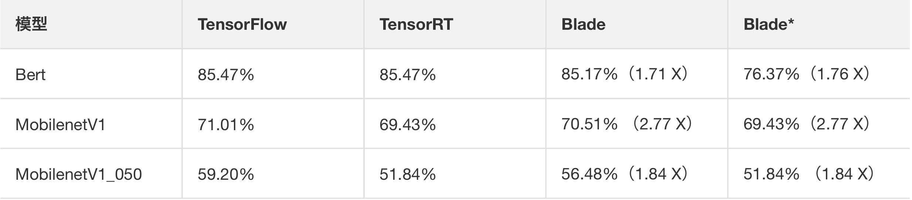
