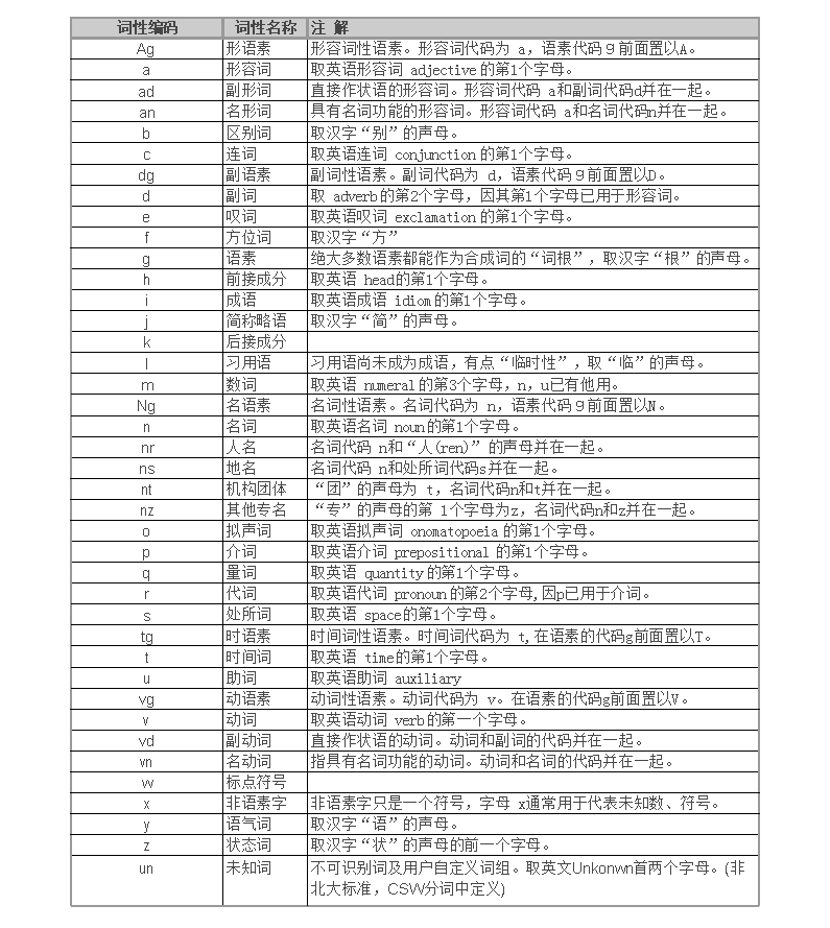

> **学习物联网，来HaaSEDU就对了**

# 自然语言处理
## 自然语言处理的定义-NLP
&emsp;&emsp;
NLP: 自然语言处理(Natural Language Processing) 是研究人与计算机交互的语言问题的一门学科，是指用计算机对自然语言的形、音、义等信息进行处理，即对字、词、句、篇章的输入、输出、识别、分析、理解、生成等的操作和加工。实现人机间的信息交流，是人工智能界、计算机科学和语言学界所共同关注的重要问题。在人工智能领域或者是语音信息处理领域中，学者们普遍认为采用图灵试验可以判断计算机是否理解了某种自然语言，具体的判别标准有以下几条：第一，问答，机器人能正确回答输入文本中的有关问题；第二，文摘生成，机器有能力生成输入文本的摘要；第三，释义，机器能用不同的词语和句型来复述其输入的文本；第四，翻译，机器具有把一种语言翻译成另一种语言的能力。

&emsp;&emsp;
可以说，自然语言处理就是要计算机理解自然语言，自然语言处理机制涉及两个流程，即自然语言理解和自然语言生成两个部分：

&emsp;&emsp;
自然语言理解（Natural language Understanding ，NLU）,NLU 主要是理解文本的含义，具体到每个单词和结构都需要被理解；自然语言生成（Natural language Generation，NLG），NLG与理解相反，分三个阶段：

&emsp;&emsp;
1）确定目标；

&emsp;&emsp;
2）通过评估情况和可用的交际资源来计划如何实现目标；

&emsp;&emsp;
3）并将计划形成为文本。

&emsp;&emsp;
自然语言的理解和分析是一个层次化的过程，许多语言学家把这一过程分为五个层次，可以更好地体现语言本身的构成，五个层次分别是语音分析、词法分析、句法分析、语义分析和语用分析。

&emsp;&emsp;
1）语音分析

&emsp;&emsp;
语音分析是要根据音位规则，从语音流中区分出一个个独立的音素，再根据音位形态规则找出音节及其对应的词素或词。

&emsp;&emsp;
2）词法分析

&emsp;&emsp;
词法分析的目的是找出词汇的各个词素，从中获得语言学的信息。词法分析包括汉语的分词和词性标注这两部分。汉语分词与英文不同，汉语书面词语之间没有明显的空格标记，文本中的句子以字符串的方式出现，句子中心逗号分隔，句子和句子之间常以句号分隔。针对议语这种独特的书面表现形式，汉语的自然语言处理的首要工作就是要将输人的文本切分为单独的词语，然后在此技术上进行其他更高级的分析。

&emsp;&emsp;
上述这个步骤称为分词。除了分词之外，词性标注也通常被认为是词法分析的一部分，词性标注的目的是为每一个词赋予一个类别，这个类别可以是名词(noun)、动词（verb）、形容词（adjective）等。通常来说，属于相同词性的词，在句法中承担类似的角色。

&emsp;&emsp;
3）句法分析

&emsp;&emsp;
句法分析是对输人的文本以句子为单位，进行分析以得到句子的句法结构的处理过程。对句法结构进行分析，一方面是为了帮助理解句子的含义，另一方面也为更高级的自然语言处理任务提供支持(比如机器翻译、情感分析等)。目前业界存在三种比较主流的句法分析方法：短语结构句法体系，作用是识别出句子中的短语结构以及短语之间的层次句法关系；依存结构句法体系，作用是识别句子中词与词之间的相互依赖关系;深层文法句法分析，利用深层文法，例如词汇化树邻接文法，组合范畴文法等对句子进行深层的句法以及语义分析。

&emsp;&emsp;
上述几种句法分析，依存句法分析属于浅层句法分析，其实现过程相对来说比较简单而且适合在多语言环境下应用，但是其所能提供的信息也相对较少。深层文法句法分析可以提供丰富的句法和语义信息，但是采用的文法相对比较复杂，分析器的运行复杂度也比较高，这使得深层句法分析不太适合处理大规模的数据。短语结构句法分析介于依存句法分析和深层文法句法分析之间。

&emsp;&emsp;
4）语义分析

&emsp;&emsp;
语义分析的目的是找出词义、结构意义及其结合意义，从而确定语言所表达的真正含义或概念。但是，语义应该采用什么表示形式一直困扰着研究者们，至今这个问题也没有一个统一的答案。语义角色标注（semantic role labeling)是目前比较成熟的浅层语义分析技术。语义角色标注一般都在句法分析的基础上完成，句法结构对于语义角色标注的性能至关重要。基于逻辑表达的语义分析也得到学术界的长期关注。出于机器学习模型复杂度、效率的考虑，自然语言处理系统通常采用级联的方式，即分词、词性标注、句法分析、语义分析分别训练模型。实际使用时，给定输入句子，逐一使用各个模块进行分析，最终得到所有结果。

&emsp;&emsp;
5）语用分析

&emsp;&emsp;
语用分析则是研究语言所存在的外界环境对语言使用者所产生的影响。语用分析把语句中表述的对象和对对象的描述，与现实的真实事物及其属性相关联。找到真实具体的细节，把这些细节与语句系统的对应起来,形成动态的表意结构。

&emsp;&emsp;
语用分析有四个基本要素：1.发话者--语言信息的发出者；2.受话者--指听话人或信息接受者；3.话语内容--发话者用语言符号表达具体内容；4.语境--就是语言使用的环境，就是语言行为发生的环境。

 

## 自然语言处理过程
&emsp;&emsp;
中文自然语言处理的过程和机器学习过程大体一致，但又存在很多细节上的不同点，下面我们就来看看中文自然语言处理的基本过程有哪些呢？整个处理流程如下图：

### 获取语料
&emsp;&emsp;
语料，即语言材料。语料是语言学研究的内容。语料是构成语料库的基本单元。所以，人们简单地用文本作为替代，并把文本中的上下文关系作为现实世界中语言的上下文关系的替代品。我们把一个文本集合称为语料库（Corpus），当有几个这样的文本集合的时候，我们称之为语料库集合(Corpora)。按语料来源，我们将语料分为以下两种：

&emsp;&emsp;
1）已有语料：很多业务部门、公司等组织随着业务发展都会积累有大量的纸质或者电子文本资料。那么，对于这些资料，在允许的条件下我们稍加整合，把纸质的文本全部电子化就可以作为我们的语料库。

&emsp;&emsp;
2）网上下载、抓取语料：如果现在个人手里没有数据怎么办呢？这个时候，我们可以选择获取国内外标准开放数据集，比如国内的中文汉语有搜狗语料、人民日报语料。国外的因为大都是英文或者外文，这里暂时用不到。也可以选择通过爬虫自己去抓取一些数据，然后来进行后续内容。

 

### 语料预处理
&emsp;&emsp;
在一个完整的中文自然语言处理工程应用中，语料预处理大概会占到整个50%-70%的工作量，所以开发人员大部分时间就在进行语料预处理。下面通过数据洗清、分词、词性标注、去停用词四个大的方面来完成语料的预处理工作。

&emsp;&emsp;
1）语料清洗

&emsp;&emsp;
数据清洗，顾名思义就是在语料中找到我们感兴趣的东西，把不感兴趣的、视为噪音的内容清洗删除，包括对于原始文本提取标题、摘要、正文等信息，对于爬取的网页内容，去除广告、标签、HTML、JS 等代码和注释等。常见的数据清洗方式有：人工去重、对齐、删除和标注等，或者规则提取内容、正则表达式匹配、根据词性和命名实体提取、编写脚本或者代码批处理等。

&emsp;&emsp;
2）分词

&emsp;&emsp;
中文语料数据为一批短文本或者长文本，比如：句子，文章摘要，段落或者整篇文章组成的一个集合。一般句子、段落之间的字、词语是连续的，有一定含义。而进行文本挖掘分析时，我们希望文本处理的最小单位粒度是词或者词语，所以这个时候就需要分词来将文本全部进行分词。

&emsp;&emsp;
常见的分词算法有：基于字符串匹配的分词方法、基于理解的分词方法、基于统计的分词方法和基于规则的分词方法，每种方法下面对应许多具体的算法。当前中文分词算法的主要难点有歧义识别和新词识别，比如：“羽毛球拍卖完了”，这个可以切分成“羽毛 球拍 卖 完 了”，也可切分成“羽毛球 拍卖 完 了”，如果不依赖上下文其他的句子，恐怕很难知道如何去理解。

&emsp;&emsp;
3）词性标注

&emsp;&emsp;
词性标注，就是给每个词或者词语打词类标签，如形容词、动词、名词等。这样做可以让文本在后面的处理中融入更多有用的语言信息。词性标注是一个经典的序列标注问题，不过对于有些中文自然语言处理来说，词性标注不是必需的。比如，常见的文本分类就不用关心词性问题，但是类似情感分析、知识推理却是需要的，下图是常见的中文词性整理。

&emsp;&emsp;
常见的词性标注方法可以分为基于规则和基于统计的方法。其中基于统计的方法，如基于最大熵的词性标注、基于统计最大概率输出词性和基于HMM的词性标注。

&emsp;&emsp;
4）去停用词

&emsp;&emsp;
停用词一般指对文本特征没有任何贡献作用的字词，比如标点符号、语气、人称等一些词。所以在一般性的文本处理中，分词之后，接下来一步就是去停用词。但是对于中文来说，去停用词操作不是一成不变的，停用词词典是根据具体场景来决定的，比如在情感分析中，语气词、感叹号是应该保留的，因为他们对表示语气程度、感情色彩有一定的贡献和意义。

 

### 特征工程
&emsp;&emsp;
做完语料预处理之后，接下来需要考虑如何把分词之后的字和词语表示成计算机能够计算的类型。显然，如果要计算我们至少需要把中文分词的字符串转换成数字，确切的说应该是向量化。有两种常用的表示模型分别是词袋模型和词向量。

&emsp;&emsp;
词袋模型（Bag of Word, BOW)，即不考虑词语原本在句子中的顺序，直接将每一个词语或者符号统一放置在一个集合（如 list），然后按照计数的方式对出现的次数进行统计。

&emsp;&emsp;
词向量是将字、词语转换成向量矩阵的计算模型。目前为止最常用的词表示方法是 One-hot，这种方法把每个词表示为一个很长的向量。

&emsp;&emsp;
同数据挖掘一样，在文本挖掘相关问题中，特征工程也是必不可少的。在一个实际问题中，构造好的特征向量，是要选择合适的、表达能力强的特征。文本特征一般都是词语，具有语义信息，使用特征选择能够找出一个特征子集，其仍然可以保留语义信息；但通过特征提取找到的特征子空间，将会丢失部分语义信息。所以特征选择是一个很有挑战的过程，更多的依赖于经验和专业知识，并且有很多现成的算法来进行特征的选择。目前，常见的特征选择方法主要有 DF、MI、IG、CHI、WLLR、WFO六种。

 

### 模型训练
&emsp;&emsp;
在特征向量选择好之后，接下来要做的事情是训练模型，对于不同的应用需求，我们使用不同的模型，传统的有监督和无监督等机器学习模型， 如 KNN、SVM、Naive Bayes、决策树、GBDT、K-means 等模型；深度学习模型比如 CNN、RNN、LSTM、 Seq2Seq、Fast-Text、Text-CNN 等。这些模型在后续的分类、聚类、神经序列、情感分析等示例中都会用到。下面是在模型训练时需要注意的几个点。

&emsp;&emsp;
注意过拟合、欠拟合问题，不断提高模型的泛化能力。
过拟合：模型学习能力太强，以至于把噪声数据的特征也学习到了，导致模型泛化能力下降，在训练集上表现很好，但是在测试集上表现很差。常见的解决方法有：
&emsp;&emsp;
* 增大数据的训练量；
* 增加正则化项，如 L1 正则和 L2 正则；
* 特征选取不合理，人工筛选特征和使用特征选择算法；
采用 Dropout 方法等。
* 欠拟合：就是模型不能够很好地拟合数据，表现在模型过于简单。常见的解决方法有：
    * 添加其他特征项；
    * 增加模型复杂度，比如神经网络增加更多的层、线性模型通过添加多项式使模型泛化能力更强；
    * 减少正则化参数，正则化的目的是用来防止过拟合的，但是现在模型出现了欠拟合，则需要减少正则化参数。

&emsp;&emsp;
2）对于神经网络，注意梯度消失和梯度爆炸问题。

 

### 评价指标
&emsp;&emsp;
训练好的模型，上线之前要对模型进行必要的评估，目的让模型对语料具备较好的泛化能力。具体有以下这些指标可以参考。

&emsp;&emsp;
1）错误率、精度、准确率、精确度、召回率、F1 衡量。

&emsp;&emsp;
2）ROC 曲线、AUC 曲线。

&emsp;&emsp;
ROC 全称是“受试者工作特征”（Receiver Operating Characteristic）曲线。我们根据模型的预测结果，把阈值从0变到最大，即刚开始是把每个样本作为正例进行预测，随着阈值的增大，模型预测正样例数越来越少，直到最后没有一个样本是正样例。

 

## 自然语言处理的发展
&emsp;&emsp;
1950年图灵提出了著名的“图灵测试”，这一般被认为是自然语言处理思想的开端，20世纪50年代到70年代自然语言处理主要采用基于规则的方法，研究人员们认为自然语言处理的过程和人类学习认知一门语言的过程是类似的，所以大量的研究员基于这个观点来进行研究，这时的自然语言处理停留在理性主义思潮阶段，以基于规则的方法为代表。但是基于规则的方法具有不可避免的缺点，首先规则不可能覆盖所有语句，其次这种方法对开发者的要求极高，开发者不仅要精通计算机还要精通语言学，因此，这一阶段虽然解决了一些简单的问题，但是无法从根本上将自然语言理解实用化。

&emsp;&emsp;
70年代以后随着互联网的高速发展，丰富的语料库成为现实以及硬件不断更新完善，自然语言处理思潮由理性主义向经验主义过渡，基于统计的方法逐渐代替了基于规则的方法。贾里尼克和他领导的 IBM 华生实验室是推动这一转变的关键，他们采用基于统计的方法，将当时的语音识别率从70%提升到90%。在这一阶段，自然语言处理基于数学模型和统计的方法取到了实质性的突破，从实验室走向实际应用。

&emsp;&emsp;
从2008年到现在，在十年来的时间里，在图像识别和语音识别领域的成果激励下，人们也逐渐开始引入深度学习来做 NLP 研究，由最初的词向量到2013年 word2vec 将深度学习与自然语言处理的结合推向了高潮，并在机器翻译、问答系统、阅读理解等领域取得了一定成功。深度学习是一个多层的神经网络，从输入层开始经过逐层非线性的变化得到输出，从输入到输出做端到端的训练。把输入到输出对的数据准备好，设计并训练一个神经网络，即可执行预想的任务。RNN 已经是自然语言处理最常用的方法之一，GRU、LSTM 等模型相继引发了一轮又一轮的热潮。下面介绍一些近年来NLP上的重大进展。

 

### 2013年——词嵌入
&emsp;&emsp;
通过稀疏向量对文本进行表示的词袋模型，在自然语言处理领域已经有很长的历史了。而用稠密的向量对词语进行描述，也就是词嵌入，则在2001年首次出现。2013 年Mikolov 等人工作的主要创新之处在于，通过去除隐藏层和近似计算目标使词嵌入模型的训练更为高效。尽管这些改变在本质上是十分简单的，但它们与高效的 word2vec（word to vector，用来产生词向量的相关模型）组合在一起，使得大规模的词嵌入模型训练成为可能。

&emsp;&emsp;
Word2vec有两种不同的实现方法：
* CBOW（continuous bag-of-words）和skip-gram。它们在预测目标上有所不同：
* 一个是根据周围的词语预测中心词语，另一个则恰恰相反。

&emsp;&emsp;
虽然这些嵌入与使用前馈神经网络学习的嵌入在概念上没有区别，但是在一个非常大语料库上的训练使它们能够获取诸如性别、动词时态和国际事务等单词之间的特定关系。如下图所示。

&emsp;&emsp;
虽然word2vec捕捉到的关系具有直观且几乎不可思议的特性，但后来的研究表明，word2vec本身并没有什么特殊之处：词嵌入也可以通过矩阵分解来学习，经过适当的调试，经典的矩阵分解方法SVD和LSA都可以获得相似的结果。

&emsp;&emsp;
从那时起，大量的工作开始探索词嵌入的不同方面。尽管有很多发展，word2vec 仍然是目前应用最为广泛的选择。Word2vec 的应用范围也超出了词语级别：带有负采样的 skip-gram——一个基于上下文学习词嵌入的方便目标，已经被用于学习句子的表征。它甚至超越了自然语言处理的范围，被应用于网络和生物序列等领域。

 

### 2013年——用于自然语言处理的神经网络
&emsp;&emsp;
2013年和2014年是自然语言处理领域神经网络时代的开始。其中三种类型的神经网络应用最为广泛：循环神经网络（recurrent neural networks）、卷积神经网络（convolutional neural networks）和结构递归神经网络（recursive neural networks）。

&emsp;&emsp;
循环神经网络是NLP领域处理动态输入序列最自然的选择。Vanilla循环神经网络很快被经典的长短期记忆网络（long-short term memory networks，LSTM）代替，该模型能更好地解决梯度消失和梯度爆炸问题。在2013年之前，人们仍认为循环神经网络很难训练，直到Ilya Sutskever博士的论文改变了循环神经网络这一名声。双向的长短期记忆记忆网络通常被用于同时处理出现在左侧和右侧的文本内容。LSTM结构如图所示。

&emsp;&emsp;
应用于文本的卷积神经网络只在两个维度上进行操作，卷积层只需要在时序维度上移动即可。下图展示了应用于自然语言处理的卷积神经网络的典型结构。

&emsp;&emsp;
与循环神经网络相比，卷积神经网络的一个优点是具有更好的并行性。因为卷积操作中每个时间步的状态只依赖于局部上下文，而不是循环神经网络中那样依赖于所有过去的状态。卷积神经网络可以使用更大的卷积层涵盖更广泛的上下文内容。卷积神经网络也可以和长短期记忆网络进行组合和堆叠，还可以用来加速长短期记忆网络的训练. 循环神经网络和卷积神经网络都将语言视为一个序列。但从语言学的角度来看，语言是具有层级结构的：词语组成高阶的短语和小句，它们本身可以根据一定的产生规则递归地组合。这激发了利用结构递归神经网络，以树形结构取代序列来表示语言的想法，如下图所示。

&emsp;&emsp;
结构递归神经网络自下而上构建序列的表示，与从左至右或从右至左对序列进行处理的循环神经网络形成鲜明的对比。树中的每个节点是通过子节点的表征计算得到的。一个树也可以视为在循环神经网络上施加不同的处理顺序，所以长短期记忆网络则可以很容易地被扩展为一棵树. 不只是循环神经网络和长短期记忆网络可以扩展到使用层次结构，词嵌入也可以在语法语境中学习，语言模型可以基于句法堆栈生成词汇，图形卷积神经网络可以树状结构运行。

 

### 2015年——注意力机制
&emsp;&emsp;
注意力机制首先从人类直觉中得到，在NLP领域的机器翻译任务上首先取得不错的效果。简而言之，深度学习中的注意力可以广义地解释为重要性权重的向量：为了预测一个元素，例如句子中的单词，使用注意力向量来估计它与其他元素的相关程度有多强，并将其值的总和作为目标的近似值。

&emsp;&emsp;
注意力机制是神经网络机器翻译 (NMT neural machine translation) 的核心创新之一，也是使神经网络机器翻译优于经典的基于短语的机器翻译的关键。传统的基于短语的翻译系统通过将源句子分成多个块，然后逐词翻译它们来完成它们的任务，这导致了翻译输出的不流畅。不妨先来想想我们人类是如何翻译的？我们首先会阅读整个待翻译的句子，然后结合上下文理解其含义，最后产生翻译。从某种程度上来说，神经机器翻译（NMT）的提出正是想去模仿这一过程。而在NMT的翻译模型中经典的做法是由编码器-解码器架构制定(encoder-decoder)，用作encoder和decoder常用的是循环神经网络。这类模型大概过程是首先将源句子的输入序列送入到编码器中，提取最后隐藏状态的表示并用于解码器的输入，然后一个接一个地生成目标单词，这个过程广义上可以理解为不断地将前一个时刻t-1的输出作为后一个时刻t的输入，循环解码，直到输出停止符为止。通过这种方式，NMT解决了传统的基于短语的方法中的局部翻译问题：它可以捕获语言中的长距离依赖性，并提供更流畅的翻译。

&emsp;&emsp;
为了缓解中间向量context很难将Source序列所有重要信息压缩进来的问题，特别是对于那些很长的句子。提出在机器翻译任务上encoder–decoder做出了如下扩展：将翻译和对齐联合学习。这个操作在生成Target序列的每个词时，用到的中间语义向量context是Source序列通过encoder的隐藏层的加权和，而传统的做法是只用encoder最后一个时刻输出作为context，这样就能保证在解码不同词的时候，Source序列对现在解码词的贡献是不一样的。

&emsp;&emsp;
通过这种attention的设计， Source序列的每个词(通过encoder的隐藏层输出)和Target序列 (当前要翻译的词) 的每个词巧妙的建立了联系。于是翻译每个词的时候，都有一个语义向量，而这个语义向量是Source序列每个词通过encoder之后的隐藏层的加权和。 由此可以得到一个Source序列和Target序列的对齐矩阵，通过可视化这个矩阵，可以看出在翻译一个词的时候，Source序列的每个词对当前要翻译词的重要性分布，这在直觉上也能给人一种可解释性的感觉。如图所示。

&emsp;&emsp;
之后，各种形式的注意力机制涌现而出。注意力机制被广泛接受，在各种需要根据输入的特定部分做出决策的任务上都有潜在的应用，随着注意力机制的广泛应用，在某种程度上缓解了源序列和目标序列由于距离限制而难以建模依赖关系的问题。现在已经涌现出了一大批基于基本形式的注意力的不同变体来处理更复杂的任务。

 

### 2015年——基于记忆的神经网络
&emsp;&emsp;
注意力机制可以视为模糊记忆的一种形式，其记忆的内容包括模型之前的隐藏状态，由模型选择从记忆中检索哪些内容。与此同时，更多具有明确记忆单元的模型被提出。他们有很多不同的变化形式，比如神经图灵机（Neural Turing Machines）、记忆网络（Memory Network）、端到端的记忆网络（End-to-end Memory Networks）、动态记忆网络（Dynamic Memory Networks）、神经可微计算机（Neural Differentiable Computer）、循环实体网络（Recurrent Entity Network）。

&emsp;&emsp;
记忆的存取通常与注意力机制相似，基于与当前状态且可以读取和写入。这些模型之间的差异体现在它们如何实现和利用存储模块。比如说，端到端的记忆网络对输入进行多次处理并更新内存，以实行多次推理。神经图灵机也有一个基于位置的寻址方式，使它们可以学习简单的计算机程序，比如排序。基于记忆的模型通常用于需要长时间保留信息的任务中，例如语言模型构建和阅读理解。记忆模块的概念非常通用，知识库和表格都可以作为记忆模块，记忆模块也可以基于输入的全部或部分内容进行填充。

 

### 2018年——预训练的语言模型
&emsp;&emsp;
预训练的词嵌入与上下文无关，仅用于初始化模型中的第一层，相比之下，语言模型只需要未标记的文本，因此其训练可以扩展到数十亿单词的语料、新的领域、新的语言。预训练的语言模型于2015年被首次提出，但直到最近它才被证明在大量不同类型的任务中均十分有效。语言模型嵌入可以作为目标模型中的特征，或者根据具体任务进行调整。如下图所示，语言模型嵌入为许多任务的效果带来了巨大的改进。如下图：

&emsp;&emsp;
使用预训练的语言模型可以在数据量十分少的情况下有效学习。由于语言模型的训练只需要无标签的数据，因此他们对于数据稀缺的低资源语言特别有利。

 

## 自然语言处理的主要困难
&emsp;&emsp;
自然语言处理的困难可以罗列出来很多，不过关键在于消除歧义问题，如词法分析、句法分析、语义分析等过程中存在的歧义问题，简称为消歧。而正确的消歧需要大量的知识，包括语言学知识（如词法、句法、语义、上下文等）和世界知识（与语言无关）。这带来自然语言处理的两个主要困难。
&emsp;&emsp;
首先，语言中充满了大量的歧义，这主要体现在词法、句法及语义三个层次上。歧义的产生是由于自然语言所描述的对象――人类活动非常复杂，而语言的词汇和句法规则又是有限的，这就造成同一种语言形式可能具有多种含义。
### 单词界定问题
&emsp;&emsp;
单词定界问题是属于词法层面的消歧任务。在口语中，词与词之间通常是连贯说出来的。在书面语中，中文等语言也没有词与词之间的边界。由于单词是承载语义的最小单元，要解决自然语言处理，单词的边界界定问题首当其冲。特别是中文文本通常由连续的字序列组成，词与词之间缺少天然的分隔符，因此中文信息处理比英文等西方语言多一步工序，即确定词的边界，我们称为“中文自动分词”任务。通俗的说就是要由计算机在词与词之间自动加上分隔符，从而将中文文本切分为独立的单词。例如一个句子“今天天气晴朗”的带有分隔符的切分文本是“今天|天气|晴朗”。中文自动分词处于中文自然语言处理的底层，是公认的中文信息处理的第一道工序，扮演着重要的角色，主要存在新词发现和歧义切分等问题。我们注意到：正确的单词切分取决于对文本语义的正确理解，而单词切分又是理解语言的最初的一道工序。这样的一个“鸡生蛋、蛋生鸡”的问题自然成了（中文）自然语言处理的第一条拦路虎。

 

### 短语级别歧义问题
&emsp;&emsp;
短语级别上，“进口彩电”可以理解为动宾关系（从国外进口了一批彩电），也可以理解为偏正关系（从国外进口的彩电）。又如在句子级别上，“做手术的是她的父亲”可以理解为她父亲生病了需要做手术，也可以理解为她父亲是医生，帮别人做手术。总之，同样一个单词、短语或者句子有多种可能的理解，表示多种可能的语义。如果不能解决好各级语言单位的歧义问题，我们就无法正确理解语言要表达的意思。

 

### 上下文知识的获取问题
&emsp;&emsp;
另外一个方面，消除歧义所需要的知识在获取、表达以及运用上存在困难。由于语言处理的复杂性，合适的语言处理方法和模型难以设计。

&emsp;&emsp;
例如上下文知识的获取问题。在试图理解一句话的时候，即使不存在歧义问题，我们也往往需要考虑上下文的影响。所谓的“上下文”指的是当前所说这句话所处的语言环境，例如说话人所处的环境，或者是这句话的前几句话或者后几句话，等等。假如当前这句话中存在指代词的时候，我们需要通过这句话前面的句子来推断这个指代词是指的什么。我们以“小明欺负小亮，因此我批评了他”为例。在其中的第二句话中的“他”是指代“小明”还是“小亮”呢？要正确理解这句话，我们就要理解上句话“小明欺负小亮”意味着“小明”做得不对，因此第二句中的“他”应当指代的是“小明”。由于上下文对于当前句子的暗示形式是多种多样的，因此如何考虑上下文影响问题是自然语言处理中的主要困难之一。

 

### 背景知识问题
&emsp;&emsp;
再如背景知识问题。正确理解人类语言还要有足够的背景知识。举一个简单的例子，在机器翻译研究的初期，人们经常举一个例子来说明机器翻译任务的艰巨性。在英语中“The spirit is willing but the flesh is weak.”，意思是“心有余而力不足”。但是当时的某个机器翻译系统将这句英文翻译到俄语，然后再翻译回英语的时候，却变成了“The Vodka is strong but the meat is rotten.”，意思是“伏特加酒是浓的，但肉却腐烂了”。从字面意义上看，“spirit”（烈性酒）与“Vodka”（伏特加）对译似无问题，而“flesh”和“meat”也都有肉的意思。那么这两句话在意义上为什么会南辕北辙呢？关键的问题就在于在翻译的过程中，机器翻译系统对于英语成语并无了解，仅仅是从字面上进行翻译，结果自然失之毫厘，差之千里。

&emsp;&emsp;
上面的两个方面的主要困难，我们看到自然语言处理这个难题的根源就是人类语言的复杂性和语言描述的外部世界的复杂性。人类语言承担着人类表达情感、交流思想、传播知识等重要功能，因此需要具备强大的灵活性和表达能力，而理解语言所需要的知识又是无止境的。

&emsp;&emsp;
虽然现有的经过预训练的语言超级模型架构十分强大，但是根据原始文本语料库训练这些模型的方式鼓励了一种“学到什么就是什么”（you get what you get）的风潮。换句话说，他们所学到的东西是几乎不受限制的，而这些模型的卓越性能可能只是由于在庞大的训练数据集中遇到各种各样的上下文中的许多实例，从而表现出的功能。我们能否融合相关的知识资源中的信息来对此进行改进呢？

&emsp;&emsp;
近年有许多论文试图解决这个问题。例如，Zhang等人将类型化的实体嵌入和实体对齐技术应用到了一个底层知识图谱上，从而改进BERT的表征，证明了他们的模型可以在实体分类和关系分类任务中超越BERT模型。Yang等人也提出了KT-NET来解决这个问题，该模型使用了一个注意力机制来融合从知识库（例如，WordNet和NELL）中选择的信息，从而在机器阅读理解任务中取得了最先进的性能。Logan等人撰写的另一篇优秀的论文提出了知识图谱语言模型，这是一种生成式架构，它能够有选择性地根据一个与底层上下文语境相关的知识图谱中复制出事实，其性能优于许多强大的语言模型对比基线。
