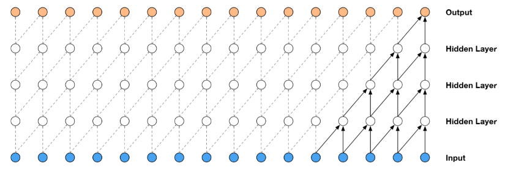
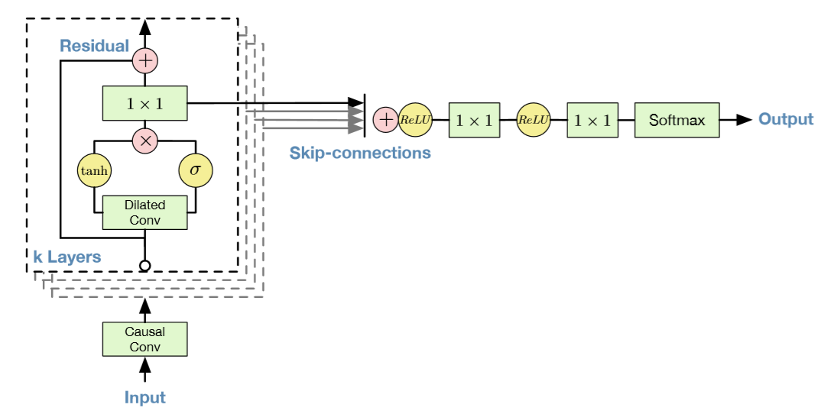
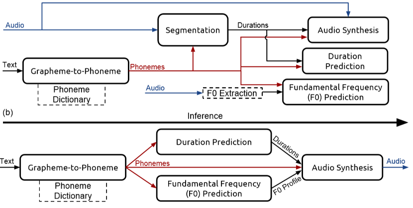
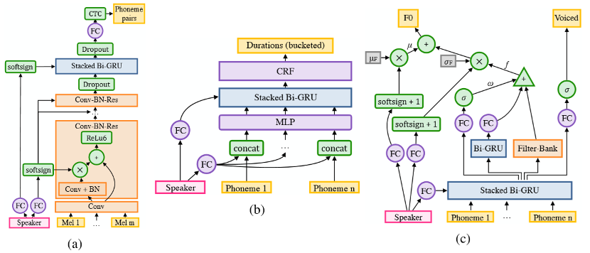
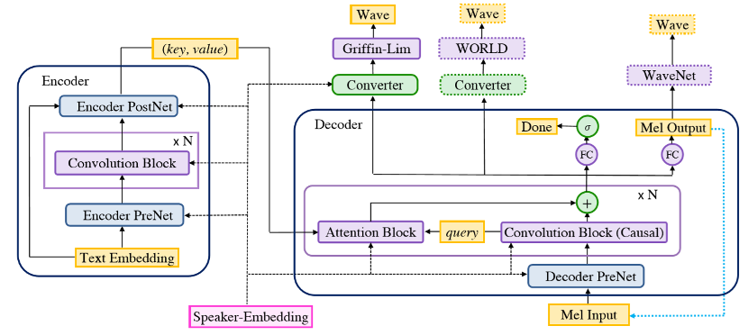

> **学习物联网，来HaaSEDU就对了**

# 语音合成技术-TTS
&emsp;&emsp;
语音合成是通过机械的、电子的方法产生人造语音的技术。TTS技术（又称文语转换技术）隶属于语音合成，它是将计算机自己产生的、或外部输入的文字信息转变为可以听得懂的、流利的汉语口语输出的技术。
语音合成的系统可分为前端和后端，如下图所示：

## 语音合成的发展
&emsp;&emsp;
起源阶段：语音合成技术的起源可以追溯到18到19世纪，当时是用机械装置来模拟人的发声，那时候科学家们会制作出一些精巧的气囊和风箱去搭建发声的系统，可以合成出一些元音和单音。

&emsp;&emsp;
电子合成器阶段：20世纪初，出现了用电子合成器来模拟人发声的技术，最具代表性的就是贝尔实验室的Dudley，他在1939年推出了名为“VODER”的电子发声器，使用电子器件来模拟声音的谐振。

&emsp;&emsp;
共振峰合成器阶段：到了20世纪80年代，随着集成电路技术的发展，出现了比较复杂的组合型的电子发生器，比较代表性的KLATT在1980年发布的串/并联混合共振峰合成器。

&emsp;&emsp;
单元挑选拼接合成阶段：到了20世纪80、90年代随着PSOLA方法的提出和计算机能力的发展，单元挑选和波形拼接技术逐渐走向成熟，90年代末刘庆峰博士提出听感量化思想，首次将中文语音合成技术做到了实用化地步。

&emsp;&emsp;
基于HMM的参数合成阶段：在20世纪末期，还有另外一种基于HMM的参数合成技术出现。

&emsp;&emsp;
基于深度学习的语音合成：随着AI技术不断发展，基于深度学习的语音合成技术逐渐被人们所知道，DNN/CNN/RNN等各种神经网络构型都可以用来做语音合成系统的训练，深度学习的算法可以更好地模拟人声变化规律。

## 语音合成步骤

### 文本处理
&emsp;&emsp;
这一步做的事情是把文本转化成音素序列，并标出每个音素的起止时间、频率变化等信息。
作为一个预处理步骤，它的重要性经常被忽视，但是它涉及到很多值得研究的问题，比如拼写相同但读音不同的词的区分、缩写的处理、停顿位置的确定等等。
### 语音合成
&emsp;&emsp;
狭义上这一步专指根据音素序列（以及标注好的起止时间、频率变化等信息）生成语音，广义上它也可以包括文本处理的步骤。
&emsp;&emsp;

这一步主要有三类方法：

&emsp;&emsp;
a) 拼接法，即从事先录制的大量语音中，选择所需的基本单位拼接而成。这样的单位可以是音节、音素等等；为了追求合成语音的连贯性，也常常用使用双音子（从一个音素的中央到下一个音素的中央）作为单位。拼接法合成的语音质量较高，但它需要录制大量语音以保证覆盖率。
* 优点：语音质量较高，近似真人的声音。

* 缺点：一是数据库要求太大，一般需要几十个小时的成品预料。企业级商用，需要至少5万句，费用成本在几百万元。二是如果库里的音素切分出错、语言学标注出错，那显然它最后会找错。

&emsp;&emsp;
b) 参数法，即根据统计模型来产生每时每刻的语音参数（包括基频、共振峰频率等），然后把这些参数转化为波形。

&emsp;&emsp;
参数法主要分为3个模块：前端、后端和声码器。前端做的事情，是把文本进行解析，决定每个字的发音是什么，这句话用什么样的语气语调，用什么样的节奏来读，哪些地方是需要强调的重点等等。常见的语气相关的数据描述包含但不限于下面这些：韵律边界、重音、边界调、甚至情感。其核心是预测问题，有若干统计模型可以解决，目前主流是用神经网络用来预测。然后用声码器 (vocoder) 生成波形，实现特征到 waveform 这最后一步。
* 优点：一是数据库要求相对较小一些，二是对于语音库里的标注错误不敏感。
* 缺点：听感不自然，因为受制于发声算法，有损失。

&emsp;&emsp;
c) 声道模拟法。参数法利用的参数是语音信号的性质，它并不关注语音的产生过程。与此相反，声道模拟法则是建立声道的物理模型，通过这个物理模型产生波形。这种方法的理论看起来很优美，但由于语音的产生过程实在是太复杂，所以实用价值并不高。

&emsp;&emsp;
以上方法代表了传统的语音合成方法。下面将介绍几种使用深度学习的新方法。

## 使用深度学习的语音合成方法
### WaveNet: 原始音频生成模型
&emsp;&emsp;
这篇文章的作者来自谷歌。他们提出了一种能产生原始音频波的神经网络。他们的模型是完全概率的和自回归的，在英语和汉语的text-to-speech上都取得了最先进的结果。

&emsp;&emsp;
WaveNet的主要成分是因果卷积。因果卷积确保了模型输出不会违反数据的顺序：模型在t时刻输出的预测不会依赖任何一个未来时刻的数据，如图4-3，对图像来说，因果卷积等价于一个遮蔽卷积，可以在使用前通过构建一个遮蔽张量与卷积核进行点乘来实现。对于音频这样的一维数据来说实现起来更简单，将正常卷积的输出偏移几个时间步即可。
WaveNET是基于PixelCNN的音频生成模型，它能够产生类似于人类发出的声音。在这个生成模型中，每个音频样本都以先前的音频样本为条件。条件概率用一组卷积层来建模，这个网络没有池化层，模型的输出与输入具有相同的时间维数。

&emsp;&emsp;
在模型架构中使用临时卷积可以确保模型不会违反数据建模的顺序。在该模型中，每个预测语音样本被反馈到网络上用来帮助预测下一个语音样本。由于临时卷积没有周期性连接，因此它们比RNN训练地更快。
### Tacotron: 端到端的语音合成
&emsp;&emsp;
为了解决传统语音合成的弊端促使了端到端语音合成的出现，研究者希望能够使合成系统能够尽量的简化，减少人工干预和对语言学相关背景知识的要求。近年来基于神经网络架构的深度学习方法崛起，使得原本在传统专业领域门槛极高的TTS应用上更接地气。

&emsp;&emsp;
通常的TTS模型包含许多模块，例如文本分析， 声学模型， 音频合成等。而构建这些模块需要大量专业相关的知识以及特征工程，这将花费大量的时间和精力，而且各个模块之间组合在一起也会产生很多新的问题。TACOTRON是一个端到端的深度学习TTS模型，它可以说是将这些模块都放在了一个黑箱子里，我们不用花费大量的时间去了解TTS中需要用的的模块或者领域知识，直接用深度学习的方法训练出一个TTS模型，模型训练完成后，给定input,模型就能生成对应的音频。

&emsp;&emsp;
这个模型是在音频和文本对上进行的训练，因此它可以非常方便地应用到新的数据集上。Tacotron是一个seq2seq模型，该模型包括一个编码器、一个基于注意力的解码器以及一个后端处理网络（post-processing net）。如下框架图所示，该模型输入字符，输出原始谱图。然后把这个谱图转换成波形图。

&emsp;&emsp;
下图显示了CBHG模块的结构。它由1-D卷积滤波器，highway networks和双向GRU（Gated Recurrent Unit）组成。

&emsp;&emsp;
将字符序列输入编码器，编码器将提取出文本的顺序表示。每个字符被表示为一个独热向量嵌入到连续向量中。然后加入非线性变换，再然后加上一个dropout，以减少过度拟合。这在本质上减少了单词的发音错误。模型所用的解码器是基于内容注意力的tanh解码器。然后使用Griffin-Lim算法生成波形图。

&emsp;&emsp;
Tacotron2是基于Tacotron和WaveNet进行融合的自然结果，既充分利用了端到端的合成框架，又利用了高音质的语音生成算法。在这一框架中，采用与Tacotron类似的结构，用于生成Mel谱，作为WaveNet的输入，而WaveNet则退化成神经网络声码器，两者共同组成了一个端到端的高音质系统。

&emsp;&emsp;
上图即Tacotron2的整体结构。将输入文本转化为嵌入向量作为第一层的输入，通过特征预测得到的梅尔声谱图序列作为下一层Wavenet的输入，然后得到时域波形。Wavenet的输入通常为语言特征，预测对数基频或者音素持续时间，但在Tacotron2中Wavenet的输入换成了梅尔声谱图。梅尔声谱图与STFT声谱图相关。相对于语言和声音特征，梅尔声谱图是一个比较简单，低水平的表现，wavenet模型通过这种表现能够直接生成音频。

### Deep Voice
&emsp;&emsp;
•	Deep Voice 1 **实时神经文本到语音合成**

这篇文章的作者来自百度硅谷人工智能实验室。Deep Voice是一个利用深度神经网络开发的文本到语音的系统。它有五个重要的组成模块：

&emsp;&emsp;
定位音素边界的分割模型（基于使用连接时间分类(CTC)损失函数的深度神经网络）；

&emsp;&emsp;
字母到音素的转换模型(字素到音素是在一定规则下产生单词发音的过程)；

&emsp;&emsp;
音素持续时间预测模型；

&emsp;&emsp;
基频预测模型；

&emsp;&emsp;
音频合成模型（一个具有更少参数的WaveNet变体）。

&emsp;&emsp;
字母到音素模型将英文字符转换为音素。分割模型识别每个音素在音频文件中开始和结束的位置。音素持续时间模型预测音素序列中每个音素的持续时间。基频模型预测音素是否发声。音频合成模型则综合了字母到音素转换模型、音素持续时间模型、基频预测模型等的输出进行音频合成。

&emsp;&emsp;
百度硅谷人工智能实验室在Deep Voice上进行了二次迭代。他们介绍了一种利用低维可训练说话人嵌入来增强神经文本到语音的方法，这可以从单个模型产生不同的声音。该模型与Deep Voice 1有类似的流水线，但它在音频质量上却有显著的提高。该模型能够从每个说话人不到半个小时的语音数据中学习数百种独特的声音。

&emsp;&emsp;
•	Deep Voice 2 **多说话人神经文本语音转换**

&emsp;&emsp;
Deep Voice 2和Deep Voice 1之间的主要区别在于音素持续时间模型和频率模型的分离。Deep Voice 1有一个用于联合预测音素持续时间和频率曲线的单一模型; 而在Deep Voice 2中，则先预测音素持续时间，然后将它们用作频率模型的输入。

&emsp;&emsp;
Deep Voice 2中的分割模型使用一种卷积递归结构（采用连接时间分类(CTC)损失函数）对音素对进行分类。Deep Voice 2的主要修改是在卷积层中添加了大量的归一化和残余连接。它的发声模型是基于WaveNet架构的。

&emsp;&emsp;
从多个说话人合成语音，主要通过用每个说话人的单个低维级说话人嵌入向量增强每个模型来完成的。说话人之间的权重分配，则是通过将与说话人相关的参数存储在非常低维的矢量中来实现。递归神经网络(RNN)的初始状态由说话人声音的嵌入产生。采用均匀分布的方法随机初始化说话人声音的嵌入，并用反向传播对其进行联合训练。说话人声音的嵌入包含在模型的多个部分中，以确保能考虑到每个说话人的声音特点。

&emsp;&emsp;
•	Deep Voice 3 **利用卷积序列学习将文本转换为语音**

&emsp;&emsp;
提出了一种全卷积字符到谱图的框架，可以实现完全并行计算。该框架是基于注意力的序列到序列模型。这个模型在LibriSpeech ASR数据集上进行训练。

&emsp;&emsp;
这个模型的结构能够将字符、音素、重音等文本特征转换成不同的声码器参数，其中包括Mel波段光谱图、线性比例对数幅度谱图、基频谱图、谱包络图和非周期性参数。然后将这些声码器参数作为音频波形合成模型的输入。

&emsp;&emsp;
模型的结构由以下几个部分组成：
* 编码器：一种全卷积编码器，可将文本特征转换为内部学习表示。
* 解码器：一种全卷积因果解码器，以自回归的方式解码学习表示。
* 转换器：一种全卷积后处理网络，可预测最终的声码器参数。

### Voice-Loop: 通过语音循环进行语音拟合与合成
&emsp;&emsp;
这篇文章来自Facebook AI研究院。引入了一种神经文本到语音(TTS)技术，可以将文本从野外采集的声音转换为语音。Voice-Loop的灵感来源于一种称为语音循环的工作记忆模型，它能在短时间内保存语言信息。它由两部分组成，一是一个不断被替换的语音存储（phonological store），二是一个在语音存储中保持长期表达（longer-term representations）的预演过程。

&emsp;&emsp;
Voice-loop将移动缓冲区视作矩阵，从而来构造语音存储。句子表示为音素列表。然后从每个音素解码一个短向量。通过对音素的编码进行加权并在每个时间点对它们求和来生成当前的上下文向量。使Voice-Loop脱颖而出的一些属性包括：使用内存缓冲区而不是传统的RNN，所有进程之间的内存共享，以及使用浅层、全连接的网络进行所有计算。

### 语音合成的发展趋势
&emsp;&emsp;
从合成的发展历史来看，表现力、音质、复杂度和自然度一直是合成技术所追求的四点。其中随着技术的演进，复杂度、自然度、音质三个方面都已经取得了非常不错的成绩。目前各大技术提供商更多的是在研究如何提高合成音的表现力，特别是语气和情感方面。
###提高合成语音的自然度

&emsp;&emsp;
提高合成语音的自然度仍然是高性能文语转换的当务之急。就汉语语音合成来说，目前在单字和词组一级上，合成语音的可懂度和自然度已基本解决，但是到句子乃至篇章一级时其自然度问题就比较大。
### 丰富合成语音的表现力

&emsp;&emsp;
目前国内外大多数语音合成研究是针对文语转换系统，且只能解决以某种朗读风格将书面语言转换成口语输出，缺乏不同年龄、性别特征及语气、语速的表现，更不用说赋予个人的感情色彩。随着信息社会的需求发展，对人机交互提出了更高的要求，人机口语对话系统的研究也提到了日程上。即语音合成研究已开始从文字到语音的转换阶段向概念到语音的转换阶段发展。这不仅对语音合成技术提出了更高的要求，而且涉及到计算机语言生成，涉及人类大脑的高级神经活动。
### 降低语音合成技术的复杂度

&emsp;&emsp;
语音合成技术正在走向市场。为了适应社会的需求，扩大文语合成的应用场合，除了解决好上面两个问题，提高合成语音的质量和增强语音合成的表现力以外，在其他实用化方面也有要加以改进的地方。就目前汉语文语转换系统而言，减小音库容量就是一个重要课题。
### 多语种文语合成

&emsp;&emsp;
语言是人们交流的工具，不同民族有自己不同的语言，不同语言之间的交流在今天开放的信息社会和网络时代显得十分重要，多语种的文语合成有着独特的应用价值。例如在自动电话翻译，有声的电子邮件等中都提出多语种的合成，即使是对汉语合成也有多方言文语转换的需求。理想的多语种合成系统最好是各种语言共用一种合成算法或语音合成器，但是现有的语音合成系统大多是针对某一种语言或若干种语言开发出来的，所采用的算法及规则都是和某种语言密切相关的，因此很难推广到其他的语种。例如汉语就和西方语言有很大的差异，国内的系统都是做汉语文语转换，它的一套韵律控制规则完全不适合于英语，而且主要是合成汉语普通话，即使推广到广东话和上海话都有相当的难度。可见要真正解决多语种的文语合成，从文本处理到语音合成都必须有新的思路。美国贝尔实验室在多语种文语转换方面作了大量的工作，其中包括汉语普通话合成，值得注意。

