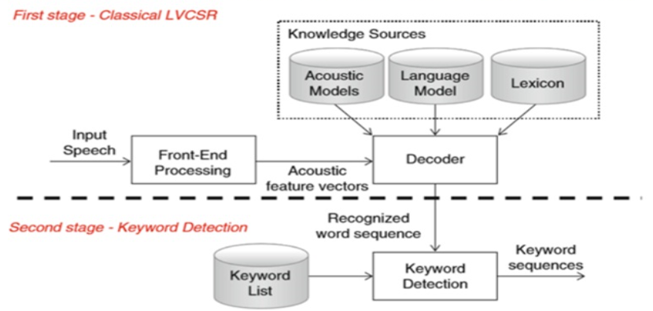
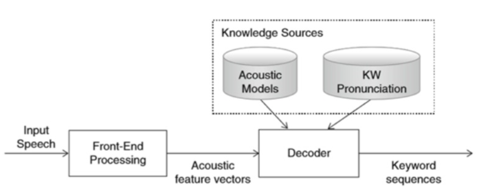
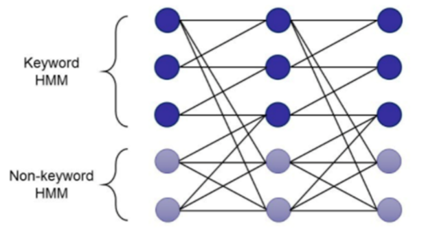
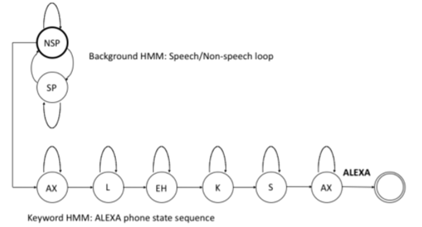
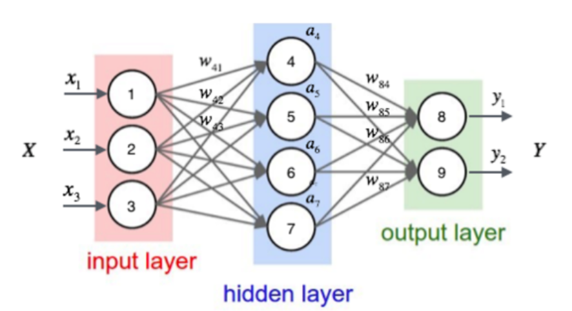
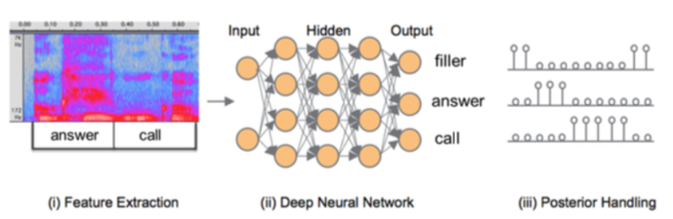

> **学习物联网，来HaaSEDU就对了**

# 语音唤醒技术-KWS
## 语音唤醒定义

&emsp;&emsp;
语音唤醒在学术上被称为keyword spotting（简称KWS），需要在连续语流中实时地检测出说话人的特定片段。这里要注意，检测的“实时性”是一个关键点，语音唤醒的目的就是将设备从休眠状态激活至运行状态，所以唤醒词说出之后，需要立刻被检测出来。那么，该怎样评价语音唤醒的效果呢？通行的指标有四个方面，即唤醒率、虚警率、响应时间和功耗水平：
* 唤醒率，指用户交互的成功率，专业术语为召回率（被唤醒次数中正确唤醒的比例）。
* 虚警率，用户未进行交互而设备被唤醒的概率（被唤醒次数中被误唤醒的比例）。
* 响应时间，指从用户说完唤醒词后，到设备给出反馈的时间差。
* 功耗水平，即唤醒系统的耗电情况。很多智能设备是通过电池供电，需要满足长时续航，对功耗水平就比较在意。

 

## 语音唤醒的技术路线
&emsp;&emsp;
语音唤醒能力主要依赖于语音唤醒模型（下称“唤醒模型”），是整个语音唤醒核心。唤醒模型主要负责在听到唤醒词后马上切换为工作状态，所以必须要实时监测，才能做到听到后及时反馈。一是需要实时响应，二是唤醒模型对算力的要求不高，一般唤醒模型是做在本地的（区别于云端的ASR识别）。这就是我们即使没有联网，你叫“天猫精灵”，她也会答应你的原因。

&emsp;&emsp;
唤醒词识别可以看成是一种keyword spotting的任务，解决这个问题的方法可以是基于大词汇量连续语音识别（large vocabulary continuous speech recognition，LVCSR）的，也可以是基于流行的filler模型（或者 background 模型）。基于 LVCSR 的方法可以一劳永逸地解决问题，不过需要较大的解码资源，而后者模型结构简单小巧，不需要大的解码资源而容易本地化、实时化。

&emsp;&emsp;
基于Keyword的方法：

&emsp;&emsp;
唤醒模型的算法经过了三个阶段的发展：
### 基于模板匹配
&emsp;&emsp;
第一种识别方式称为基于模板识别，训练和测试的步骤比较简单，训练就是依据注册语音或者模板语音进行特征提取，构建模板。测试时，通过特征提取生成特征序列，使用DTW（dynamic time warping）等方法计算测试的特征序列和模板序列的距离，基于此判断是否唤醒。简单理解就是找到唤醒词的特征，根据特征制定触发条件，然后判断音频内容是否满足触发条件。

&emsp;&emsp;
在过去几十年对query-by -example方法的探索中，研究热点是如何选择合适的特征表示方法对关键词进行建模，而模板比对主要采用动态时间规整(dynamic time warping)的算法，它采用了动态规划的思想。在自动语音识别的孤立词识别任务中，也采用了类似query-by-example的方法。将给定的词汇创建模板，将待识别语音和模板比对，相似度最大的即为识别结果。DTW方法在孤立词识别任务中也能取得较好的效果。query-by-example方法不再是KWS问题的主流方法，因此此处不再做过多展开。

&emsp;&emsp;
这种方法主要分两步：一是用常规连续语音识别方法识别出文本，二是从文本中检测出关键词，找到就唤醒，反之就不唤醒。

&emsp;&emsp;
基于LVCSR系统方法的一个缺点是OOV（out-of-vocabulary）问题。如果关键词不在词典中，那识别任务将无法进行。基于LVCSR的关键词唤醒虽然能取得较好的效果，但是计算需求量大，在训练资源充足的时候系统稳定性较强，但是在移动设备上连续运行LVCSR系统通常是不切实际的。

 

### 基于隐马尔可夫模型
&emsp;&emsp;
基于隐马尔可夫模型（Hidden Markov Model，HMM）的keyword/filler系统是目前的主流方法之一，它和语音识别中早期使用的HMM-GMM系统原理相似。其思想都是用HMM模型对待识别的语音的子字单元进行建模。最大的不同是在解码器中，LVCSR方法的解码器中包含了词典中所有的单词，而关键词唤醒任务的keyword/filler系统则将语音分为关键词(keyword) 和非关键词(filler) 两类进行建模，即除关键词以外的词汇都包含在Filler路径当中，这样的网络会比语音识别的网络小很多。如下图所示。

&emsp;&emsp;
用隐马尔可夫模型来做唤醒模型，一般会为唤醒词和其他声音分别建立一个模型，然后将输入的信号（会对音频信息进行切割处理）分别传入两个模型进行打分，最后对比两个模型的分值，决定是该唤醒，还是保持休眠。

&emsp;&emsp;
keyword建模采用精细建模方法，在词级、音素级或状态级上对关键词进行建模; filler建模采用粗放建模的方法，对除关键词之外的任意词语和噪音进行建模。这样建模的好处是大大缩小了解码空间，使解码速度变快，提高系统的实时率。如图1-5所示为基于HMM系统的keyword-filler的一个实例。该解码系统由keyword(Alexa)路径和filler路径构成，filler路径又分为非语音(Non-speech，NSP)路径和语音(speech，SP) 路径。对关键词采用三状态HMM对音素进行建模，而filler采用单状态HMM进行建模，有趣的是该隐马尔可夫模型的发射概率由TDNN进行建模。

 

### 基于深度学习的方案
&emsp;&emsp;
用神经网络来做唤醒模型，可以分为多种：有将模版匹配中的特征提取，改为神经网络作为特征提取器；也有在隐马尔可夫模型中，某个步骤使用神经网络模型的；还有基于端到端的神经网络方案。

&emsp;&emsp;
基于深度学习的方案通常包括三个部分：第一步是特征的提取，第二步是一个神经网络，它的输入是语音特征，输出是各个关键词和非关键词即Filler这样一个后验概率。由于第二步的网络是以帧为单位输出后验值的，就需要第三步对后验值以一定的窗长进行平滑，平滑后的后验值如果超过一定阈值会被认为是唤醒了。

&emsp;&emsp;
下图是一个DNN KWS系统的框图，这个系统由三部分组成。首先，在特征提取模块中，每25ms计算40维Mel-filter bank特征，帧移位为10ms。接下来，在每一帧，我们向左堆叠23帧，向右堆叠8帧，并将其输入DNN。基准DNN架构由3个隐藏层组成，其中128个隐藏单元/层和softmax层。每个隐藏层使用非线性的ReLU。softmax输出层包含一个输出目标，用于检测关键字短语中的每个单词，以及一个额外的输出目标，该目标表示不属于关键字中任何单词的帧。用分布式异步梯度下降优化交叉熵标准去训练网络权重。最后，在后验处理模块中，来自DNN的单个帧后验分数被组合成对应于关键字的单个分数。

 

## 唤醒模型的训练步骤
### 定义唤醒词

&emsp;&emsp;
首先我们需要定义一个唤醒词：定义唤醒词也是有讲究的，一般会定义3-4个音节的词语作为唤醒词。像我们常见的“天猫精灵”、“小爱同学”、“小度小度”，全部都是4个音节，由于汉语的发音和音节的关系，你也可以简单的把音节理解为字数。唤醒词字数越少，越容易误触发；字数越多，越不容易记忆——这也是一般定义在4个字的原因。另外这3-4个字要避开一些常见的发音，避免和其他发音出现竞合，要不然会频繁的误唤醒。

 

### 收集发音数据
&emsp;&emsp;
然后就需要收集这个唤醒词的发音，理论上来说发音人越多、发音场景越丰富，训练的唤醒效果越好。一般按照发音人数和声音时长进行统计，不同的算法模型对于时长的依赖不一样。基于端到端神经网络的模型，一个体验良好的唤醒词可能需要千人千时，就是一千个人的一千个小时。收集唤醒词发音的时候，一定要注意发音的清晰程度，有时候甚至要把相近的音也放到训练模型中，防止用户发音问题导致无法进行唤醒。

 

### 训练唤醒模型
&emsp;&emsp;
训练唤醒模型有之前讲到的三种方法，三种方法的性能比较如下图：

 

### 测试并迭代
&emsp;&emsp;
一般在成熟的产品中需要用到这一步，个人测试就不需要了。

 

## 语音唤醒的难点及应用
&emsp;&emsp;
语音唤醒的难点，主要是低功耗要求和高效果需求之间的矛盾。一方面，目前很多智能设备采用的都是低端芯片，同时采用电池供电，这就要求唤醒所消耗的能源要尽可能的少。另一方面，用户对体验效果的追求越来越高。目前语音唤醒主要应用于C端，用户群体广泛，且要进行大量远场交互，对唤醒能力提出了很高要求。要解决两者之间的矛盾，对于低功耗需求，一般采用模型深度压缩策略，减少模型大小并保证效果下降幅度可控；而对于高效果需求，一般是通过模型闭环优化来实现。先提供一个效果可用的启动模型，随着用户的使用，进行闭环迭代更新，整个过程完成自动化，无需人工参与。

&emsp;&emsp;
语音唤醒的应用领域十分广泛，主要是C端产品，比如机器人、音箱、汽车等。比较有代表性的应用模式有如下几种：
* 传统语音交互：先唤醒设备，等设备反馈后（提示音或亮灯），用户认为设备被唤醒了，再发出语音控制命令，缺点在于交互时间长。
* One-shot：直接将唤醒词和工作命令一同说出，如“叮咚叮咚，我想听周杰伦的歌”，客户端会在唤醒后直接启动识别以及语义理解等服务，缩短交互时间。
* Zero-shot：将常用用户指定设置为唤醒词，达到用户无感知唤醒，例如直接对智能音箱说“导航到浙江大学”，这里将一些高频前缀的说法设置成唤醒词。

 

# 附录
&emsp;&emsp;
摘自[清华语音和语言技术中心](http://cslt.riit.tsinghua.edu.cn/mediawiki/images/c/c5/Kws.pdf)