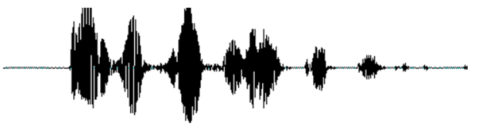
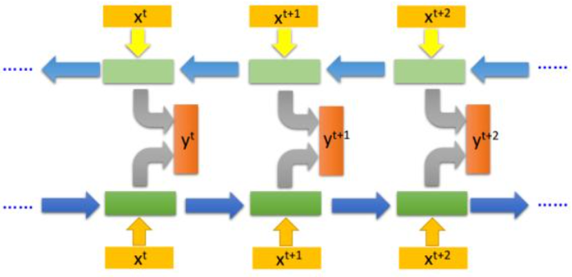
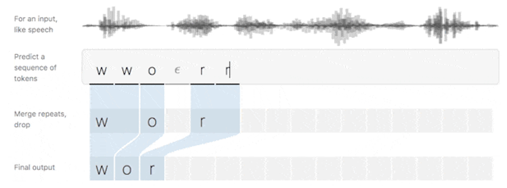
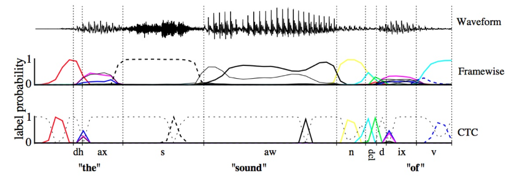

> **学习物联网，来HaaSEDU就对了**

# 语音识别技术-ASR
&emsp;&emsp;
语音识别技术即Automatic Speech Recognition（简称ASR），是指将人说话的语音信号转换为可被计算机程序所识别的信息，从而识别说话人的语音指令及文字内容的技术。语音识别主要是将人类语音中的词汇内容转换为计算机可读的输入，一般都是可以理解的文本内容，也有可能是二进制编码或者字符序列。但是，我们一般理解的语音识别其实都是狭义的语音转文字的过程，简称语音转文本识别（Speech To Text，STT）更合适，这样就能与语音合成(Text To Speech，TTS)对应起来。

&emsp;&emsp;
语音技术在近年来开始改变我们的生活和工作方式。对于某些嵌入式设备来说，语音成为了人机交互的主要方式。出现这种趋势的原因，首先是计算能力的不断提升，通用GPU等高计算能力设备的发展，使得训练更复杂、更强大的声学模型（Acoustic Model, AM）变得可能，高性能的嵌入式处理器的出现，使得语音识别的终端应用变得可能；其次，借助近乎无处不在的互联网和不断发展的云计算，我们可以得到海量的语音数据资源，真实场景的数据使得语音识别系统变得更加鲁棒；最后，移动设备、可穿戴设备、智能家居设备、车载信息娱乐系统正变得越来越流行，在这些设备上，语音交互变成了一个无法避免的交互方式。目前，基于近场信号的、受控环境（低噪声、低混响）下的标准音语音识别能够达到很高的水平。然而在智能音箱开放性的真实环境，语音识别依然是一个不小的挑战，需要结合前端信号处理一起来优化。

 

## 语音识别发展
&emsp;&emsp;
现代语音识别可以追溯到1952年，Davis等人研制了世界上第一个能识别10个英文数字发音的实验系统，从此正式开启了语音识别的进程。

&emsp;&emsp;
70年代，语音识别主要集中在小词汇量、孤立词识别方面，使用的方法也主要是简单的模板匹配方法，即首先提取语音信号的特征构建参数模板，然后将测试语音与参考模板参数进行一一比较和匹配，取距离最近的样本所对应的词标注为该语音信号的发音。该方法对解决孤立词识别是有效的，但对于大词汇量、非特定人连续语音识别就无能为力。

&emsp;&emsp;
因此，进入80年代后，研究思路发生了重大变化，从传统的基于模板匹配的技术思路开始转向基于统计模型（HMM）的技术思路。
下图是从1993年到2017年在Switchboard上语音识别率的进展情况，从图中也可以看出1993年到2009年，语音识别一直处于GMM-HMM时代，语音识别率提升缓慢，尤其是2000年到2009年语音识别率基本处于停滞状态；2009年随着深度学习技术，特别是DNN的兴起，语音识别框架变为DNN-HMM，语音识别进入了DNN时代，语音识别精准率得到了显著提升；2015年以后，由于“端到端”技术兴起，语音识别进入了百花齐放时代，语音界都在训练更深、更复杂的网络，同时利用端到端技术进一步大幅提升了语音识别的性能，直到2017年微软在Swichboard上达到词错误率5.1%，从而让语音识别的准确性首次超越了人类，当然这是在一定限定条件下的实验结果，还不具有普遍代表性。

 

## 语音识别原理
&emsp;&emsp;
语音识别的本质是一种基于语音特征参数的模式识别，即通过学习，系统能够把输入的语音按一定模式进行分类，进而依据判定准则找出最佳匹配结果。下图是基于模式匹配原理的语音识别系统框图。

 

### 语音识别系统组成
&emsp;&emsp;
语音识别系统主要有四部分组成：信号处理和特征提取、声学模型、语言模型（Language Model, LM）和解码器(Decoder)。

 

## 语音识别系统
&emsp;&emsp;
信号处理和特征提取部分以音频信号为输入，通过消除噪音、信道失真等对语音进行增强，将语音信号从时域转化到频域，并为后面的声学模型提取合适的特征。其中信号处理包括分帧，加窗，预加重等。特征提取中常用的特征参数包括：基音周期，共振峰，短时平均能量或幅度，线性预测系数（LPC），感知加权预测系数（PLP），短时平均过零率，线性预测倒谱系数（LPCC），自相关函数，梅尔倒谱系数（MFCC），小波变换系数，经验模态分解系数（EMD）和伽马通滤波器系数（GFCC）等。

&emsp;&emsp;
声学模型将声学和发音学的知识进行整合，以特征提取模块提取的特征为输入，生成声学模型得分。

&emsp;&emsp;
语言模型估计通过重训练语料学习词之间的相互概率，来估计假设词序列的可能性，也即语言模型得分。如果了解领域或者任务相关的先验知识，语言模型得分通常可以估计得更准确。

&emsp;&emsp;
解码器对给定的特征向量序列和若干假设词序列计算声学模型得分和语言模型得分，将总体输出分数最高的词序列作为识别结果。

&emsp;&emsp;
关于声学模型，主要有两个问题，分别是特征向量序列的可变长和音频信号的丰富变化性。可变长特征向量序列问题在学术上通常有动态时间规划（Dynamic Time Warping, DTW）和隐马尔科夫模型（Hidden Markov Model, HMM）方法来解决。而音频信号的丰富变化性是由说话人的各种复杂特性或者说话风格与语速、环境噪声、信道干扰、方言差异等因素引起的。声学模型需要足够的鲁棒性来处理以上的情况。

&emsp;&emsp;
下面用易于理解的方法介绍语音识别的基本原理。
### 前端信号处理
&emsp;&emsp;
在语音识别之前，首先需要进行前端信号处理，前端的信号处理是对原始语音信号进行的相关处理，使得处理后的信号更能代表语音的本质特征，相关技术点如下：

* 1.语音活动检测：语音活动检测（Voice Activity Detection, VAD）用于检测出语音信号的起始位置，分离出语音段和非语音（静音或噪声）段。VAD算法大致分为三类：基于阈值的VAD、基于分类器的VAD和基于模型的VAD。 
  * 基于阈值的VAD是通过提取时域（短时能量、短时过零率等）或频域（MFCC、谱熵等）特征，通过合理的设置门限，达到区分语音和非语音的目的；
  * 基于分类的VAD是将语音活动检测作为（语音和非语音）二分类，可以通过机器学习的方法训练分类器，达到语音活动检测的目的；
  * 基于模型的VAD是构建一套完整的语音识别模型用于区分语音段和非语音段，考虑到实时性的要求，并未得到实际的应用。

* 2.降噪：在生活环境中通常会存在例如空调、风扇等各种噪声，降噪算法目的在于降低环境中存在的噪声，提高信噪比，进一步提升识别效果。 常用降噪算法包括自适应LMS和维纳滤波等。

* 3.回声消除：回声存在于双工模式时，麦克风收集到扬声器的信号，比如在设备播放音乐时，需要用语音控制该设备的场景。 回声消除通常使用自适应滤波器实现的，即设计一个参数可调的滤波器，通过自适应算法（LMS、NLMS等）调整滤波器参数，模拟回声产生的信道环境，进而估计回声信号进行消除。
* 4.混响消除：语音信号在室内经过多次反射之后，被麦克风采集，得到的混响信号容易产生掩蔽效应，会导致识别率急剧恶化，需要在前端处理。混响消除方法主要包括：基于逆滤波方法、基于波束形成方法和基于深度学习方法等。
* 5.声源定位：麦克风阵列已经广泛应用于语音识别领域，声源定位是阵列信号处理的主要任务之一，使用麦克风阵列确定说话人位置，为识别阶段的波束形成处理做准备。声源定位常用算法包括：基于高分辨率谱估计算法（如MUSIC算法），基于声达时间差（TDOA）算法，基于波束形成的最小方差无失真响应（MVDR）算法等。
* 6.波束形成：波束形成是指将一定几何结构排列的麦克风阵列的各个麦克风输出信号，经过处理（如加权、时延、求和等）形成空间指向性的方法，可用于声源定位和混响消除等。波束形成主要分为：固定波束形成、自适应波束形成和后置滤波波束形成等。

 

### 信号处理
&emsp;&emsp;
声音实际上是一种波。常见的mp3、wmv等格式都是压缩格式，必须转成非压缩的纯波形文件，比如Windows PCM文件，即wav文件来处理。wav文件里存储的除了一个文件头以外，就是声音波形的一个个点了。采样率越大，每毫秒语音中包含的点的个数就越多。另外声音有单通道、双通道之分，还有四通道的等等。对语音识别任务来说，单通道就足够了，多了浪费，因此一般要把声音转成单通道的来处理。下图是一个波形的示例。

&emsp;&emsp;
在开始语音识别之前，有时需要把首尾端的静音切除，降低对后续步骤造成的干扰。这个静音切除的操作一般称为VAD，需要用到信号处理的一些技术。要对声音进行分析，需要对声音分帧，也就是把声音切开成一小段一小段，每小段称为一帧。分帧操作一般不是简单的切开，而是使用移动窗函数来实现，帧与帧之间一般是有交叠的，如下图：

 

### 特征提取
&emsp;&emsp;
分帧后，语音就变成了很多小段。但波形在时域上几乎没有描述能力，因此必须将波形作变换。常见的一种变换方法是提取MFCC（Mel-scale Frequency Cepstral Coefficients，梅尔倒谱系数）特征，根据人耳的生理特性，把每一帧波形变成一个多维向量，可以简单地理解为这个向量包含了这帧语音的内容信息。这个过程叫做声学特征提取。至此，声音就成了一个12行（假设声学特征是12维）、N列的一个矩阵，称之为观察序列，这里N为总帧数。观察序列如下图所示，图中，每一帧都用一个12维的向量表示，色块的颜色深浅表示向量值的大小。

 

### 声学特征转文字
&emsp;&emsp;
如下图，图中，每个小竖条代表一帧，若干帧语音对应一个状态，每三个状态组合成一个音素（音素：单词的发音由音素构成。对英语，一种常用的音素集是卡内基梅隆大学的一套由39个音素构成的音素集，参见The CMU Pronouncing Dictionary。汉语一般直接用全部声母和韵母作为音素集，另外汉语识别还分有调无调），若干个音素组合成一个单词。也就是说，只要知道每帧语音对应哪个状态了，语音识别的结果也就出来了。即：
* 第一步，把帧识别成状态（难点）；
* 第二步，把状态组合成音素；
* 第三步，把音素组合成单词。
  

&emsp;&emsp;
那么如何判断每帧声音特征对应哪个状态呢？比较简单的办法是，看某帧对应哪个状态的概率最大，那这帧就属于哪个状态。比如下面的示意图，这帧对应S3状态的概率最大，因此就让这帧属于S3状态。那么，判断状态必须有一个现有模板进行比较和匹配，这就是声学模型，获取声学模型需要大量的声音数据进行训练产生。
 

&emsp;&emsp;
但很明显，简单匹配并不一定可以得到良好的效果，因为很有可能相邻的帧识别出的结果相差很大，整体更是杂乱无章的，可能不能合成有序的状态进而判断出是什么音素，所以要使用更好的算法来进行状态的匹配，这也是语音识别技术的核心算法，下面就来介绍常见的语音识别技术算法。

 

## 主流语音识别模型介绍
&emsp;&emsp;
声学模型可以理解为是对发声的建模，它能够把语音输入转换成声学表示的输出，更准确的说是给出语音属于某个声学符号的概率。
语音识别技术主要分为三大类，第一类是模型匹配法，包括矢量量化(VQ) 、动态时间规整(DTW)等；第二类是概率统计方法，包括高斯混合模型(GMM) 、隐马尔科夫模型(HMM)等；第三类是辨别器分类方法，如支持向量机(SVM) 、人工神经网络(ANN)和深度神经网络（DNN）等以及多种组合方法。

&emsp;&emsp;
在过去，主流的语音识别系统通常使用梅尔倒谱系数（Mel-Frequency Cepstral Coefficient, MFCC）或者线性感知预测（Perceptual Linear Prediction, PLP）作为特征，使用混合高斯模型-隐马尔科夫模型（GMM-HMM）作为声学模型。在近些年，区分性模型，比如深度神经网络（Deep Neural Network, DNN）在对声学特征建模上表现出更好的效果。基于深度神经网络的声学模型，比如上下文相关的深度神经网络-隐马尔科夫模型（CD-DNN-HMM）在语音识别领域已经大幅度超越了过去的GMM-HMM模型。

&emsp;&emsp;
下面对主流的识别模型做简单介绍。

### GMM-HMM时代
&emsp;&emsp;
HMM的理论基础在1970年前后就已经由Baum等人建立起来，随后由CMU的Baker和IBM的Jelinek等人将其应用到语音识别当中。HMM模型假定一个音素含有3到5个状态，同一状态的发音相对稳定，不同状态间是可以按照一定概率进行跳转；某一状态的特征分布可以用概率模型来描述，使用最广泛的模型是GMM（高斯混合模型Gaussian Mixture Model）。因此GMM-HMM框架中，HMM描述的是语音的短时平稳的动态性，GMM用来描述HMM每一状态内部的发音特征。 
经典的HMM建模框架如下所示：

&emsp;&emsp;
其中，输出概率使用高斯混合模型GMM建模，如下图所示：

&emsp;&emsp;
下图是GMM-HMM框架宏观图，基于GMM-HMM框架，研究者提出各种改进方法，如结合上下文信息的动态贝叶斯方法、区分性训练方法、自适应训练方法、HMM/NN混合模型方法等。这些方法都对语音识别研究产生了深远影响，并为下一代语音识别技术的产生做好了准备。自上世纪90年代语音识别声学模型的区分性训练准则和模型自适应方法被提出以后，在很长一段内语音识别的发展比较缓慢，语音识别错误率一直没有明显下降。

 

### DNN-HMM时代
&emsp;&emsp;
2006年，Hinton提出深度置信网络（DBN），促使了深度神经网络（DNN）研究的复苏。2009年，Hinton将DNN应用于语音的声学建模，在TIMIT上获得了当时最好的结果。2011年底，微软研究院的俞栋、邓力又把DNN技术应用在了大词汇量连续语音识别任务上，大大降低了语音识别错误率。从此语音识别进入DNN-HMM时代。 
DNN-HMM主要是用DNN模型代替原来的GMM模型，对每一个状态进行建模，DNN带来的好处是不再需要对语音数据分布进行假设，将相邻的语音帧拼接又包含了语音的时序结构信息，使得对于状态的分类概率有了明显提升，同时DNN还具有强大环境学习能力，可以提升对噪声和口音的鲁棒性。 

&emsp;&emsp;
DNN与GMM相比具有如下优点：
* 1）DNN不需要对声学特征所服从的分布进行假设；
* 2）DNN的输入可以采用连续的拼接帧，因而可以更好地利用上下文的信息；
* 3）DNN的训练过程可以采用随机优化算法来实现，而不是采用传统的批优化算法，因此当训练数据规模较大时也能进行非常高效的训练，显然，训练数据规模越大，所得到的声学模型就越精确，也就越有利于提高语音识别的性能；
* 4）在发音模式分类上，DNN这种区分式模型也要比GMM这种产生式模型更加合适。

&emsp;&emsp;
DNN输出向量的维度对应HMM中状态的个数，通常每一维输出对应一个绑定的triphone状态。训练时，为了得到每一帧语音在DNN上的目标输出值(标准值)，需要通过事先训练好的GMM-HMM识别系统在训练语料上进行强制对齐。即要训练一个DNN-HMM声学模型，首先需要训练一个GMM-HMM声学模型，并通过基于Viterbi算法的强制对其方法给每个语音帧打上一个HMM状态标签，然后以此状态标签，训练一个基于DNN训练算法的DNN模型。最后用DNN模型替换HMM模型中计算观察概率的GMM部分，但保留转移概率和初始概率等其他部分。

&emsp;&emsp;
由于语音信号是连续的，不仅各个音素、音节以及词之间没有明显的边界，各个发音单位还会受到上下文的影响。虽然拼帧可以增加上下文信息，但对于语音来说还是不够。语音的协同发音现象说明声学模型需要考虑到语音帧之间的长时相关性，尽管上文中DNN-HMM通过拼帧的方式对上下文信息进行了建模，但是毕竟拼接的帧数有限，建模能力不强，因此引入RNN(循环神经网络)增强了长时建模的能力，RNN隐层的输入除了接收前一个隐层的输出之外，还接收前一时刻的隐层输出作为当前输入，通过RNN的隐层的循环反馈，保留了长时的历史信息，大大增强了模型的记忆能力，语音的时序特性通过RNN也得到了很好的描述。

&emsp;&emsp;
但是RNN的简单结构在模型训练进行BPTT(Back propagation Through Time)时很容易引起梯度消失/爆炸等问题，因此在RNN的基础上引入了LSTM(long stort term memory长短时记忆模型)，LSTM是一种特殊的RNN，通过Cell以及三个门控神经元的特殊结构对长时信息进行建模，解决了RNN出现的梯度问题，并且具有长短时记忆能力。虽然LSTM的计算复杂度会比DNN增加，但其整体性能比DNN有相对20%左右稳定提升。LSTM示意图如下：

&emsp;&emsp;
RNN与LSTM输入输出对比图如下：

&emsp;&emsp;
BLSTM是在LSTM基础上做的进一步改进，不仅考虑语音信号的历史信息对当前帧的影响，还要考虑未来信息对当前帧的影响，因此其网络中沿时间轴存在正向和反向两个信息传递过程，这样该模型可以更充分考虑上下文对于当前语音帧的影响，能够极大提高语音状态分类的准确率。BLSTM考虑未来信息的代价是需要进行句子级更新，模型训练的收敛速度比较慢，同时也会带来解码的延迟，对于这些问题，业界都进行了工程优化与改进，即使现在仍然有很多大公司使用的都是该模型结构。 
 
&emsp;&emsp;
图像识别中主流的模型就是CNN，而语音信号的时频图也可以看作是一幅图像，因此CNN也被引入到语音识别中。CNN是一种经典的前馈神经网络，是受生物学上感受野机制启发而来。它本质上是一种基于监督学习的数学模型，由多个卷积层和池化层交替出现构成整个网络的前端，用于特征提取和表示，在后端由多个全连接层用于对提取到的局部特征进行全局上的整合与变换。网络最终输出会根据任务的不同而动态调整。与传统的DNN网络结构相比，CNN能够从大量的训练数据中提取有效且泛化能力强的特征，因而非常适合于分类任务。

&emsp;&emsp;
要想提高语音识别率，就需要克服语音信号所面临的多样性，包括说话人自身、说话人所处的环境、采集设备等，这些多样性都可以等价为各种滤波器与语音信号的卷积。而CNN相当于设计了一系列具有局部关注特性的滤波器，并通过训练学习得到滤波器的参数，从而从多样性的语音信号中抽取出不变的部分，CNN本质上也可以看作是从语音信号中不断抽取特征的一个过程。CNN相比于传统的DNN模型，在相同性能情况下，前者的参数量更少。

&emsp;&emsp;
综上所述，对于建模能力来说，DNN适合特征映射到独立空间，LSTM具有长短时记忆能力，CNN擅长减少语音信号的多样性，因此一个好的语音识别系统是这些网络的组合。

 

### 端到端时代
&emsp;&emsp;
语音识别的端到端方法主要是代价函数发生了变化，但神经网络的模型结构并没有太大变化。总体来说，端到端技术解决了输入序列的长度远大于输出序列长度的问题。端到端技术主要分成两类：一类是CTC（Connectionist Temporal Classification）方法，另一类是Sequence-to-Sequence方法。在基于DNN-HMM架构的语音识别声学模型中，训练DNN通常需要帧对齐标签。在GMM中，这个对齐操作是通过EM算法（E-step：使用BPTT算法优化神经网络参数；M-step：使用神经网络的输出，重新寻找最有的对齐关系）不断迭代完成的，而训练DNN时需要用GMM进行对齐则显得非常别扭。因此一种不需要事先进行帧对齐的方法呼之欲出。

&emsp;&emsp;
CTC中文翻译大概是连接时序分类，它要达到的目标就是直接将语音和相应的文字对应起来，实现时序问题的分类。采用CTC作为损失函数的声学模型序列，不需要预先对数据对齐，只需要一个输入序列和一个输出序列就可以进行训练。CTC关心的是预测输出的序列是否和真实的序列相近，而不关心预测输出序列中每个结果在时间点上是否和输入的序列正好对齐。CTC建模单元是音素或者字，因此它引入了Blank。对于一段语音，CTC最后输出的是尖峰的序列，尖峰的位置对应建模单元的Label，其他位置都是Blank。 

&emsp;&emsp;
CTC可以看成是一个分类方法，甚至可以看作是目标函数。在构建end-to-end声学模型的过程中，CTC起到了很好的自动对齐的效果。同传统的基于CD-DNN-HMM的方法相比，对齐效果如图所示：

&emsp;&emsp;
这幅图可以理解：基于帧对齐的方法强制要求切分好的帧对齐到对应的标签上去，而CTC则可以时帧的输出为空，只有少数帧对齐到对应的输出标签上。这样带来的差别就是帧对齐的方法即使输出是正确的，但是在边界区域的切分也很难准确，从而给DNN的训练引入错误。

&emsp;&emsp;
Sequence-to-Sequence方法原来主要应用于机器翻译领域。2017年，Google将其应用于语音识别领域，取得了非常好的效果，将词错误率降低至5.6%。如下图所示，Google提出新系统的框架由三个部分组成：Encoder编码器组件，它和标准的声学模型相似，输入的是语音信号的时频特征；经过一系列神经网络，映射成高级特征henc，然后传递给Attention组件，其使用henc特征学习输入x和预测子单元之间的对齐方式，子单元可以是一个音素或一个字。最后，attention模块的输出传递给Decoder，生成一系列假设词的概率分布，类似于传统的语言模型。 

&emsp;&emsp;
端到端技术的突破，不再需要HMM来描述音素内部状态的变化，而是将语音识别的所有模块统一成神经网络模型，使语音识别朝着更简单、更高效、更准确的方向发展。

 

## 语音识别技术现状
&emsp;&emsp;
目前，主流语音识别框架还是由3个部分组成：声学模型、语言模型和解码器，有些框架也包括前端处理和后处理。随着各种深度神经网络以及端到端技术的兴起，声学模型是近几年非常热门的方向，业界都纷纷发布自己新的声学模型结构，刷新各个数据库的识别记录。由于中文语音识别的复杂性，国内在声学模型的研究进展相对更快一些，主流方向是更深更复杂的神经网络技术融合端到端技术。

&emsp;&emsp;
2018年，科大讯飞提出深度全序列卷积神经网络（DFCNN），DFCNN使用大量的卷积直接对整句语音信号进行建模，主要借鉴了图像识别的网络配置，每个卷积层使用小卷积核，并在多个卷积层之后再加上池化层，通过累积非常多卷积池化层对，从而可以看到更多的历史信息。 DFCNN直接将一句语音作为输入，输出单元则直接与最终的识别结果相对应（音节或汉字），DFCNN的结构中把时间和频率作为图像的两个维度，通过较多的卷积层和池化层的组合，实现对整个语句的建模。

&emsp;&emsp;
其原理是：首先对音频文件的每帧进行傅里叶变换，将时间和频率做为图像的两个维度，然后使用3*3的卷积核对时频图进行卷积，卷积层（convolution layer）输出32特征，然后使用最大池化Max-pooling提取最大参数，来降低参数数量，池化层（pooling layer）输出64特征，此时数据的另两个维度减半，然后再通过一次cnn_cell，此时数据的维度减半，特征值变为128，最后接入全连接层（fully connected layers）。

&emsp;&emsp;
2018年，阿里提出LFR-DFSMN（Lower Frame Rate-Deep Feed forward Sequential Memory Networks）。该模型将低帧率算法和DFSMN算法进行融合，语音识别错误率相比上一代技术降低20%，解码速度提升3倍。FSMN通过在FNN的隐层添加一些可学习的记忆模块，从而可以有效的对语音的长时相关性进行建模。而DFSMN是通过跳转避免深层网络的梯度消失问题，可以训练出更深层的网络结构。

&emsp;&emsp; 
输入的是每帧语音信号提取的声学特征，每帧语音的时长通常为10ms，对于每个输入的语音帧信号会有相对应的一个输出目标。通过将相邻时刻的语音帧进行绑定作为输入，去预测这些语音帧的目标输出得到的一个平均输出目标。可以极大的提升语音识别系统服务时声学得分的计算以及解码的效率，如下图是Deep FSMN模型结构：

结合LFR和以上提出的DFSMN，构建了如下图的基于LFR-DFSMN的语音识别声学模型：

&emsp;&emsp;
2019年，百度提出了流式多级的截断注意力模型SMLTA，该模型是在LSTM和CTC的基础上引入了注意力机制来获取更大范围和更有层次的上下文信息。其中流式表示可以直接对语音进行一个小片段一个小片段的增量解码；多级表示堆叠多层注意力模型；截断则表示利用CTC模型的尖峰信息，把语音切割成一个一个小片段，注意力模型和解码可以在这些小片段上展开。在线语音识别率上，该模型比百度上一代DeepPeak2模型提升相对15%的性能。 

&emsp;&emsp;
开源语音识别Kaldi是业界语音识别框架的基石。Kaldi的作者DanielPovey一直推崇的是Chain模型。该模型是一种类似于CTC的技术，建模单元相比于传统的状态要更粗颗粒一些，只有两个状态，一个状态是CDPhone，另一个是CDPhone的空白，训练方法采用的是Lattice-FreeMMI训练。该模型结构可以采用低帧率的方式进行解码，解码帧率为传统神经网络声学模型的三分之一，而准确率相比于传统模型有非常显著的提升。

&emsp;&emsp;
远场语音识别技术主要解决真实场景下舒适距离内人机任务对话和服务的问题，是2015年以后开始兴起的技术。由于远场语音识别解决了复杂环境下的识别问题，在智能家居、智能汽车、智能会议、智能安防等实际场景中获得了广泛应用。目前国内远场语音识别的技术框架以前端信号处理和后端语音识别为主，前端利用麦克风阵列做去混响、波束形成等信号处理，以让语音更清晰，然后送入后端的语音识别引擎进行识别。

&emsp;&emsp;
语音识别另外两个技术部分：语言模型和解码器，目前来看并没有太大的技术变化。语言模型主流还是基于传统的N-Gram方法，虽然目前也有神经网络的语言模型的研究，但在实用中主要还是更多用于后处理纠错。解码器的核心指标是速度，业界大部分都是按照静态解码的方式进行，即将声学模型和语言模型构造成WFST网络，该网络包含了所有可能路径，解码就是在该空间进行搜索的过程。由于该理论相对成熟，更多的是工程优化的问题，所以不论是学术还是产业目前关注的较少。

 

## 语音识别技术的趋势
&emsp;&emsp;
语音识别主要趋于远场化和融合化的方向发展，但在远场可靠性还有很多难点没有突破，比如多轮交互、多人噪杂等场景还有待突破，还有需求较为迫切的人声分离等技术。新的技术应该彻底解决这些问题，让机器听觉远超人类的感知能力。这不能仅仅只是算法的进步，需要整个产业链的共同技术升级，包括更为先进的传感器和算力更强的芯片。

&emsp;&emsp;
单从远场语音识别技术来看，仍然存在很多挑战，包括： 

&emsp;&emsp;
（1）回声消除技术。由于喇叭非线性失真的存在，单纯依靠信号处理手段很难将回声消除干净，这也阻碍了语音交互系统的推广，现有的基于深度学习的回声消除技术都没有考虑相位信息，直接求取的是各个频带上的增益，能否利用深度学习将非线性失真进行拟合，同时结合信号处理手段可能是一个好的方向。

&emsp;&emsp;
（2）噪声下的语音识别仍有待突破。信号处理擅长处理线性问题，深度学习擅长处理非线性问题，而实际问题一定是线性和非线性的叠加，因此一定是两者融合才有可能更好地解决噪声下的语音识别问题。

&emsp;&emsp;
（3）上述两个问题的共性是目前的深度学习仅用到了语音信号各个频带的能量信息，而忽略了语音信号的相位信息，尤其是对于多通道而言，如何让深度学习更好的利用相位信息可能是未来的一个方向。

&emsp;&emsp;
（4）另外，在较少数据量的情况下，如何通过迁移学习得到一个好的声学模型也是研究的热点方向。例如方言识别，若有一个比较好的普通话声学模型，如何利用少量的方言数据得到一个好的方言声学模型，如果做到这点将极大扩展语音识别的应用范畴。这方面已经取得了一些进展，但更多的是一些训练技巧，距离终极目标还有一定差距。

&emsp;&emsp;
（5）语音识别的目的是让机器可以理解人类，因此转换成文字并不是最终的目的。如何将语音识别和语义理解结合起来可能是未来更为重要的一个方向。语音识别里的LSTM已经考虑了语音的历史时刻信息，但语义理解需要更多的历史信息才能有帮助，因此如何将更多上下文会话信息传递给语音识别引擎是一个难题。

&emsp;&emsp;
（6）让机器听懂人类语言，仅靠声音信息还不够，“声光电热力磁”这些物理传感手段，下一步必然都要融合在一起，只有这样机器才能感知世界的真实信息，这是机器能够学习人类知识的前提条件。而且，机器必然要超越人类的五官，能够看到人类看不到的世界，听到人类听不到的世界。
