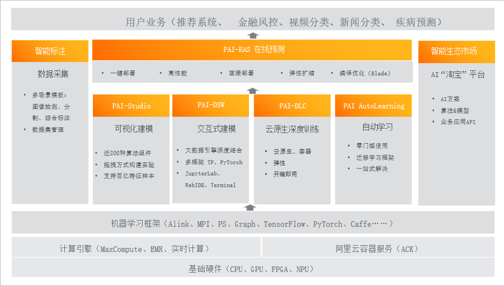
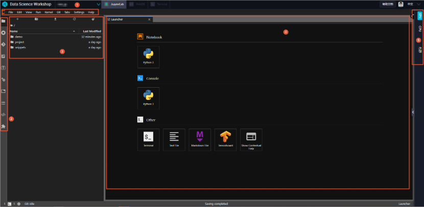
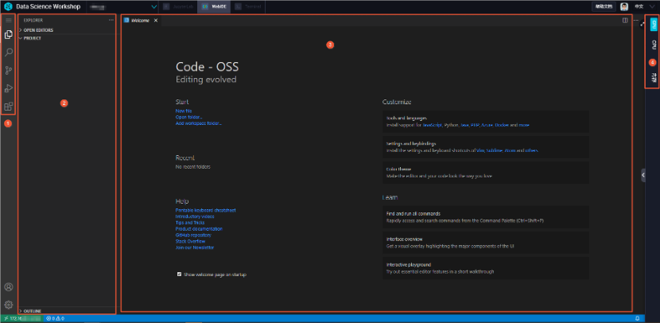
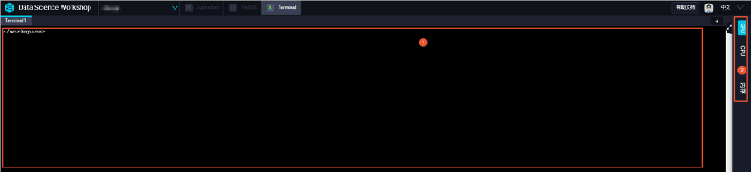
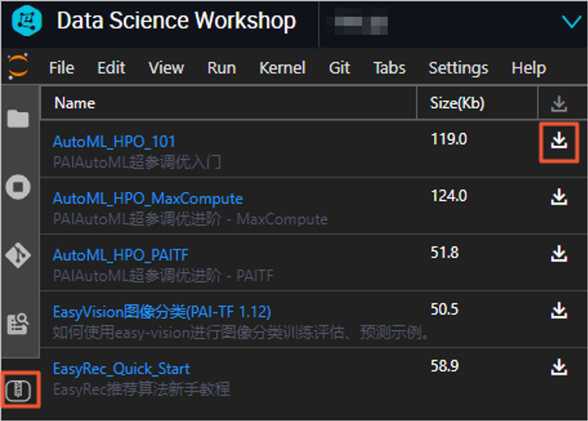

> **学习物联网，来HaaSEDU就对了**

# 阿里云机器学习PAI平台
&emsp;&emsp;
PAI起初是服务于阿里巴巴集团内部（例如淘宝、支付宝和高德）的机器学习平台，致力于让公司内部开发者更高效、简洁、标准地使用人工智能AI（Artificial Intelligence）技术。随着PAI的不断发展，2018年PAI平台正式商业化，目前已经积累了数万的企业客户和个人开发者，是中国领先的云端机器学习平台之一。

&emsp;&emsp;
PAI底层支持多种计算框架：
- 流式计算框架Flink。
- 基于开源版本深度优化的深度学习框架TensorFlow。
- 千亿特征样本的大规模并行计算框架Parameter Server。
- Spark、PySpark、MapReduce等业内主流开源框架。

&emsp;&emsp;
PAI提供的服务：
- 可视化建模和分布式训练PAI-Studio。
- Notebook交互式AI研发PAI-DSW（Data Science Workshop）。
- 自动化建模PAI-AutoLearning。
- 在线预测PAI-EAS（Elastic Algorithm Service）。

**PAI的优势：**

&emsp;&emsp;
服务支持单独或组合使用。支持一站式机器学习，您只要准备好训练数据（存放到OSS或MaxCompute中），所有建模工作（包括数据上传、数据预处理、特征工程、模型训练、模型评估和模型发布至离线或在线环境）都可以通过PAI实现。
对接DataWorks，支持SQL、UDF、UDAF、MR等多种数据处理方式，灵活性高。
生成训练模型的实验流程支持DataWorks周期性调度，且调度任务区分生产环境和开发环境，进而实现数据安全隔离。

<br>

# 平台架构

&emsp;&emsp;
如上图所示，PAI的业务架构分为五层：
1.	基础设施层：包括CPU、GPU、FPGA及NPU。
2.	计算引擎和容器服务层：包括MaxCompute、EMR、实时计算等计算引擎及容器服务ACK。
3.	计算框架层：包括Alink、TensorFlow、PyTorch、Caffe、MapReduce、SQL及MPI等计算框架，用于执行分布式计算任务。
4.	按照机器学习全流程，PAI分别提供了数据准备、模型开发和训练及模型部署阶段的产品：

    a)	数据准备：PAI提供了智能标注，支持在多种场景下进行数据标注和数据集管理。

    b)	模型开发和训练：PAI提供了可视化建模PAI-Studio、交互式编程建模PAI-DSW、云原生深度学习训练平台PAI-DLC及端到端自动学习PAI-AutoLearning，满足不同的建模需求。

    c)	模型部署：PAI提供了云原生在线推理服务平台PAI-EAS和模型推理加速工具PAI-Blade，帮助您快速地将模型部署为服务。同时，PAI提供了智能生态市场，您可以获取业务解决方案和模型算法，实现相关业务和技术的高效对接。
5.	业务层：PAI应用于金融、医疗、教育、交通以及安全等各个领域。阿里巴巴集团内部的搜索系统、推荐系统及金融服务系统等，均依赖于PAI进行数据挖掘。

# PAI-DSW介绍
&emsp;&emsp;
PAI-DSW是一款云端机器学习开发IDE，为您提供交互式编程环境，适用于不同水平的开发者。本文介绍个人版、GPU特价版及探索者版的功能特点、实例规格及可用区。

&emsp;&emsp;
PAI-DSW集成了开源JupyterLab，并以插件化的形式进行深度定制化开发。您无需任何运维配置，即可进行Notebook编写、调试及运行Python代码。同时，PAI-DSW提供丰富的计算资源，且对接多种数据源。通过EASCMD的方式，可以将PAI-DSW获得的训练模型部署为RESTful接口，对外提供模型服务，从而实现一站式机器学习。

## 功能特性
- 支持资源实时监控。算法开发时，可以显示CPU或GPU的使用情况。
- 支持多源数据接入，包括MaxCompute、OSS及NAS。
- 支持编写和运行SQL语句。
- 支持多种资源型号，包括纯CPU及多种GPU算力卡。
- 支持灵活切换各类资源，有效降低使用成本。
- 预置常用大数据开发包和算法库，且支持自定义安装第三方库。
## 个人版
&emsp;&emsp;
个人版由原V2专业版改进，基于阿里云Docker和Kubernetes等云原生技术，为您提供灵活且开放的AI开发环境。该版本的功能特点：

*版本特点*

&emsp;&emsp;
对比原V2专业版，实例的创建时间降低了65%。同时，不额外收取EIP和SLB费用。

&emsp;&emsp;
支持实例随时停止和启动、镜像一键保存及开发环境恢复。

&emsp;&emsp;
提供集成式AI开发环境：

&emsp;&emsp;
预装常用大数据开发包和算法包，且开放Sudo权限，从而允许安装第三方库。

&emsp;&emsp;
预装JupyterLab插件，可以提高开发效率。例如Git及TensorBoard。

&emsp;&emsp;
提供多种官方镜像，可以覆盖多版本主流计算框架。例如TensorFlow及PyTorch。

&emsp;&emsp;
嵌入WebIDE，可以安装任意插件。

&emsp;&emsp;
预置PAI的基础能力，包括视觉类算法工具EasyVision、自动调参工具AutoML、编译优化及读取MaxCompute表的CommonIO组件。
支持Root权限。

## 探索者版
&emsp;&emsp;
索者版由原V2专业版改进，基于阿里云Docker和Kubernetes等云原生技术，为您提供灵活且开放的AI开发环境。[探索者版](https://dsw-dev.data.aliyun.com/#/)处于免费状态，登录探索者版即可使用，详细的使用文档请参见天池实验室[DSW新手使用手册](https://tianchi.aliyun.com/forum/#type=new&pageNum=1)。

## 通过控制台创建实例
1.	登录PAI控制台。
2.	在左侧导航栏，选择模型开发和训练 > 交互式建模（DSW）。
3.	在页面左上方，选择目标地域。
4.	在Notebook建模服务页面，单击创建实例。
5.	在配置实例向导页面，配置参数。

## 界面介绍
### Jupyterlab


<table align="center"><tbody>
    <tr>
        <th>功能区编号</th>
        <th>描述</th>
    </tr>
    <tr>
        <th>①</th>
        <th>顶部菜单栏</th>
    </tr>
    <tr>
        <th>②</th>
        <th>左侧工具栏</th>
    </tr>
    <tr>
        <th>③</th>
        <th>工具内容</th>
    </tr>
    <tr>
        <th>④</th>
        <th>主工作区</th>
    </tr>
    <tr>
        <th>⑤</th>
        <th>资源水位</th>
    </tr>
</table>

### WebIDE

<table align="center"><tbody>
    <tr>
        <th>功能区编号</th>
        <th>描述</th>
    </tr>
    <tr>
        <th>①</th>
        <th>左侧工具栏</th>
    </tr>
    <tr>
        <th>②</th>
        <th>工具内容</th>
    </tr>
    <tr>
        <th>③</th>
        <th>资源水位</th>
    </tr>
    <tr>
        <th>④</th>
        <th>主工作区</th>
    </tr>
    <tr>
        <th>⑤</th>
        <th>资源水位</th>
    </tr>
</table>

### Terminal

<table align="center"><tbody>
    <tr>
        <th>功能区编号</th>
        <th>描述</th>
    </tr>
    <tr>
        <th>①</th>
        <th>主工作区</th>
    </tr>
    <tr>
        <th>②</th>
        <th>资源水位</th>
    </tr>
</table>

## 使用预置的Notebook案例
&emsp;&emsp;
如果您初次使用PAI-DSW，推荐通过预置案例，熟悉产品功能。
1.	进入PAI-DSW开发环境。

    i. 登录[PAI控制台](https://pai.data.aliyun.com/console)。

    ii. 在左侧导航栏，选择模型开发和训练 > 交互式建模（DSW）。

    iii. 在页面左上方，选择使用服务的地域。

    iv.	可选：在Notebook建模服务页面的搜索框，输入实例名称或关键字，搜索实例。

    v.	单击需要打开的实例操作列下的打开。
2.	下载预置案例。

    i.	在PAI-DSW开发环境左侧的工具栏，单击图标。

    ii.	单击待下载案例（例如AutoML_HPO_101）后的图标。

3.	打开案例文件（以AutoML_HPO_101为例）。

    i.	进入案例存储路径。

&emsp;&emsp;
下载完成的AutoML_HPO_101案例存储在/demo/AutoML_HPO_101/下，您可以通过以下任何一种方式进入案例存储路径：
* 下载案例后，在Download Success对话框中，单击Go to Directory。
 
* 通过PAI-DSW开发环境左侧的工具栏进入：
  
    a)	在PAI-DSW开发环境左侧的工具栏，单击 图标。

    b)	双击Name列下的demo。

    c)	双击Name列下的AutoML_HPO_101。

    d)	在存储路径下，双击Name列下的AutoML_HPO_101.ipynb，打开案例文件。
4.	在AutoML_HPO_101.ipynb文件中，可以查看案例的使用原理，您可以根据该信息执行任务。

## 上传数据
&emsp;&emsp;
在PAI-DSW Jupyterlab Notebook编程环境中，单击左侧工具栏中的图标。

&emsp;&emsp;
单击快捷工具栏中的 图标，即可上传文件，且支持断点续传。
 
## 管理第三方库
&emsp;&emsp;
如果使用Python开发环境，您可以在Terminal中，对第三方库进行以下操作：
- 安装
```shell
> pip install --user <yourLibraryName>
```
&emsp;&emsp;
需要将\<yourLibraryName>替换为待安装的第三方库名称。例如，使用pip install --user sklearn命令，安装sklearn库。
- 查看
```shell
pip list
```
&emsp;&emsp;
查看所有已安装的第三方库。
- 卸载
```shell
pip uninstall <yourLibraryName>
```
&emsp;&emsp;
需要将\<yourLibraryName>替换为已安装的第三方库名称。

**说明**

> 只能卸载自己安装的第三方库。

&emsp;&emsp;
因为tensoflow-gpu不支持卸载，所以只能使用更新命令安装固定版本的tensoflow-gpu，且新版本必须与CUDA版本（预付费实例的CUDA版本为10，后付费实例的CUDA版本为9）兼容。

&emsp;&emsp;
```shell
pip install --upgrade --user 
tensorflow-gpu=<versionNumber>
```

&emsp;&emsp;
需要将\<versionNumber>替换为待安装的 tensoflow-gpu版本号。

&emsp;&emsp;
**注意** 不要升级系统pip，否则可能导致无法安装。

&emsp;&emsp;
PAI-DSW提供的开发环境包括Python2、Python3、PyTorch及TensorFlow2.0。安装第三方库时，默认安装至Python3，如果需要安装至其他环境，则必须手动切换环境后，再进行安装。

```shell
#安装至Python2环境。
source activate python2
pip install --user <yourLibraryName>

#安装至TensorFlow2.0环境。
source activate tf2
pip install --user <yourLibraryName>
需要将 <yourLibraryName>替换为待安装的第三方库名称。
```
